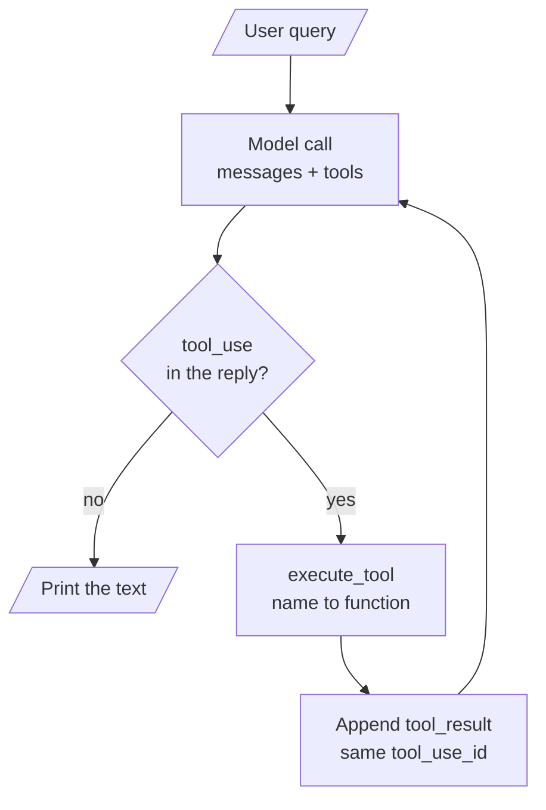

# M38.1 Theory: From a tool-calling chatbot to MCP

*[M38 theory](../README.md) · Lesson 38.1 · Notebooks: [`01a_chatbot_example.ipynb`](../../../../course/p11_agent_protocols/m38_mcp_foundations/notebooks/01a_chatbot_example.ipynb), [`01b_chatbot_example_openai_walkthrough.ipynb`](../../../../course/p11_agent_protocols/m38_mcp_foundations/optional/01b_chatbot_example_openai_walkthrough.ipynb) (optional) · [All theory pages](../../../README.md)*

## What moves out of the chatbot

Notebook 01a builds the chatbot the rest of the module takes apart. It has two tools, `search_papers` (query arXiv and save the results to `papers_info.json` under a topic folder) and `extract_info` (look a paper up by id in those files), and every tool needs three things written by hand in the chatbot:

1. **The function** that does the work.
2. **A schema** in the `tools` list: a name, a description and an `input_schema` that the model reads to decide when and how to call it.
3. **An entry in `mapping_tool_function`**, so `execute_tool` can turn the name the model picked back into a Python call and the result into a string.

Around them sits the loop in `process_query`: send the question and the `tools` list to the model (`claude-3-7-sonnet-20250219`, `max_tokens=2024`), and while the reply contains a `tool_use` block, run the tool, append a `tool_result` with the same `tool_use_id`, and call the model again.

MCP keeps the loop and moves the rest. In notebook 03a the chatbot has no `tools` list and no mapping; both come from the server.

| Piece | 01a: inside the chatbot | 03a: with MCP |
|---|---|---|
| Tool functions | Defined in the notebook | In `research_server.py`, behind `@mcp.tool()` |
| Tool schemas | Written by hand in `tools` | Fetched with `session.list_tools()` |
| Name to function | `mapping_tool_function` and `execute_tool` | `session.call_tool(name, arguments=...)` |
| The loop and the model | `process_query`, `chat_loop` | Unchanged, now methods of `MCP_ChatBot` |

The split pays off as soon as a second chatbot, an IDE or an agent framework wants the same tools: each of them speaks MCP to the same server instead of copying three pieces per tool. For Larkspur Cloud, the M11 retriever becomes one server, `larkspur-handbook`, and every assistant the support team builds connects to it.

The optional notebook 01b runs the same chatbot on OpenAI. Only the wrapper changes: each schema sits inside `{"type": "function", "function": {...}}` with `parameters` in place of `input_schema`, and the arguments arrive as a JSON string the code parses with `json.loads`. The tools and the loop are the same, which is why the server in lesson 38.2 can serve either provider.

## Check yourself

1. The model replies with a tool_use block. What must the 01a chatbot do before it calls the model again, and when does the loop stop?

It runs the tool through `execute_tool`, appends a `tool_result` with the same `tool_use_id`, and calls the model again with the messages and the `tools` list. The loop stops when a reply contains no `tool_use` block, and the chatbot prints the text. MCP keeps this loop unchanged.

2. You add a third tool to the 01a chatbot. Which three pieces do you write by hand, and where does each come from in the 03a version?

The function, its schema in the `tools` list, and an entry in `mapping_tool_function`. In 03a the function sits in `research_server.py` behind `@mcp.tool()`, the schema comes from `session.list_tools()`, and the call goes through `session.call_tool(name, arguments=...)`. A second chatbot or an IDE then reuses the same server instead of copying all three.

3. Your Anthropic chatbot works, but the OpenAI port fails when it reads the tool arguments. What differs between the two providers?

Only the wrapper. In 01b each schema sits inside `{"type": "function", "function": {...}}` with `parameters` in place of `input_schema`, and the arguments arrive as a JSON string the code must parse with `json.loads`. The tools and the loop are the same, which is why one MCP server can serve either provider.

---
*Previous: [M38 overview](../README.md). Next: [38.2 Building an MCP server](../02_building_an_mcp_server/README.md).*
