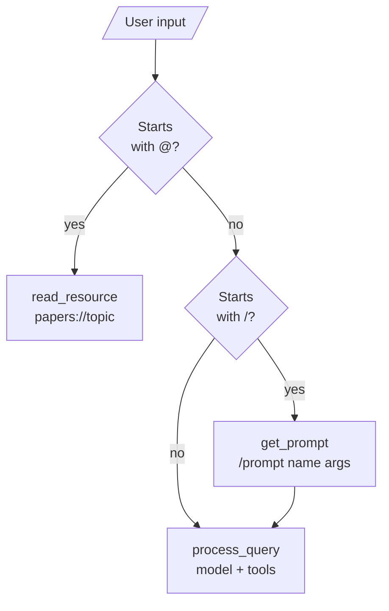

# M38.5 Theory: Prompts and resources

*[M38 theory](../README.md) · Lesson 38.5 · Notebooks: [`05a_adding_prompt_and_resource_features.ipynb`](../../../../course/p11_agent_protocols/m38_mcp_foundations/notebooks/05a_adding_prompt_and_resource_features.ipynb) · [All theory pages](../../../README.md)*

## Tools, resources, prompts

A server can offer three kinds of thing. They differ in who decides to use them, and that decides which one a feature should be.

| | Tool | Resource | Prompt |
|---|---|---|---|
| FastMCP decorator | `@mcp.tool()` | `@mcp.resource("papers://folders")` | `@mcp.prompt()` |
| Listed with | `tools/list` | `resources/list`, `resources/templates/list` | `prompts/list` |
| Used with | `tools/call` | `resources/read` | `prompts/get` |
| In the lesson 7 chatbot, chosen by | the model | the user, typing `@topic` | the user, typing `/prompt name arg=value` |
| Returns | content for the model | data the app shows or adds to context | messages to send to the model |

**Resources** are read-only data, like GET endpoints in a REST API: they return data and should not change anything. Each has a URI the server chooses. A static URI names one thing (`papers://folders`, the list of topic folders); a template names a family (`papers://{topic}`, the papers saved under one topic), and the client fills in the parameter at read time.

**Prompts** are templates the server owns. `generate_search_prompt(topic, num_papers=5)` returns a long instruction to search for papers on the topic and summarise them; FastMCP takes the prompt's name from the function and its arguments from the signature, and `prompts/get` returns the filled-in text as messages.

The Larkspur server offers one of each kind of resource and a prompt. Recorded with SDK 1.30.0:

- `resources/list` returned only the static resource, `handbook://sections`.
- `resources/templates/list` returned the template, `handbook://section/{chunk_id}`.
- `resources/read` on `handbook://section/refund-timing` returned that chunk as `text/plain`.
- `prompts/get` for `answer_with_citations` with `question = "How long does a refund take?"` returned one message with `role: "user"` whose text asks the model to call `search_handbook` and cite chunk ids.

The lesson 7 chatbot routes user input before the model sees it:

`/prompts` only prints the list. A prompt fetched with `/prompt` goes to `process_query` like a typed question. A resource is printed for the user and never reaches the model in this chatbot; another host could add it to the context instead. Two details in the chatbot's code are worth knowing before you copy it:

- **It lists only static resources.** `connect_to_server` calls `list_resources()`, which does not return templates, so `papers://{topic}` never enters the routing table. `get_resource` works around it: for an unknown `papers://` URI it uses any session that has a `papers://` resource. With two servers using that scheme it picks the first.
- **One dict routes all three kinds.** `self.sessions` maps tool names, prompt names and resource URIs to sessions, so a prompt named like another server's tool overwrites the route, the same collision the lab in [lesson 38.4](../04_connecting_to_reference_servers/README.md) shows for tools.

For Larkspur the split is: `search_handbook` is a tool, because the model needs it mid-answer with a query it writes; the sections are resources, for a support console that lets an engineer attach a section; and `answer_with_citations` is a prompt the engineer starts on purpose.

---
*Previous: [38.4 Connecting to reference servers](../04_connecting_to_reference_servers/README.md). Next: [38.6 Remote servers and deployment](../06_remote_servers_and_deployment/README.md).*
