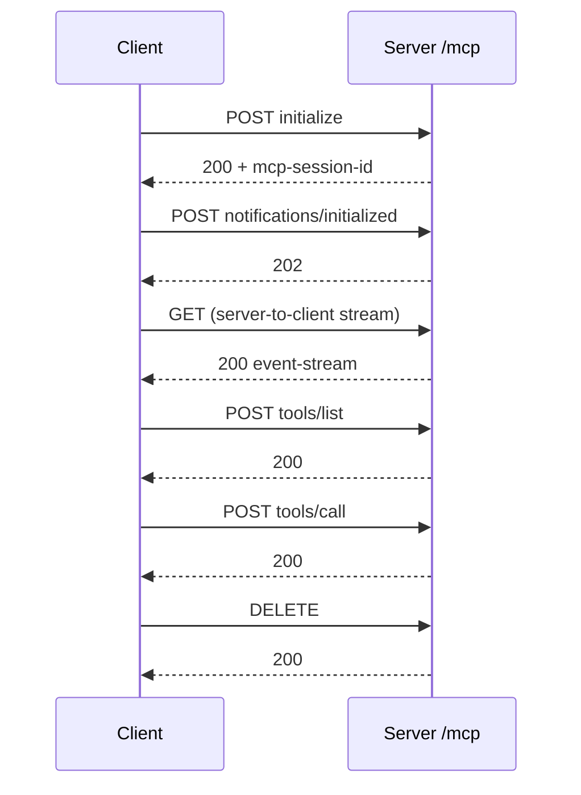

# M38.6 Theory: Remote servers and deployment

*[M38 theory](../README.md) · Lesson 38.6 · Notebooks: [`06a_creating_and_deploying_remote_servers.ipynb`](../../../../course/p11_agent_protocols/m38_mcp_foundations/notebooks/06a_creating_and_deploying_remote_servers.ipynb) · [All theory pages](../../../README.md)*

## Remote transport

A stdio server is a subprocess: the client starts it, owns it, and talks over its standard input and output. A remote server is a process of its own, often on another machine, that must already be running when the client connects by URL. The tools, resources and prompts do not change; with FastMCP only the last line does:

```python
mcp = FastMCP("research", port=8001)   # notebook 06a
...
mcp.run(transport="sse")               # or "streamable-http", or "stdio"
```

Notebook 06a deploys over SSE because, when the course was filmed, Streamable HTTP was still being built into the Python SDK; it adds notes for Streamable HTTP. SDK 1.30.0 ships both. Recorded against the Larkspur server running each way (initialize, list tools, one `tools/call`, close):

| | SSE | Streamable HTTP | Streamable HTTP, `stateless_http=True` |
|---|---|---|---|
| Endpoints | `GET /sse`, then `POST /messages/?session_id=…` | `/mcp` for everything | `/mcp` |
| Reply to a request | `202 Accepted`; the answer arrives on the `/sse` stream | `200` with the answer in the response (`text/event-stream`) | `200` with the answer |
| Session | id in the query string | `mcp-session-id` header, set on the `initialize` reply | none |
| Close | close the stream | `DELETE /mcp` | nothing to close |


<!-- animated: diagrams/streamable-http.anim.html -->

After `initialize`, every request in the stateful run carried two headers: `mcp-session-id` (32 characters) and `mcp-protocol-version: 2025-11-25`. The session id is what lets a stateful server remember a client between requests; it is also why a stateful server behind several replicas needs sticky routing, while a stateless one can answer from any replica and cannot keep anything between calls.

Paths and names to get right in SDK 1.30.0:

- **Defaults.** `FastMCP` listens on `127.0.0.1:8000`, with SSE at `/sse` and `/messages/` and Streamable HTTP at `/mcp`. The notebook's `port=8001` still works as a constructor argument.
- **The URL.** The notebook says to append `/mcp/`. The server answers `POST /mcp/` with `307` and a `Location` of `/mcp`; the 1.30.0 client follows a same-origin `307` for a POST, so either works, and `/mcp` saves the round trip.
- **The client function.** The notebook imports `streamablehttp_client`. In 1.30.0 it is marked deprecated with “Use `streamable_http_client` instead.”; the new one takes the URL and an optional `httpx.AsyncClient` for headers and auth. `sse_client(url)` still takes the URL as the notebook passes it.

## Deploying a remote server

The lesson 9 project ships a `Dockerfile`: `python:3.11-slim`, `uv pip install --system .`, `EXPOSE 8001`, then `uv run research_server.py`. Two things change once the server leaves your laptop.

**The bind address depends on the SDK version.** The project's own `uv.lock` pins mcp 1.8.0, whose FastMCP default host is `0.0.0.0`, reachable through the container's mapped port. The course environment's 1.30.0 defaults to `127.0.0.1`, which only the container itself can reach. Set `host="0.0.0.0"` in the constructor and the server behaves the same under both.

**The server's files live where it runs.** The research server keeps papers in a `papers/` folder beside it. In notebook 06a's hosted server that folder is empty, so the resources list no topics. On a fresh copy, recorded with 1.30.0, `papers://folders` returns “No topics found.” and `extract_info` fails with `[Errno 2] No such file or directory: 'papers'`, because it lists the folder without checking that it exists. A remote server needs storage that outlives the container, and tools that handle an empty start.

Before anyone outside can reach the server, it needs what a stdio server never did: authentication, because anyone who can reach the URL can call the tools; TLS; and logs of which client called what. The 1.30.0 `FastMCP` constructor takes `auth` settings and a `token_verifier` for the first. Notebook 06a's optional section deploys to Render, and its resources link Cloudflare's guide to remote MCP servers.

---
*Previous: [38.5 Prompts and resources](../05_prompts_and_resources/README.md). Next: [M38 interview questions](../README.md#interview-spotlight-5-questions-you-might-get-asked).*
