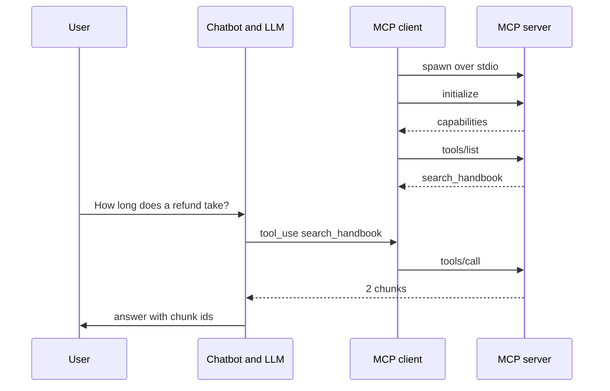

# M38 Theory: MCP Foundations

*Part XI · Agent Protocols: MCP & A2A · [Module README](../../../course/p11_agent_protocols/m38_mcp_foundations/README.md) · [All theory pages](../../README.md)*

M38 takes the tool-calling chatbot apart. The tool code and its schemas move into an MCP server, the chatbot keeps its loop and talks to the server through an MCP client, and from then on any client can reuse the server and the chatbot can plug in servers it did not write. The M38 notebooks build on four ideas: a server and a client that share one session, the three things a server can offer (tools, resources and prompts), the reference servers you add from a config file, and the transports that move a server off your machine. Each idea has a page in the folder of the lesson that teaches it, listed under [Lessons](#lessons). This page has the overview, the interview questions and the takeaways.

The notebooks wrap an arXiv research server. These pages also put the Larkspur Cloud handbook from M11 to M13 behind MCP, which is the module's lab brief: a FastMCP server called `larkspur-handbook` with the M11 retriever as its one tool, `search_handbook`, the handbook chunks as resources, and an `answer_with_citations` prompt. The golden question is the M11 one, *How long does a refund take?* Every message, schema and status code quoted here was recorded from real runs with MCP Python SDK 1.30.0, the version in the course's `protocols` dependency group.

## TL;DR

- An MCP server owns the tools; the chatbot keeps the loop. The client launches a stdio server as a subprocess, opens one session per server, sends `initialize` (protocol version `2025-11-25` in SDK 1.30.0), then `tools/list` and `tools/call` as the model asks.
- FastMCP builds each tool definition from the Python function: the function name, the whole docstring as the description, and a JSON schema from the type hints. The `Args:` lines stay inside the description; no parameter gets a schema description of its own.
- Tools are for the model to call. Resources and prompts are for the application and the user: the lesson 7 chatbot reads a resource when the user types `@topic` and fetches a prompt on `/prompt`.
- Every connected server's tools go to the model on every call. The notebook's three servers send 17 definitions, about 2,527 tokens, and the filesystem server is 80% of that. Two filesystem servers send 14 names twice, and the chatbot routes all 14 to the second one.
- Remote servers run on their own and the client connects by URL. Streamable HTTP uses one endpoint, `/mcp`, and an `mcp-session-id` header; the older SSE transport uses a stream at `/sse` plus POSTs to `/messages/`.

## Mental model

<!-- animated: diagrams/session.anim.html -->

The client and the server agree on a protocol version and capabilities once, then the client lists what the server offers. The model sees only the tool definitions; it never talks to the server. When it asks for a tool, the chatbot hands the call to the session that owns that tool, and the result goes back to the model as a tool result. Swap the server for another and the chatbot code does not change.

## Lessons

| Lesson | Topic | Theory |
|---|---|---|
| 38.1 | From a tool-calling chatbot to MCP | [What moves out of the chatbot](01_from_a_tool_calling_chatbot_to_mcp/README.md#what-moves-out-of-the-chatbot) |
| 38.2 | Building an MCP server | [From a function to a tool definition](02_building_an_mcp_server/README.md#from-a-function-to-a-tool-definition) |
| 38.3 | Building an MCP client | [MCP server / client](03_building_an_mcp_client/README.md#mcp-server--client) |
| 38.4 | Connecting to reference servers | [Reference servers](04_connecting_to_reference_servers/README.md#reference-servers) |
| 38.5 | Prompts and resources | [Tools, resources, prompts](05_prompts_and_resources/README.md#tools-resources-prompts) |
| 38.6 | Remote servers and deployment | [Remote transport](06_remote_servers_and_deployment/README.md#remote-transport) [Deploying a remote server](06_remote_servers_and_deployment/README.md#deploying-a-remote-server) |
| 38.7 | Labs: Wikipedia assistant with tools, resources and prompts | *planned* |

## Interactive lab

[**Server config lab**](04_connecting_to_reference_servers/interactive/server-config-lab.html): open the file in a browser. Start with *Notebook config* and read the ledger: 17 tool definitions and 10,107 characters go out with every request, and `filesystem` sends 14 of them. Switch on `larkspur` to add the handbook retriever for 417 characters. Then pick *Two filesystem servers*: the first filesystem server still sends 14 definitions but gets 0 calls, and the file the model asks for comes back as missing.

## How it connects

- **Before:** [M23](../../p08_agent_foundations/m23_agent_loop_and_tools/README.md) builds the tool-calling loop that M38 splits in two, and [M24](../../p08_agent_foundations/m24_react_agents/README.md) packages it as `create_agent`. The `larkspur-handbook` server wraps the retriever from [M11](../../p04_rag_foundations/m11_rag_lifecycle/README.md), the one Part VII improves. [M37](../../p10_memory_and_multi_agent/m37_multi_agent_builds_deep_agents/README.md) ends Part X by pointing at protocols: the coordinator and specialist split stays, and the tools move behind servers.
- **Next:** [M39](../m39_building_mcp_servers_and_clients/README.md) builds MCP servers and clients with more of the protocol. M40 builds MCP applications and RAG over MCP, and M41 moves from tools to agents with the A2A protocol.

## Interview Spotlight: 5 Questions You Might Get Asked

*Production questions in the style of OpenAI, Anthropic and Google interviews for applied AI roles.*

### 1. Larkspur's support bot connects to a filesystem server rooted at the project folder. Someone adds a second filesystem server rooted at `./handbook`. Now the bot says files it read yesterday “do not exist”. How do you find the cause?

**What a strong answer covers:**
- Reads the startup log: both servers list the same 14 tool names, so the model gets 32 definitions for 18 names
- Finds the router, `tool_to_session[tool.name] = session`, which keeps the last server for each name; every filesystem call now goes to `./handbook`, which resolves `research_server.py` inside its own root and answers `ENOENT`
- Fixes it by namespacing tool names per server (for example `handbook__read_text_file`) or by refusing to start on a duplicate name, rather than relying on config order
- Adds a startup check that fails when two servers expose the same name, and logs which server each call went to

### 2. You are exposing the handbook to agents over MCP. A teammate wants every chunk as a tool, another wants them as resources, a third wants a prompt. How do you decide?

**What a strong answer covers:**
- Asks who decides when the data is used: the model picks tools, the application or user picks resources, the user picks prompts
- Makes search a tool (`search_handbook`), since the model needs to call it in the middle of an answer with a query it writes
- Makes sections resources (`handbook://section/{chunk_id}`), read without side effects, for a UI that lets an engineer attach a section to the chat
- Makes “answer with citations” a prompt, a reusable instruction the user starts with `/prompt`, and keeps tool count low because every tool definition is sent on every call

### 3. After connecting four MCP servers, Larkspur's bot got slower and its bill went up, though most questions never call a tool. How do you measure where the cost went?

**What a strong answer covers:**
- Measures the tool definitions sent per request: in the lab, the notebook's three servers send about 2,527 tokens of tool JSON before the question starts, and the filesystem server is 80% of it
- Logs per request the number of tool definitions, their size, and which tools were called, to find servers whose tools are never used
- Drops or filters servers per route (a billing question does not need `write_file`), and checks the tool-choice rate on a fixed question set after each change
- Watches for the hidden cost of duplicates: two filesystem servers raise the total to about 4,649 tokens and add nothing the model can use

### 4. You ship `larkspur-handbook` in a Docker container with `transport="streamable-http"` and port 8001 mapped. The container is healthy, but no client can connect. What do you check?

**What a strong answer covers:**
- Checks the bind address: in SDK 1.30.0 FastMCP listens on `127.0.0.1` by default, which no one outside the container can reach; pass `host="0.0.0.0"` (the project's own lock, mcp 1.8.0, defaulted to `0.0.0.0`, so the same code behaves differently)
- Checks the URL: Streamable HTTP lives at `/mcp`; `/sse` is the other transport, and `/mcp/` answers with a 307 redirect to `/mcp`
- Checks the session: a stateful server returns an `mcp-session-id` header that every later request must carry, so behind several replicas it needs sticky routing or `stateless_http=True`
- Tests from outside with the MCP Inspector before blaming the client, and keeps an authenticated endpoint in mind before exposing it publicly

### 5. A security review flags the bot's `server_config.json`: `@modelcontextprotocol/server-filesystem` with the argument `.`, run from the project folder. What is the risk, and what do you change?

**What a strong answer covers:**
- The `.` makes the whole project folder readable and writable through `read_text_file` and `write_file`, and that folder holds the `.env` with the API keys the chatbot loads
- Any text the model reads, including a fetched web page, can ask it to read that file; the fetch server's own description already tells the model it now has internet access, so tool descriptions shape behaviour too
- Narrows the root to a data folder, drops write tools the bot does not need, and keeps secrets out of any served folder
- Reviews every third-party server's tool descriptions before connecting it, and pins server versions in the config so an update cannot change them unseen

## Key Takeaways

- Put tools behind a server once and every client can use them; keep the loop, the model choice and the routing in the client.
- Read the definitions FastMCP generates before shipping: the docstring is the description the model sees, and parameter help belongs in the type hints if the model needs it.
- Count what each server costs on every request, and give every tool a name that is unique across all connected servers.
- Choose the transport by where the server runs: stdio for a local subprocess, Streamable HTTP at `/mcp` for a shared service, with the bind address, session header and auth checked before deploy.

---
*Previous: [M37 Multi-Agent Applied Builds & Deep Agents](../../p10_memory_and_multi_agent/m37_multi_agent_builds_deep_agents/README.md). Next: [M39 Building MCP Servers & Clients](../m39_building_mcp_servers_and_clients/README.md).*
