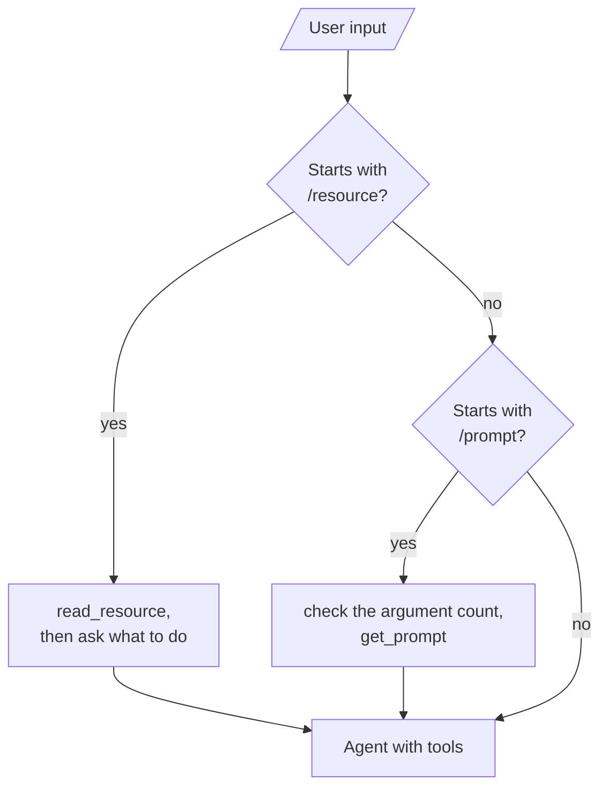

# M39.1 Theory: Single-server MCP, with resources

*[M39 theory](../README.md) · Lesson 39.1 · Notebooks: [`01_single_server_mcp`](../../../../course/p11_agent_protocols/m39_building_mcp_servers_and_clients/projects/01_single_server_mcp), [`02_single_server_mcp_with_resources`](../../../../course/p11_agent_protocols/m39_building_mcp_servers_and_clients/projects/02_single_server_mcp_with_resources) · [All theory pages](../../../README.md)*

## What comes back from a server

Both projects build one FastMCP weather server and a LangGraph client that talks to it over stdio. Project 01 gives the server a tool, `get_weather`, and a prompt, `compare_weather_prompt`. Project 02 swaps the prompt for a resource, `file://delivery_log`, which reads nine order lines from `delivery_log.txt`. [Lesson 38.5](../../m38_mcp_foundations/05_prompts_and_resources/README.md) explains who chooses each kind; this page is about what each one returns, because the client has to handle every shape.

Recorded with SDK 1.30.0 against copies of the two servers, with no API key set:

| Request | What the client gets |
|---|---|
| `tools/call get_weather {"location": "Dublin"}` | One text block holding `{"error": "OpenWeatherMap API key is not configured on the server."}`, with `isError: false` |
| `prompts/get compare_weather_prompt` | One message, `role: "user"`, the filled-in instructions; both arguments are required |
| `resources/list` | One resource, listed as `file://delivery_log/` with a trailing slash, MIME type `text/plain` |
| `resources/read file://delivery_log` | One text block holding a JSON array of the nine lines |

Three things in that table catch people out.

- **An error returned as data is a success.** `get_weather` catches every failure and returns a dict with an `error` key, so the result carries `isError: false` and the model reads the message as weather data. A tool that raises is reported differently: a Larkspur `search_handbook` that raises `ValueError("index not loaded")` comes back with `isError: true` and the text `Error executing tool search_handbook: index not loaded`, and `langchain-mcp-adapters` turns that into a `ToolMessage` with `status="error"`. Raise when the call failed; return data when it worked.
- **A list becomes one JSON string.** The resource function returns `list[str]`, and FastMCP serialises it as one text block, not one block per line. The client joins the text blocks it receives and pastes the result into a message, so the model sees a JSON array.
- **The return type decides the schema.** `get_weather` is typed `-> dict`, and FastMCP lists it with no `outputSchema`, so the result has no `structuredContent` either. A typed return, such as a Pydantic model, gives the client a schema to check results against.

The project 03 copy of the server ships with `OPENWEATHERMAP_API_KEY = "{{OPENWEATHERMAP_API_KEY}}"`. The guard only rejects an empty key or the literal `YOUR_OPENWEATHERMAP_API_KEY`, so the placeholder passes, the API answers 401, and the tool returns `{"error": "Authentication failed…"}`, again as a success.

The client decides what reaches the model, and the two projects do it differently:

A prompt's text goes to the agent as if the user had typed it. A resource goes in wrapped as `CONTEXT … TASK: <what you asked>`, or with a request to acknowledge it and keep it in memory when you give no task; the `MemorySaver` checkpointer keeps it for the rest of the thread. Both servers read files and are started by relative path (`python weather_server.py`, `Path("delivery_log.txt")`), so the client only works when it is run from the project folder.

For Larkspur, the same rules give one decision per feature. `search_handbook` raises when the index is missing and returns chunk ids and text otherwise; the refund policy can be a resource a support engineer attaches by hand; and a prompt like M38's `answer_with_citations` is something the engineer starts on purpose.

## Key Takeaways

- Raise when a tool call failed and return data when it worked. A caught error returned as a dict carries `isError: false`, so the model reads it as a real result.
- FastMCP serialises a returned list as one text block, so the client pastes a single JSON array into the model's message.
- Type the return value to get an `outputSchema`. A tool typed `-> dict` gives the client no schema and no `structuredContent` to check.

## Check yourself

1. With no API key set, get_weather returns an error message with isError false. Why, and why is that a problem for the model?

`get_weather` catches every failure and returns a dict with an `error` key, so the call counts as a success and the model reads the message as weather data. A tool that raises comes back with `isError: true`, and `langchain-mcp-adapters` turns it into a `ToolMessage` with `status="error"`. Raise when the call failed; return data when it worked.

2. The delivery log resource function returns a list of nine strings. What does the model see after the client reads it?

One JSON array. FastMCP serialises the `list[str]` as one text block, not one block per line, and the client joins the text blocks and pastes the result into a message, wrapped as `CONTEXT … TASK: <what you asked>`. The `MemorySaver` checkpointer keeps it for the rest of the thread.

3. You want the client to check get_weather results against a schema. Why does the server give it nothing to check, and what change fixes that?

`get_weather` is typed `-> dict`, so FastMCP lists it with no `outputSchema` and its results carry no `structuredContent`. The return type decides the schema: a typed return, such as a Pydantic model, gives the client a schema to check results against.

---
*Previous: [M39 overview](../README.md). Next: [39.2 Multi-server MCP](../02_multi_server_mcp/README.md).*
