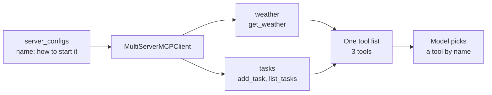

# M39.2 Theory: Multi-server MCP

*[M39 theory](../README.md) · Lesson 39.2 · Notebooks: [`03_multi_server_mcp`](../../../../course/p11_agent_protocols/m39_building_mcp_servers_and_clients/projects/03_multi_server_mcp) · [All theory pages](../../../README.md)*

## Multi-server

Project 03 puts the weather server next to a second one, a task server whose `add_task` and `list_tasks` tools keep a to-do list in `tasks.txt`. The client names both in one dict and hands it to `MultiServerMCPClient` from `langchain-mcp-adapters`:

```python
server_configs = {
    "weather": {"command": "python", "args": ["weather_server.py"], "transport": "stdio"},
    "tasks":   {"command": "python", "args": ["task_server.py"],    "transport": "stdio"},
}
client = MultiServerMCPClient(server_configs)
all_tools = await client.get_tools()   # one flat list: get_weather, add_task, list_tasks
```

The keys, `weather` and `tasks`, are the client's names for the servers. The model never sees them. It gets one list of tools, bound to the LLM with `bind_tools`, and a LangGraph `ToolNode` runs whichever one it picks. When the model calls `add_task`, the adapter sends the call to the server that listed it.



Three rules follow from the flat list.

- **Names must be unique across servers.** `ToolNode` indexes tools in a dict by name (langgraph 1.2.18), so if two servers both offer `search`, the one loaded last answers every call and nothing warns you. `MultiServerMCPClient(..., tool_name_prefix=True)` renames each tool `<server>_<tool>`, which gives `weather_get_weather` and `tasks_add_task` here. [Lesson 38.4](../../m38_mcp_foundations/04_connecting_to_reference_servers/README.md) shows the same collision in a hand-written client.
- **Descriptions do the routing.** The model chooses by name and description alone; server boundaries are invisible to it. For Larkspur, `search_handbook` says it searches the handbook's policies and `search_status` says it searches live status pages, so *Is there an outage right now?* lands on the status server. If both said "search Larkspur information", the model would have to guess.
- **Every tool costs tokens on every call.** All definitions from all servers go to the model each turn, as [M38](../../m38_mcp_foundations/README.md) measures. Connect the servers an agent needs, not every server you have.

Project 02 under lesson 39.4 builds the same thing by hand: a `config.json` with an `mcpServers` block, one `stdio_client` and `ClientSession` per entry on an `AsyncExitStack`, and `load_mcp_tools(session)` for each. Its two servers run in Docker. The `config.json` entries start each one with `docker run -i --rm …`, where `-i` keeps standard input open so stdio works through the container, and the client starts a fresh container for every session. `docker-compose up` only needs to build the two images: the containers it also starts sit with their input open and are not the ones the client talks to. Replace the placeholder `/ABSOLUTE/PATH/TO/…` volume path in `config.json` with your own first; as shipped, it mounts a folder that does not exist.

The second server there is MCP's reference fetch server: one `fetch` tool that returns a page as Markdown, 5,000 characters at a time by default, with a `start_index` for the next slice, and a `robots.txt` check before it fetches on the model's behalf. It is the web-search half of the module's lab brief.

## When one server fails

`get_tools()` loads every server at once with `asyncio.gather`, so the first server that fails raises and no tools load at all. Recorded with a working `handbook` server and a `status` entry whose command does not exist:

- `await client.get_tools()` raised `FileNotFoundError` for the status command, and returned nothing for the healthy handbook server.
- `await client.get_tools(server_name="handbook")` returned `search_handbook`.

The hand-built client in project 02 wraps each server in its own `try`, prints `Connection failed for <name>`, and starts with the tools it got. Neither is right by default. A Larkspur assistant can answer refund questions with the status server down, so it should start degraded and say which tools are missing; an agent whose every task needs both servers should refuse to start. Load per server, record which ones failed, and put that list in the system prompt and the logs.

Failures during a call are a separate case. A tool that raises comes back as `isError: true`, and the adapter returns it to the model as a `ToolMessage` with `status="error"` so the agent can try something else. A dead process or a dropped connection is not a tool error: the adapter raises, and the agent run stops unless your code catches it.

---
*Previous: [39.1 Single-server MCP, with resources](../01_single_server_mcp_with_resources/README.md). Next: [39.4 Your own client and a multi-server client](../04_your_own_client_and_a_multi_server_client/README.md).*
