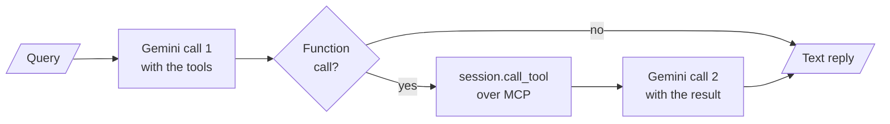

# M39.4 Theory: Your own client and a multi-server client

*[M39 theory](../README.md) · Lesson 39.4 · Notebooks: [`01_build_your_own_server_client`](../../../../course/p11_agent_protocols/m39_building_mcp_servers_and_clients/projects/01_build_your_own_server_client), [`02_multi_server_client`](../../../../course/p11_agent_protocols/m39_building_mcp_servers_and_clients/projects/02_multi_server_client) · [All theory pages](../../../README.md)*

## Client sessions

Every client in these projects is built from the same three layers, each an async context manager:

```python
transport = await stack.enter_async_context(stdio_client(params))   # or sse_client(url), streamable_http_client(url)
read, write = transport[0], transport[1]
session = await stack.enter_async_context(ClientSession(read, write))
await session.initialize()                                           # the handshake
tools = (await session.list_tools()).tools
result = await session.call_tool("execute_shell_command", {"cmd": "ls"})
```

The transport moves bytes: pipes to a child process, or HTTP. `ClientSession` speaks JSON-RPC over it. `initialize()` sends the client's protocol version (`2025-11-25` in SDK 1.30.0) and capabilities, reads the server's, and sends the `notifications/initialized` notification. From then on the session carries requests until the `AsyncExitStack` closes, which closes the session and then the transport: a stdio server process exits, and a Streamable HTTP client sends `DELETE`.

A **session** is the unit of state in MCP. The protocol version, the capabilities and anything the server ties to the connection live for one session. Over stdio a session is also a process, because the client starts one server process per connection. That makes the question of how long a session lives the main design choice in a client.

Project 02 holds one session per server for the life of the agent, on one `AsyncExitStack`. `MultiServerMCPClient.get_tools()` in project 03 does not hold any. Its docstring says it plainly: "A new session will be created for each tool call". Each tool call opens a session, initializes it, calls the tool and closes it. With SDK 1.30.0 a fresh session also sends `tools/list` after the call, because `call_tool` checks the result against the tool's output schema and a new session has not listed its tools yet.

The [interactive lab](interactive/session-wire-lab.html) drives the two Larkspur servers through both clients over every transport and shows each recorded message. For 8 tool calls:

| Transport | Held sessions | A session per call |
|---|---|---|
| stdio | 2 processes, 14 messages | 10 processes, 38 messages |
| SSE | 14 messages, 16 HTTP requests | 38 messages, 48 HTTP requests |
| Streamable HTTP | 14 messages, 18 HTTP requests | 38 messages, 58 HTTP requests |
| Streamable HTTP, stateless | 14 messages, 14 HTTP requests | 38 messages, 38 HTTP requests |

Held sessions pay 6 messages once (an `initialize`, a notification and a `tools/list` per server) and then 1 per call. A session per call pays 4 per call. Over stdio the cost is also processes: 8 calls were answered by 8 different server processes, so a cache, a loaded index or a counter in server memory starts empty every time. Over HTTP the server process stays up, so its memory survives, but nothing tied to a session does.

<!-- lab: interactive/session-wire-lab.html -->

To keep the convenience of `MultiServerMCPClient` and hold the session, open it yourself:

```python
client = MultiServerMCPClient(connections)
async with client.session("handbook") as session:
    tools = await load_mcp_tools(session)        # calls reuse this session
    agent = create_agent(model, tools)
    ...
```

A session per call is the right choice in one case: a stateless server behind several replicas, where any request may land anywhere and holding a session buys nothing. Everywhere else, hold one session per server and reopen it when it drops.

## A client written by hand

Project 01's `client.py` connects Gemini to the terminal server without LangChain, which shows the work an adapter does for you. After the handshake it lists the server's tools and turns each into a Gemini `FunctionDeclaration`: the MCP name, the description and the `inputSchema` with every `title` key removed. FastMCP's schema for `get_weather` in lesson 39.1 shows what gets stripped: `"title": "get_weatherArguments"` on the object and `"title": "Location"` on the property.

Then each query runs one round:



The client stops after that round. If the second reply asks for another tool, the client does not run it and returns only the first part's text. It also sends `execution_result.content`, a list of MCP content objects, as the function response, where a plain string or dict would be safer. `langchain_mcp_client.py` in the same project replaces all of it with two calls: `load_mcp_tools(session)` converts the tools and `create_react_agent(llm, tools)` runs the loop until the model stops asking for tools. In langgraph 1.2.18 `create_react_agent` is deprecated in favour of `create_agent` from `langchain.agents`, which [M24](../../../p08_agent_foundations/m24_react_agents/README.md) uses.

The terminal server these clients drive runs any shell command the model writes, with `shell=True` and the working directory set to `~/Desktop/github/langgraph-ai/mcp/01-build-your-own-server-client/workspace`, a path from the author's machine. Point it at a folder of your own before running it, and treat the tool as remote code execution: project 02's copy runs it inside a container, which limits what a bad command can reach.

---
*Previous: [39.2 Multi-server MCP](../02_multi_server_mcp/README.md). Next: [39.5 Transports: SSE and streamable HTTP](../05_transports_sse_and_streamable_http/README.md).*
