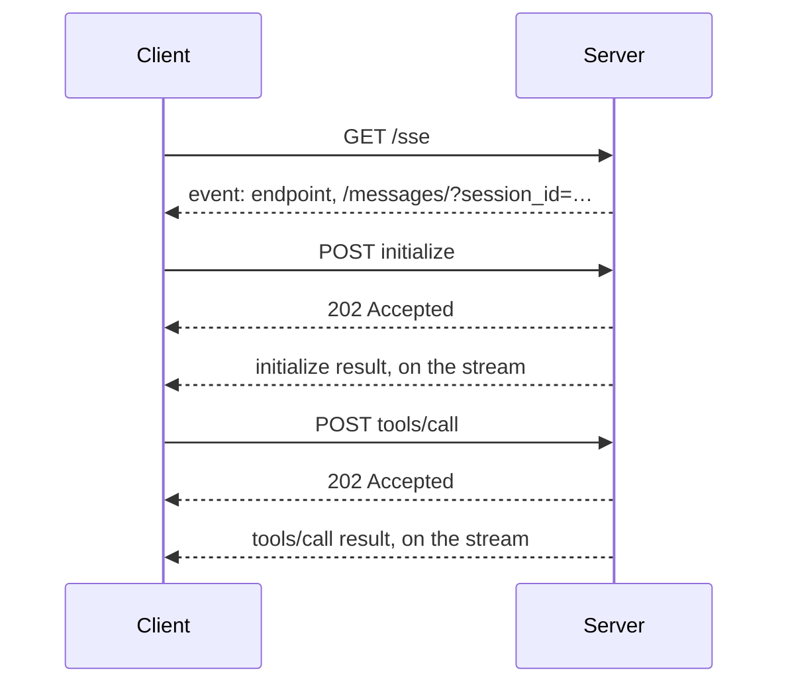

# M39.5 Theory: Transports: SSE and streamable HTTP

*[M39 theory](../README.md) · Lesson 39.5 · Notebooks: [`03_sse_transport_server_client`](../../../../course/p11_agent_protocols/m39_building_mcp_servers_and_clients/projects/03_sse_transport_server_client), [`04_streamable_http_client`](../../../../course/p11_agent_protocols/m39_building_mcp_servers_and_clients/projects/04_streamable_http_client) · [All theory pages](../../../README.md)*

## SSE

[Lesson 38.6](../../m38_mcp_foundations/06_remote_servers_and_deployment/README.md) compares the two HTTP transports side by side. Project 03 builds the SSE one by hand, which shows how it works. The server is a Starlette app with two routes around the SDK's `SseServerTransport`:

```python
sse = SseServerTransport("/messages/")
routes = [
    Route("/sse", endpoint=handle_sse),             # GET: one long-lived stream per session
    Mount("/messages/", app=sse.handle_post_message),  # POST: every message the client sends
]
```

`handle_sse` hands the stream to the low-level server, `mcp._mcp_server.run(...)`, which serves one session for as long as the GET stays open. FastMCP builds the same app for you with `mcp.run(transport="sse")` or `mcp.sse_app()`.


<!-- animated: diagrams/sse.anim.html -->

The POST never carries an answer. Every request gets `202 Accepted`, and its result arrives later as an event on the GET stream, matched by JSON-RPC id. Recorded with SDK 1.30.0 on the two Larkspur servers with held sessions, setup took 4 requests per server (the GET and three POSTs) and each tool call 1 more, so 8 calls made 16 HTTP requests. Nothing closes the session but the stream: when the GET ends, the server drops the session id. That puts the whole session on one long-lived connection, which a proxy that closes idle connections will cut.

The project's code has five problems to fix before you copy it:

- **`handle_sse` returns `None`.** The SDK's own example in `mcp/server/sse.py` returns `Response()` after the stream ends and says why: without it, a client disconnect raises `TypeError: 'NoneType' object is not callable`.
- **No host checks.** The app builds `SseServerTransport` with no security settings, so DNS-rebinding protection is off. FastMCP turns it on by itself when the host is `127.0.0.1` or `localhost`.
- **An open shell on every interface.** It binds `0.0.0.0:8081` by default, and `run_command` runs any command with `shell=True` and no timeout.
- **A README that describes another server.** It lists `execute_shell_command` with a `command` parameter and promises "command validation"; the code defines `run_command` and `add_numbers` and validates nothing.
- **Two workspaces.** The Docker instructions mount the workspace at `/workspace`, while the code runs commands in `/root/mcp/workspace`.

## Streamable HTTP

Project 04's temperature server is a FastMCP server on one endpoint, `/mcp`:

```python
mcp = FastMCP("Temperature Converter", host=host, port=port, stateless_http=True)
...
mcp.run(transport="streamable-http")
```

The comment beside `stateless_http=True` in the project says it enables the streamable HTTP protocol. It does not: `transport="streamable-http"` in `run()` picks the transport, and `stateless_http`, in the words of FastMCP's settings, decides "if the server should create a new transport per request". Stateful is the default. The two modes cost this, recorded on the Larkspur servers with held sessions:

| | Stateful (default) | `stateless_http=True` |
|---|---|---|
| Setup, per server | 4 requests: `initialize` (the reply sets `mcp-session-id`), the initialized notification (`202`), a GET for the server's own stream, `tools/list` | 3 requests: `initialize`, the notification, `tools/list` |
| Each tool call | 1 POST, answered as an event stream | 1 POST |
| Close, per server | `DELETE /mcp` | nothing |
| 8 calls, 2 servers | 18 requests | 14 requests |

Each POST gets its own answer in the response, as `text/event-stream` by default or JSON with `json_response=True`. The `mcp-session-id` header ties a stateful client's requests together, and the server checks it on every request. Probed against a stateful Larkspur server in SDK 1.30.0:

- A `GET /mcp` without `text/event-stream` in `Accept` gets `406` "Not Acceptable: Client must accept text/event-stream". Project 04's `server_launcher.py` uses exactly this as its health check, treating a 406 as "the server is up".
- A `tools/list` POST with no session id gets `400` "Bad Request: Missing session ID".
- A session id the server does not know, such as one from another replica or one that expired, gets `404` "Session not found", and the client has to initialize again.

Stateful sessions expire after 1,800 seconds with no request in flight, and one server holds at most 10,000 at once; both are FastMCP settings (`session_idle_timeout`, `max_sessions`). Stateless mode has neither, and no server-to-client stream either, so the server can only speak in answer to a request.

Project 04's client mixes transports behind one agent. `config/servers.json` lists the temperature server as `"type": "http"` with a URL and the terminal server as `"type": "stdio"` with a command, and Google ADK's `MCPToolset` opens each with the matching connection parameters (`StreamableHTTPServerParams`, `StdioConnectionParams`). That is the module's mental model in one file: the agent sees one tool list, and each tool goes back over its own server's transport.

## Choosing a transport

- **stdio** for a server on the same machine that the client starts and owns: a desktop assistant's file tools, a local retriever over the handbook. No network, no auth, and a process per session.
- **SSE** only to reach a server that speaks nothing else, such as M38's deployed research server. It needs two endpoints and one long-lived GET per session.
- **Streamable HTTP, stateful** for a shared server that keeps something per client or sends messages between requests. With several replicas, route by `mcp-session-id`.
- **Streamable HTTP, stateless** for tools that keep no per-client state and must scale out: Larkspur's `status` search can run as many replicas as it needs, and any of them can answer any request.

Lesson 39.3's Databricks server ends with `mcp.run()`. In SDK 1.30.0 `run()` defaults to `transport="stdio"`, so as written the server reads its standard input instead of listening for HTTP. A server that a platform reaches by URL needs `transport="streamable-http"` and must listen on the host and port the platform expects.

## Check yourself

<details>
<summary>1. Over SSE, every POST the client sends gets 202 Accepted. Where does the answer arrive, and what does that mean for the session?</summary>

On the long-lived `GET /sse` stream, as an event matched by JSON-RPC id. The whole session lives on that one connection: when the GET ends, the server drops the session id, so a proxy that closes idle connections will cut it.

</details>

<details>
<summary>2. Two Larkspur servers with held sessions make 8 tool calls over Streamable HTTP. How many HTTP requests do stateful and stateless mode use, and where does the gap come from?</summary>

18 stateful and 14 stateless. Stateful setup takes 4 requests per server (`initialize`, the notification, a GET for the server's own stream, `tools/list`) and a `DELETE /mcp` to close; stateless takes 3 and has nothing to close. Each tool call is 1 POST in both modes.

</details>

<details>
<summary>3. A stateful Streamable HTTP client behind a load balancer starts getting 404 Session not found. What happened, and what do you change?</summary>

The server does not know the session id: it came from another replica, or it expired after 1,800 seconds with no request in flight. The client has to initialise again. With several replicas, route by `mcp-session-id`, or run stateless if the tools keep no per-client state.

</details>

---
*Previous: [39.4 Your own client and a multi-server client](../04_your_own_client_and_a_multi_server_client/README.md). Next: [M39 interview questions](../README.md#interview-spotlight-5-questions-you-might-get-asked).*
