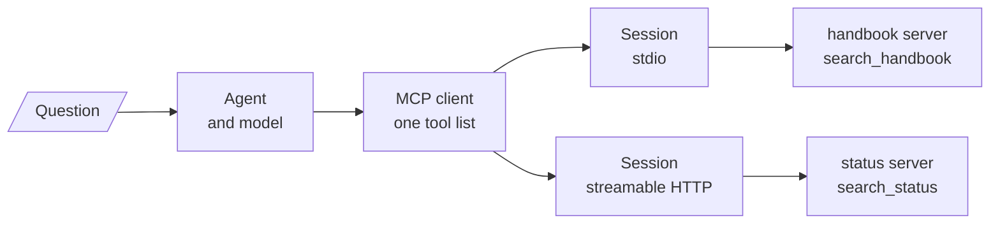

# M39 Theory: Building MCP Servers & Clients

*Part XI · Agent Protocols: MCP & A2A · [Module README](../../../course/p11_agent_protocols/m39_building_mcp_servers_and_clients/README.md) · [All theory pages](../../README.md)*

M38 connects one client to one server. M39's projects grow that into a client that holds several servers at once, a client written by hand against the SDK, and servers that answer over HTTP. The projects are runnable code in `projects/`, not notebooks. They build on four ideas: one client in front of several servers, the session each connection lives in, the older HTTP transport with a stream and a separate POST endpoint, and the newer one with a single endpoint. Each idea has a page in the folder of the lesson that teaches it, listed under [Lessons](#lessons). This page has the overview, the interview questions and the takeaways.

The running example is the module's lab brief applied to Larkspur Cloud, the fictional host whose handbook runs through M11 to M13: a support assistant with two MCP servers. `handbook` wraps a retriever over the handbook (`search_handbook`), and `status` stands in for web search over Larkspur's status pages (`search_status`, canned results, no network). The golden questions are *How long does a refund take?*, which belongs to the handbook, and *Is there an outage right now?*, which belongs to the status pages. Every count on these pages was recorded by driving those two servers through the installed SDK: `mcp` 1.30.0 and `langchain-mcp-adapters` 0.3.2.

## TL;DR

- A multi-server client keeps one session per server and merges their tools into one list for the model. Tool names must be unique across servers; `tool_name_prefix=True` turns `search` into `handbook_search`.
- A session is one `initialize` handshake followed by requests over the same transport until it closes. Over stdio a session is a server process.
- `MultiServerMCPClient.get_tools()` opens a new session for every tool call. Over stdio, 8 calls start 10 server processes and send 38 JSON-RPC messages; one held session per server needs 2 processes and 14 messages.
- SSE keeps a `GET /sse` stream open for every reply and answers each POST with `202 Accepted`. Streamable HTTP answers each POST on `/mcp` itself and ties requests together with an `mcp-session-id` header.
- `stateless_http=True` drops the session id, the server-to-client stream and the closing `DELETE`: 8 held calls cost 14 HTTP requests instead of 18, and the server keeps nothing between requests.

## Mental model

<!-- animated: diagrams/multi-server.anim.html -->

The client is the only piece that knows there are two servers. The model sees one list of tools, and each call goes back down the session of the server that listed the tool. Everything in M39 is about the middle column: how many sessions there are, how long each one lives, and what carries its messages.

## Lessons

| Lesson | Topic | Theory |
|---|---|---|
| 39.1 | Single-server MCP, with resources | [What comes back from a server](01_single_server_mcp_with_resources/README.md#what-comes-back-from-a-server) |
| 39.2 | Multi-server MCP | [Multi-server](02_multi_server_mcp/README.md#multi-server) [When one server fails](02_multi_server_mcp/README.md#when-one-server-fails) |
| 39.3 | An MCP server as a Databricks App | *planned* |
| 39.4 | Your own client and a multi-server client | [Client sessions](04_your_own_client_and_a_multi_server_client/README.md#client-sessions) [A client written by hand](04_your_own_client_and_a_multi_server_client/README.md#a-client-written-by-hand) |
| 39.5 | Transports: SSE and streamable HTTP | [SSE](05_transports_sse_and_streamable_http/README.md#sse) [Streamable HTTP](05_transports_sse_and_streamable_http/README.md#streamable-http) [Choosing a transport](05_transports_sse_and_streamable_http/README.md#choosing-a-transport) |
| 39.6 | Licence and references for the client projects | *planned* |

Lesson 39.3 is a platform variant: the same FastMCP server with a stock-price tool and a SQL tool, deployed as a Databricks App, and its transport point is covered in 39.5. Lesson 39.6 holds the GPL v3.0 licence and two reference links, with nothing to explain beyond them.

## Interactive lab

[**Sessions on the wire**](04_your_own_client_and_a_multi_server_client/interactive/session-wire-lab.html): open the file in a browser. Start with stdio and held sessions, and slide the tool calls to 8: 2 server processes, 14 messages. Switch the client to `get_tools()`: 10 processes and 38 messages, and every call lands on a process that has never seen the one before it. Then try Streamable HTTP with each client, and the stateless server, to see what each transport adds per call.

## How it connects

- **Before:** [M38](../m38_mcp_foundations/README.md) builds the first server and client, the three things a server offers, and a remote server over SSE. [M23](../../p08_agent_foundations/m23_agent_loop_and_tools/README.md) builds the tool-calling loop the clients here run, and [M31](../../p09_agentic_rag/m31_rag_as_agent_tool/README.md) makes retrieval a tool, the job the `handbook` server does behind a protocol.
- **Next:** [M40](../m40_mcp_applications/README.md) builds MCP applications and RAG over MCP on these clients and transports. [M41](../m41_a2a_protocol/README.md) moves from tools to agents with the A2A protocol.

## Interview Spotlight: 5 Questions You Might Get Asked

*Production questions in the style of OpenAI, Anthropic and Google interviews for applied AI roles.*

### 1. Larkspur's assistant moved from held sessions to `MultiServerMCPClient.get_tools()` to simplify the code. Since then the `handbook` server's in-memory embedding cache never hits, and p95 latency has doubled. What happened?

**What a strong answer covers:**
- `get_tools()` in `langchain-mcp-adapters` 0.3.2 opens a new session for each tool call, and over stdio each session is a new server process, so the cache dies with every call
- Confirms it from the wire, not the code: count `initialize` requests and server process starts per tool call (one each, against zero with held sessions)
- Fixes the client by holding sessions, `async with client.session("handbook")` and `load_mcp_tools(session)`, or moves the server to HTTP, where the process outlives the session
- Moves the cache out of process memory if it must survive restarts anyway, and adds a check on the setup cost per call to the latency dashboard

### 2. The `status` server runs as three replicas behind a load balancer, with stateful Streamable HTTP. Some tool calls fail with 404 "Session not found". What is going on, and what do you change?

**What a strong answer covers:**
- A stateful session lives in the memory of the replica that answered `initialize`; a request with that `mcp-session-id` routed to another replica gets 404, and the client must initialize again
- Two fixes: sticky routing on the `mcp-session-id` header, or `stateless_http=True` so any replica can answer any request
- Stateless costs: no server-to-client stream, so the server cannot push notifications between requests, and nothing per session survives; fine for a search tool that keeps no state
- Also checks the idle timeout (1,800 seconds by default in SDK 1.30.0) and the 10,000-session cap, since both end sessions the client still believes in

### 3. How would you monitor the MCP layer of the assistant in production, separately from the model?

**What a strong answer covers:**
- Logs per tool call: server name, transport, session id, latency split into session setup and the call itself
- Tracks the ratio of `initialize` requests to `tools/call` requests; it should be near zero with held sessions, and a jump to one means a client started opening sessions per call
- Counts HTTP status codes per server (202 on SSE, 404 for lost sessions, 406 from clients sending the wrong `Accept` header) with middleware like the lab's recorder
- Alerts when a server's `tools/list` changes, because the model's routing depends on the names and descriptions it lists

### 4. At startup the `status` server's container fails to pull. With `MultiServerMCPClient`, the assistant does not start at all, though the handbook is fine. With the hand-built client from project 02, it starts with handbook tools only. Which behaviour do you want, and how do you get it?

**What a strong answer covers:**
- `get_tools()` loads every server with `asyncio.gather`, so one failed server raises and no tools load; project 02 wraps each server in its own `try` and keeps going
- Decides per server: a support assistant can answer handbook questions without status, so start degraded, but say so in the system prompt and in the UI
- Loads servers one by one with `get_tools(server_name=...)` or per-server sessions, records which failed, and retries them in the background
- Tests it: a golden question per server, run with each server down, checking the assistant says it cannot reach status instead of guessing

### 5. A teammate deploys the SSE project's server on a VM to share it with the support team. It binds `0.0.0.0:8081` and offers `run_command`. What do you flag before it goes live?

**What a strong answer covers:**
- Anyone who reaches the port can open a session and run any shell command: `shell=True`, no authentication, no timeout (the stdio version at least has 30 seconds)
- The README promises command validation the code does not have, and the app is built by hand from `SseServerTransport` with no security settings, so DNS-rebinding protection is off
- Replaces the shell with narrow tools (`search_handbook`, not `run_command`), binds to localhost behind an authenticating proxy, and runs the process in a container with a read-only file system
- Moves to Streamable HTTP with FastMCP's own app, so host and origin checks come with the server, and adds the server to the team's security review like any other API

## Key Takeaways

- Give each server one session and hold it for the life of the agent. A session per call costs a handshake every time, and over stdio a process, and loses whatever the server kept in memory.
- Merge tools from several servers into one list only after checking names: prefix them by server, and give each a description that says which questions it answers.
- Pick the transport by where the server runs: stdio for a local subprocess, Streamable HTTP for anything shared, and stateless mode when replicas must answer any request.
- Treat an MCP server that runs commands as a remote shell. Narrow tools, authentication and a sandbox come before the first deployment.

---
*Previous: [M38 MCP Foundations](../m38_mcp_foundations/README.md). Next: [M40 MCP Applications & RAG over MCP](../m40_mcp_applications/README.md).*
