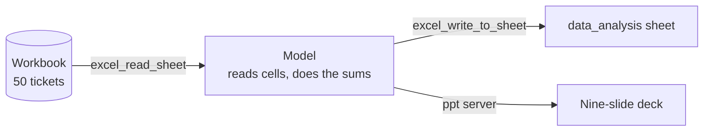

# M40.3 Theory: MCP servers for data analysis

*[M40 theory](../README.md) · Lesson 40.3 · Notebooks: [`04_mcp_servers_for_data_analysis`](../../../../course/p11_agent_protocols/m40_mcp_applications/projects/04_mcp_servers_for_data_analysis) (optional) · [All theory pages](../../../README.md)*

## Checking the agent's numbers

This project has no code. It ships the input and the output of one analysis run in Claude through MCP, the job the `excel` and `ppt` entries in the [40.2 config](../02_mcp_servers_with_claude_desktop/README.md#claude-desktop) are there for: `support_tickets_data.xlsx`, with 50 support tickets in a `support_tickets_data` sheet and the model's findings written back as a `data_analysis` sheet, and `Support_Tickets_Analysis_Report.pptx`, nine slides that end "Analysis completed using Claude MCP Analysis".

The servers move cells and slides; the arithmetic happens in the model. Recomputing the deck's figures from the ticket sheet with pandas:

| Figure | Deck and analysis sheet | From the 50 tickets |
|---|---|---|
| Resolved tickets | 23 of 50, 46% | 23 of 50, 46% |
| Average satisfaction | 2.84 / 5 | **2.82 / 5** (141 / 50) |
| Average response time | 2.2 hours, "MEETING TARGET" | 2.17 hours, against the sheet's own target of "Under 2 hours" |
| Agent A001 satisfaction | 2.14 / 5 | 2.14 / 5 |
| Agent A004 share of tickets | 36% | 18 of 50, 36% |
| Data Import and Billing share | 44% | 22 of 50, 44% |
| Critical tickets resolved | "Only 42.9%" | **71.4%** (5 of 7) |

Most figures are right, and the two wrong ones look the same as the rest. 42.9% is agent A001's resolution rate (3 of 7), one block up in the same sheet, reported as the critical-ticket rate, and it drives the slide's "Critical Ticket Problems" finding. Response time is called on target while missing the target the sheet sets in its own success-metrics block.

The excel server can do the sums itself. Its README (excel-mcp-server 0.12.0) says a written value that starts with `=` is a formula, so `=AVERAGE(support_tickets_data!I2:I51)` would let the workbook compute the average and keep the source of every number visible. The analysis sheet holds typed strings such as `2.84/5` instead, and its seven section headings, which begin with `=` (`==== EXECUTIVE SUMMARY ===`), were stored as formulas with no value, so pandas reads them as empty cells.

Rules for analysis sessions over MCP:

- **Make the tool compute.** Ask for formulas, or give the host a code or SQL tool, so each figure has a derivation you can inspect.
- **Recompute the headline numbers** before a deck leaves the room. Here that took one pandas cell and found two wrong figures and one wrong verdict.
- **Check the paging limit against the data.** `EXCEL_MCP_PAGING_CELLS_LIMIT` is 4000 cells per read; this sheet is 612 cells, so one read covered it. A larger sheet arrives in pages, and a model that stops after the first page analyses part of the data.

## Key Takeaways

- MCP servers move cells and slides; the model does the arithmetic. Its wrong figures look the same as its right ones.
- Make the tool compute, with spreadsheet formulas or a code or SQL tool, so every figure has a derivation you can inspect.
- Recompute the headline numbers before a report ships, and check the server's paging limit against the data size so the model reads every page.

## Check yourself

1. In this Claude analysis run, which part does the arithmetic, and why does that make the deck hard to trust?

The model. The excel and ppt servers only move cells and slides, so no figure has a derivation you can inspect, and the two wrong figures look the same as the right ones. Make the tool compute instead: ask for formulas, or give the host a code or SQL tool.

2. The deck reports that only 42.9% of critical tickets were resolved. What does the ticket sheet give, and where did 42.9% come from?

71.4%, 5 of 7. 42.9% is agent A001's resolution rate (3 of 7), one block up in the same sheet, reported as the critical-ticket rate, and it drives the slide's "Critical Ticket Problems" finding. One pandas cell recomputing the headline numbers caught it.

3. The next ticket sheet has 6,000 cells. What can go wrong when the model reads it through the excel server, and what do you check?

`EXCEL_MCP_PAGING_CELLS_LIMIT` is 4000 cells per read, so the sheet arrives in pages, and a model that stops after the first page analyses part of the data. Check the paging limit against the data size; this project's 612-cell sheet fit in one read.

---
*Previous: [40.2 MCP servers with Claude Desktop](../02_mcp_servers_with_claude_desktop/README.md). Next: [40.4 Tools, resources and prompts together](../04_tools_resources_and_prompts_together/README.md).*
