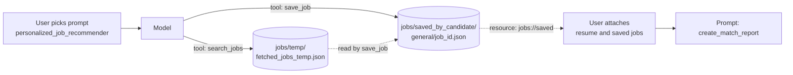

# M40.4 Theory: Tools, resources and prompts together

*[M40 theory](../README.md) · Lesson 40.4 · Notebooks: [`05_mcp_tools_resources_and_prompts`](../../../../course/p11_agent_protocols/m40_mcp_applications/projects/05_mcp_tools_resources_and_prompts) · [All theory pages](../../../README.md)*

## One server, three controllers

[M38](../../m38_mcp_foundations/README.md) introduced the three things a server can offer. The Job Market Explorer server uses all three at once, which shows how they divide the work. The project's presentation names who controls each: tools are "Model-controlled", resources "Application-controlled" and prompts "User-controlled".

| Primitive | In this server | Who triggers it | Side effects |
|---|---|---|---|
| Tool | `search_jobs(role, location, max_results=5)`, `save_job(job_id, salary=None)` | The model, when it decides to | Calls the JSearch API on RapidAPI; writes JSON files |
| Resource | `resume://default` (text from `resume/resume.pdf`), `jobs://saved` (every saved job as Markdown) | The application, usually because the user attached it | None: they only read |
| Prompt | `analyze_job_market(role, location, num_jobs=5)`, `personalized_job_recommender()`, `create_match_report()` | The user, by picking it | None: they return instructions |

A full session uses all three in order, and the pieces meet in files on the server's disk:

The prompts are scripts for the model: `personalized_job_recommender` says to read the resume, "Call job search mcp tool", then "Optionally call save job mcp tool on top matches". `create_match_report` starts "Given the attached jobs data and resume", so it only works once the user has attached both resources. The server writes the workflow; the host has to support every step of it.

Hosts differ in how much of that they support. In langchain-mcp-adapters 0.3.2, `load_mcp_tools` and `MultiServerMCPClient.get_tools()` load tools only. Resources come from `client.get_resources(...)` and prompts from `client.get_prompt(...)`, and the application has to fetch them and put them in the conversation itself. A LangGraph app that only loads tools sees 2 of this server's 7 features, and `create_match_report` has nothing attached to read.

Two design points the server gets wrong for anything beyond one user:

- **Hidden coupling between tools.** `save_job` only works after `search_jobs`, because it reads the single file `fetched_jobs_temp.json`. Two users of a shared server overwrite each other's search, and `save_job` saves a job from someone else's results or reports the id as not found.
- **Paths relative to the working directory.** `BASE_DIR = Path(".")` puts `jobs/` and `resume/` wherever the server process starts. The Claude Desktop entry passes `uv --directory`, which sets it ([40.2](../02_mcp_servers_with_claude_desktop/README.md#claude-desktop)); anchor paths on `Path(__file__).parent` instead, as the 06 and 07 servers do.

## Key Takeaways

- Tools are model-controlled and may have side effects; resources are application-controlled and only read; prompts are user-controlled and return instructions.
- Many hosts load tools only. The application must fetch resources and prompts itself, or a prompt that expects attached data has nothing to read.
- Avoid hidden coupling through shared temp files and paths relative to the working directory. Anchor paths on `Path(__file__).parent` and keep per-user state apart.

## Check yourself

1. Who triggers each of the Job Market Explorer server's three primitives, and which of them have side effects?

Tools are model-controlled and have side effects: `search_jobs` calls the JSearch API and `save_job` writes JSON files. Resources are application-controlled and only read. Prompts are user-controlled and return instructions, so they change nothing.

2. A LangGraph app loads this server with get_tools only. How much of the server does it see, and what happens to the match report?

2 of its 7 features: in langchain-mcp-adapters 0.3.2, `get_tools()` loads tools only. `create_match_report` starts "Given the attached jobs data and resume", so it has nothing to read unless the app fetches the resources with `client.get_resources(...)` and the prompt with `client.get_prompt(...)` and puts them in the conversation itself.

3. Two users share one Job Market Explorer server, and one of them saves a job that came from the other's search. Why?

`save_job` only works after `search_jobs`, because it reads the single file `fetched_jobs_temp.json`. A second user's search overwrites the first user's, so `save_job` saves a job from someone else's results or reports the id as not found. That hidden coupling between tools breaks as soon as there is more than one user.

---
*Previous: [40.3 MCP servers for data analysis](../03_mcp_servers_for_data_analysis/README.md). Next: [40.5 RAG over MCP with LangChain](../05_rag_over_mcp_with_langchain/README.md).*
