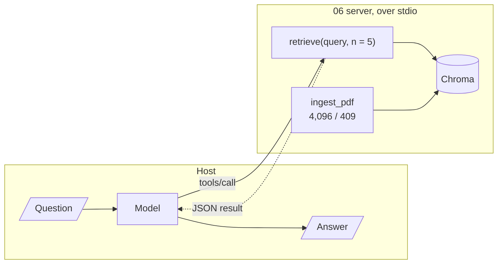

# M40.5 Theory: RAG over MCP with LangChain

*[M40 theory](../README.md) · Lesson 40.5 · Notebooks: [`06_mcp_rag_with_langchain`](../../../../course/p11_agent_protocols/m40_mcp_applications/projects/06_mcp_rag_with_langchain) · [All theory pages](../../../README.md)*

## RAG over MCP

The 06 server puts a whole LangChain RAG index behind four MCP tools: `ingest_pdf(source)` for a PDF file, a folder of PDFs or a URL; `retrieve(query, n=5)`; `db_info()`; and `clear_db()`. Inside it is the pipeline from M11 to M15: PyPDF2 extracts the text, `RecursiveCharacterTextSplitter` cuts it, Ollama's `nomic-embed-text` embeds it, and Chroma persists it in `chroma_db/` beside `server.py`. The Streamlit `app.py` is the client: a LangGraph ReAct agent on Ollama's `qwen3` that loads the server's tools for each question.

<!-- animated: diagrams/rag-over-mcp.anim.html -->

Serving retrieval this way moves every retrieval decision to the server, where all hosts share it, and leaves every question decision with the host. The server decides chunking, embeddings, the distance metric and the shape of the result. The host's model decides when to ingest, what query to write, how many chunks to ask for, and whether to call `clear_db`, which empties the collection with no confirmation.

The server's choices, read from its code:

- **Chunk size is in characters.** `CHUNK_SIZE = 4096` with `length_function=len`, and 409 characters of overlap. The project's presentation calls them "4096 tokens". At that size the whole Larkspur handbook, 1,415 characters, is a single chunk, so every question retrieves the entire handbook; [M13](../../../p05_ingestion_and_indexing/m13_chunking/README.md) is about choosing the size for the corpus.
- **Chunk ids are positions.** Each chunk is stored as `<file stem>_chunk_<i>`, and langchain-chroma 1.1.0's `add_documents` upserts. In a probe, ingesting three chunks and then a two-chunk new version of the same file left three chunks: the two new ones and the old third. Two PDFs with the same name in different folders overwrite each other.
- **Results are whole chunks.** `retrieve` returns `text`, `metadata`, `similarity_score` and `distance` for each of `n` chunks, so a default call can put up to 5 × 4,096 characters into the model's context.

One fix is needed before the project runs in this course's environment: `server.py` imports `RecursiveCharacterTextSplitter` from `langchain.text_splitter`, which raises `ModuleNotFoundError` under langchain 1.4.7. The class lives in `langchain_text_splitters`.

The client opens its MCP session inside the request handler, so each question starts the server again: a new process, a new Chroma client, a new handshake. With one question that costs nothing extra; with a conversation it adds up, as the [lab in lesson 40.6](../06_research_assistant_with_mcp_and_langgraph/interactive/session-lifetime-lab.html) counts.

## Distance is not similarity

`retrieve` calls `similarity_search_with_score`, which returns Chroma's distance, and reports `similarity_score = 1 - distance`. A collection created without a metric uses squared L2 distance (the configuration reads `'space': 'l2'` in chromadb 1.5.9). On unit vectors squared L2 is `2 - 2 × cosine`, so the reported score is `2 × cosine - 1`, a number from −3 to 1. A probe with four unit vectors and the query pointing east:

| Chunk vector | Cosine to the query | Chroma distance | 06's `similarity_score` | With `hnsw:space` cosine |
|---|---|---|---|---|
| east | 1.000 | 0.000 | 1.000 | 1.000 |
| north-east | 0.707 | 0.586 | 0.414 | 0.707 |
| north | 0.000 | 2.000 | −1.000 | 0.000 |
| west | −1.000 | 4.000 | −3.000 | −1.000 |

The ranking is right, because the score falls as the distance grows. The scale is not: a client that keeps chunks with a "similarity" above 0.5 is asking for cosine above 0.75, and if the embedding model does not return unit vectors, the scale moves with vector length and changes when the model does. The 07 server prints the same `1 - score` into its result text, so there the model reads it too.

Two fixes, both checked with langchain-chroma 1.1.0:

- **Create the collection with the metric you mean.** `Chroma(..., collection_metadata={"hnsw:space": "cosine"})` makes the distance `1 - cosine`, and `1 - distance` is then the cosine (last column).
- **Return what you computed, and say what it is.** Send `distance` and the metric name, and leave thresholds to the server, where one person owns them.

---
*Previous: [40.4 Tools, resources and prompts together](../04_tools_resources_and_prompts_together/README.md). Next: [40.6 Research assistant with MCP and LangGraph](../06_research_assistant_with_mcp_and_langgraph/README.md).*
