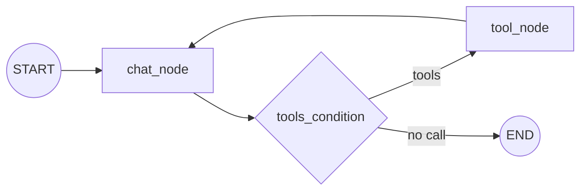
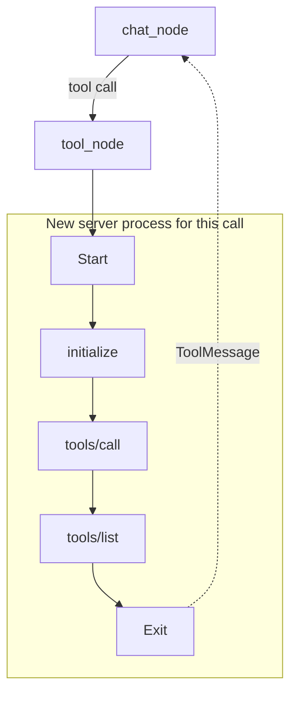

# M40.6 Theory: Research assistant with MCP and LangGraph

*[M40 theory](../README.md) · Lesson 40.6 · Notebooks: [`07_research_assistant_with_mcp_and_langgraph`](../../../../course/p11_agent_protocols/m40_mcp_applications/projects/07_research_assistant_with_mcp_and_langgraph) · [All theory pages](../../../README.md)*

## MCP + LangGraph

The research assistant splits into a graph that thinks and servers that act. `client.py` builds the graph; two MCP servers supply every tool it can call:

- **`research_server`** (this project's `server.py`) keeps research in Chroma, one database per topic under `research_chroma_dbs/<topic>/`. Its five tools: `save_research_data(content, topic)`, `search_research_data(query, topic, max_results=5)`, `list_research_topics()`, `get_topic_info(topic)` and `delete_research_topic(topic)`. Saving skips any text whose MD5 hash is already in the topic's `content_hashes.json`.
- **`firecrawl_server`** is the published `firecrawl-mcp` package, started with `npx -y`, which scrapes the web. The client copies `FIRECRAWL_API_KEY` from its environment into that server's `env` before it connects.

The graph is the tool loop from [M23](../../../p08_agent_foundations/m23_agent_loop_and_tools/README.md) and [M31](../../../p09_agentic_rag/m31_rag_as_agent_tool/README.md), unchanged:

MCP only changes where the tools come from. `MultiServerMCPClient(mcp_json).get_tools()` turns every tool of both servers into a LangChain tool; `llm.bind_tools(tools)` shows them to Ollama's `qwen3`; `ToolNode(tools=tools)` runs whichever the model picks; `tools_condition` routes. A system prompt tells the model to search saved research before crawling and to save what it finds.

The assistant has two memories, held in different processes. The client's `MemorySaver` keeps the conversation for the thread `research_session` and loses it when `client.py` exits. The research server keeps findings in Chroma on disk, across sessions and for any host that connects, Claude Desktop included (it is the `research_server` entry in the [40.2 config](../02_mcp_servers_with_claude_desktop/README.md#claude-desktop)).

Two fixes before it runs here: `client.py` imports `ChatPromptTemplate` and `MessagesPlaceholder` from `langchain.prompts`, which raises `ModuleNotFoundError` under langchain 1.4.7 (they live in `langchain_core.prompts`); and topic names become directory names unchecked, which [lesson 40.7](../07_deploying_an_mcp_server_on_ec2/README.md#deployment) shows is dangerous once the server is shared.

## How long a session lives

`MultiServerMCPClient.get_tools()` returns tools with no open connection behind them. Its docstring in langchain-mcp-adapters 0.3.2 says: "A new session will be created for each tool call". For a stdio server, a new session is a new process.

<!-- animated: diagrams/session-per-call.anim.html -->

The `tools/list` after the call comes from the SDK. mcp 1.30.0's `ClientSession` validates each structured tool result against the tool's output schema, and a session that has not listed its tools yet lists them first. A held session pays for that once; a session per call pays for it every time.

The [interactive lab](interactive/session-lifetime-lab.html) records the real JSON-RPC traffic of the Larkspur handbook server under three client patterns, with a scripted model so every run makes the same calls. Its numbers:

| Questions × calls per question | Hold one session | Session per question (06 `app.py`) | Session per tool call (07 client) |
|---|---|---|---|
| 1 × 1 | 1 start, 7 messages | 1 start, 7 messages | 2 starts, 12 messages |
| 3 × 2 | 1 start, 17 messages | 3 starts, 27 messages | **7 starts, 47 messages** |
| 3 × 3 | 1 start, 23 messages, 9,963 bytes | 3 starts, 33 messages, 12,131 bytes | **10 starts, 68 messages, 19,726 bytes** |

<!-- lab: interactive/session-lifetime-lab.html -->

Each pattern has a reason to exist:

- **Hold one session** for a conversation: `async with client.session("research_server") as session:` then `tools = await load_mcp_tools(session)`. One process, one handshake, server-side state kept in memory for as long as the session lives.
- **Session per question** isolates questions from each other and suits a request handler such as Streamlit's, at the price of one start per question.
- **Session per tool call** needs no lifecycle code, which is why `get_tools()` is the quickstart, and it is the costliest. The lab counts messages; on a real server each start also pays for the work done at import time. The research server builds its Ollama embeddings client at every start, and `npx -y firecrawl-mcp` starts Node for every crawl.

Message counts are not latency, and the lab does not time anything, because start-up cost depends on the machine and the server. Measure your own: log one line on the server's stderr at start-up and count the lines per conversation.

---
*Previous: [40.5 RAG over MCP with LangChain](../05_rag_over_mcp_with_langchain/README.md). Next: [40.7 Deploying an MCP server on EC2](../07_deploying_an_mcp_server_on_ec2/README.md).*
