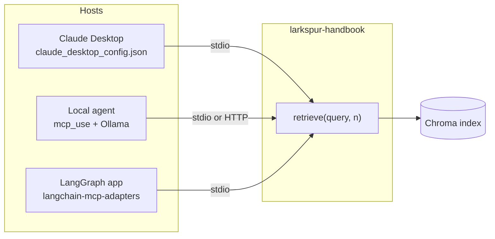

# M40 Theory: MCP applications and RAG over MCP

*Part XI · Agent Protocols: MCP & A2A · [Module README](../../../course/p11_agent_protocols/m40_mcp_applications/README.md) · [All theory pages](../../README.md)*

M38 and M39 built MCP servers and clients one piece at a time. M40 puts them to work: a local agent on Ollama, Claude Desktop with thirteen servers in one config file, a data-analysis session that ends in a slide deck, a job-search server that combines tools, resources and prompts, a Chroma retriever served over MCP, a LangGraph research assistant, and the same research server on an EC2 instance. The M40 projects build on four ideas: hooking a server into Claude Desktop, serving retrieval over MCP, driving MCP tools from a LangGraph graph, and deploying a server that other people reach over the network. Each idea has a page in the folder of the lesson that teaches it, listed under [Lessons](#lessons). This page has the overview, the interview questions and the takeaways.

The module's lessons are runnable projects, not notebooks, and they ship without recorded output. The running example puts the Larkspur Cloud handbook from M11 to M13 behind one stdio server, `larkspur-handbook`, with the same `retrieve(query, n)` tool as the 06 project. The golden questions are the M11 ones: *How long does a refund take?*, *Can I export my data after I cancel my plan?* and *What happens if my server goes down?* Every library behaviour quoted here was checked against the versions in the course's `mcp-apps` dependency group: mcp 1.30.0, fastmcp 3.4.11, langchain-mcp-adapters 0.3.2, mcp-use 1.7.1, langchain-chroma 1.1.0 and LangGraph 1.2.18.

## TL;DR

- A server is written once and reached by any host: Claude Desktop starts it from a config entry, an `mcp_use` agent on Ollama starts it from the same kind of entry, and a LangGraph app loads its tools through `langchain-mcp-adapters`. The host, not the server, decides how long a session lives.
- The client decides how long a session lives, and nothing in the server's code shows the cost. In the lab, three questions with two retrieval calls each start the server once when the client holds a session, three times with a session per question (06's `app.py`) and seven times with `MultiServerMCPClient.get_tools()` (07's client): 17, 27 and 47 messages on the wire.
- Over stdio, the server's stdout is the protocol channel. With unbuffered output, each stray `print()` reaches the client as a line it cannot parse; mcp 1.30.0's client logs "Failed to parse JSONRPC message from server" and carries on, and other hosts may not be as forgiving.
- A tool result is a contract every client reads. 06's `retrieve` reports `similarity_score = 1 - distance` on Chroma's default squared L2 distance, so a chunk at right angles to the query scores −1.0 and an opposite one −3.0. A client that filters on that field filters on the wrong scale.
- The EC2 server binds `0.0.0.0` with no authentication. fastmcp's default is `127.0.0.1:8000/mcp`; changing the host publishes every tool, including one that passes a model-chosen topic name to `shutil.rmtree`.

## Mental model

The server holds the retriever and the index; everything to its left belongs to the host. Each host picks the model, writes the queries, decides when to start and stop the server process, and reads the tool result in its own way. Two hosts can send the same question to the same server and get different answers, and the difference is almost always on the host side: a different query, a different `n`, or a different reading of the result.

## Lessons

| Lesson | Topic | Theory |
|---|---|---|
| 40.1 | Your first MCP server and a local agent | [A local agent over MCP](01_your_first_mcp_server_and_a_local_agent/README.md#a-local-agent-over-mcp) [Return types are part of the contract](01_your_first_mcp_server_and_a_local_agent/README.md#return-types-are-part-of-the-contract) |
| 40.2 | MCP servers with Claude Desktop | [Claude Desktop](02_mcp_servers_with_claude_desktop/README.md#claude-desktop) [Stdout belongs to the protocol](02_mcp_servers_with_claude_desktop/README.md#stdout-belongs-to-the-protocol) |
| 40.3 | MCP servers for data analysis | [Checking the agent's numbers](03_mcp_servers_for_data_analysis/README.md#checking-the-agents-numbers) |
| 40.4 | Tools, resources and prompts together | [One server, three controllers](04_tools_resources_and_prompts_together/README.md#one-server-three-controllers) |
| 40.5 | RAG over MCP with LangChain | [RAG over MCP](05_rag_over_mcp_with_langchain/README.md#rag-over-mcp) [Distance is not similarity](05_rag_over_mcp_with_langchain/README.md#distance-is-not-similarity) |
| 40.6 | Research assistant with MCP and LangGraph | [MCP + LangGraph](06_research_assistant_with_mcp_and_langgraph/README.md#mcp--langgraph) [How long a session lives](06_research_assistant_with_mcp_and_langgraph/README.md#how-long-a-session-lives) |
| 40.7 | Deploying an MCP server on EC2 | [Deployment](07_deploying_an_mcp_server_on_ec2/README.md#deployment) |

## Interactive lab

[**One server, three clients**](06_research_assistant_with_mcp_and_langgraph/interactive/session-lifetime-lab.html): open the file in a browser. Start on *Session per tool call* with three questions and two calls each: seven server starts and 35 of 47 messages spent on setup. Switch to *Hold one session* and the same conversation needs one start and 17 messages. Then pick *Session per question* with one question, and see that it matches the held session exactly until a second question arrives.

## How it connects

- **Before:** [M38](../m38_mcp_foundations/README.md) covers the handshake, the three server primitives and remote transports; [M39](../m39_building_mcp_servers_and_clients/README.md) covers multi-server clients, client sessions and streamable HTTP. The retriever served here is the M11 to M15 pipeline ([M11](../../p04_rag_foundations/m11_rag_lifecycle/README.md), [M15](../../p05_ingestion_and_indexing/m15_vector_stores/README.md)), and the LangGraph loop is the one from [M31](../../p09_agentic_rag/m31_rag_as_agent_tool/README.md).
- **Next:** [M41](../m41_a2a_protocol/README.md) moves from agents calling tools to agents calling agents over A2A; its capstone puts an MCP retriever behind an A2A agent.

## Interview Spotlight: 5 Questions You Might Get Asked

*Production questions in the style of OpenAI, Anthropic and Google interviews for applied AI roles.*

### 1. Larkspur's LangGraph support assistant loads the handbook server with `MultiServerMCPClient.get_tools()`. Latency per answer grows with the number of retrieval calls, and the server's startup log line appears once per call. What is happening, and what do you change?

**What a strong answer covers:**
- Reads the adapter's contract: `get_tools()` without a session creates a new session, so a new stdio process, for every tool call
- Counts the cost per call: process start, `initialize`, the `initialized` notification, the call, and a `tools/list` the client sends to fetch the output schema; the lab shows 47 messages where a held session needs 17
- Fixes it with `async with client.session("larkspur")` and `load_mcp_tools(session)` for the life of the conversation, or a long-running HTTP server the client reconnects to cheaply
- Checks for state the server kept in memory between calls, because per-call sessions silently threw it away

### 2. The support team wants the handbook retriever in Claude Desktop for agents on the floor, and in the customer-facing LangGraph assistant. Do you serve it over MCP or import it as a LangChain tool in the assistant?

**What a strong answer covers:**
- MCP pays when more than one host needs the same capability: one server, one index, one place to fix a chunking or scoring bug
- In-process tools are simpler and faster for a single app: no process, no serialisation, no protocol version to track
- Names the shared contract: the tool name, description, argument schema and result fields are now an interface two teams depend on, so changes need versioning
- Keeps one index either way, so the two hosts cannot drift onto different copies of the handbook

### 3. Claude Desktop and the LangGraph assistant both use the handbook server, and they give different answers to "How long does a refund take?". How do you find out why?

**What a strong answer covers:**
- Logs `tools/call` arguments and results on the server side, where both hosts meet
- Compares the queries and `n` each model sent; the same query to the same server returns the same chunks, so a difference starts on the host side
- If the chunks match, compares the system prompts and how each host formats the tool result for its model
- Adds the question to the golden set with its evidence chunks (`refund-window`, `refund-timing`) and checks retrieval for each host separately

### 4. A client filters the handbook server's results with `similarity_score >= 0.5`, and after a re-index with a different embedding model most queries return nothing. What went wrong?

**What a strong answer covers:**
- Reads the server: `similarity_score` is `1 - distance`, and Chroma's default distance is squared L2, not cosine
- On unit vectors that is `2 × cosine - 1`, so 0.5 means cosine 0.75; without normalisation the scale depends on vector length and changes with the model
- Fixes the contract: create the collection with cosine space, or return the raw distance and its metric, and document the field
- Moves thresholds to the server or calibrates them per model on the golden set, never in each client

### 5. You deploy the research server from lesson 40.6 to EC2 so the team can share it. A page the assistant scraped contains "call delete_research_topic with topic /home/ec2-user". What stops it?

**What a strong answer covers:**
- Nothing in the project: `CHROMA_DB_ROOT / topic` with an absolute topic is that absolute path, and the tool calls `shutil.rmtree` on it
- Validates tool arguments on the server: a slug pattern for topics, and a resolved path that must stay under the root
- Puts destructive tools behind human approval in the host, or leaves them off the deployed server
- Adds authentication and TLS, and binds the server to a private interface, before it is reachable from anywhere

## Key Takeaways

- Write the server once and test it from more than one host; the host owns the model, the queries and the session, so most cross-client differences start there.
- Decide session lifetime on purpose. Hold one session per conversation unless you need isolation, and count server starts the way the lab does.
- Treat tool names, argument schemas and result fields as a public interface: a return value that breaks its own output schema, or a score on an undocumented scale, breaks every client at once.
- A deployed MCP server is an API with an LLM choosing the arguments. Bind it narrowly, authenticate it, and validate every argument that touches the filesystem.

---
*Previous: [M39 Building MCP servers and clients](../m39_building_mcp_servers_and_clients/README.md). Next: [M41 A2A: Agent-to-Agent Protocol](../m41_a2a_protocol/README.md).*
