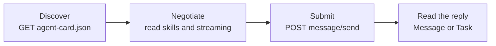

# M41.1 Theory: A2A basics: Agent Cards, tasks, messages

*[M41 theory](../README.md) · Lesson 41.1 · Notebooks: [`01a_a2a_protocol_basics.ipynb`](../../../../course/p11_agent_protocols/m41_a2a_protocol/notebooks/01a_a2a_protocol_basics.ipynb) · [All theory pages](../../../README.md)*

## Agent Card

An Agent Card is the JSON document an A2A server publishes about itself. A client that knows only a base URL fetches the card first, and everything else it needs comes from there: where to post requests, which skills the agent has, and whether it can stream.

In `a2a-sdk` 0.3.26, `AgentCard` has eight required fields:

| Field | What the client does with it |
|---|---|
| `name`, `description`, `version` | Shows or logs which agent, and which release of it, answered |
| `url` | Posts JSON-RPC requests here |
| `capabilities` | Checks `streaming` before calling `message/stream`; the others are `push_notifications`, `state_transition_history` and `extensions` |
| `skills` | Picks the agent for a job: each `AgentSkill` needs `id`, `name`, `description` and `tags`, and may add `examples` and its own input and output modes |
| `default_input_modes`, `default_output_modes` | Learns which content types the agent accepts and returns |

Two fields have defaults the notebooks never set: `protocol_version` is `0.3.0` and `preferred_transport` is `JSONRPC`. Authentication also lives on the card, in `security_schemes` and `security`, and an agent can keep some skills on an authenticated extended card (`supports_authenticated_extended_card`, served at `/agent/authenticatedExtendedCard`).

On the wire the fields are camelCase. This is the card the lab's handbook agent serves, recorded from a live server:

```json
{
  "capabilities": { "streaming": true },
  "defaultInputModes": ["text"],
  "defaultOutputModes": ["text"],
  "description": "Answers questions from the Larkspur Cloud handbook.",
  "name": "larkspur_handbook_agent",
  "preferredTransport": "JSONRPC",
  "protocolVersion": "0.3.0",
  "skills": [{
    "id": "handbook_qa", "name": "handbook_qa",
    "description": "Answers billing, export and outage questions from the Larkspur Cloud handbook.",
    "tags": ["rag", "handbook"],
    "examples": ["Can I export my data after I cancel my plan?", "How long does a refund take?"]
  }],
  "url": "http://localhost:10002/",
  "version": "1.0.0"
}
```

**Where the card lives.** The notebooks say `/.well-known/agent.json`. In 0.3.26 the SDK's constant is `AGENT_CARD_WELL_KNOWN_PATH = "/.well-known/agent-card.json"`, and `A2ACardResolver` fetches that path. `A2AStarletteApplication` serves both: the old path still returns the card and logs that it is deprecated and will be removed. Clients written against the new SDK never touch the old path, so the notebooks work unchanged.

The card is a contract. A skill description is all a calling agent's model knows about the agent, the same way a tool description is all it knows about a tool ([M31](../../../p09_agentic_rag/m31_rag_as_agent_tool/README.md)). Changing `streaming`, a skill id or the URL breaks callers that read the old card, so bump `version` when you do.

## From discovery to reply

Notebook 41.1 runs one server and one client in the same process. The server is an echo agent: its `AgentExecutor` puts a single agent message on the event queue. The client goes through four steps, and each maps to one HTTP call or one decision:



Submitting means posting a JSON-RPC 2.0 request. The message has a `role` (`user` or `agent`), a client-chosen `messageId` and a list of parts, each a `text`, `file` or `data` part:

```json
{
  "jsonrpc": "2.0", "id": "req-1", "method": "message/send",
  "params": { "message": {
    "kind": "message", "role": "user", "messageId": "id-1",
    "parts": [{ "kind": "text", "text": "Can I export my data after I cancel my plan?" }]
  } }
}
```

The echo agent answers with a Message: `"kind": "message"`, `"role": "agent"`, and the text in `parts`. The request context hands the executor a `contextId`, which groups related turns, and a `taskId`, and the executor copies both into its reply. It never created a task, though, so nothing was stored. In the lab, `tasks/get` on that id returns error -32001, Task not found. A Message is the whole answer; there is nothing to poll.

The server side of the notebook is three objects: an `AgentExecutor` with the agent logic, a `DefaultRequestHandler` that implements the JSON-RPC methods on top of it with an `InMemoryTaskStore`, and an `A2AStarletteApplication` that serves the card and the endpoint. The client side is `A2ACardResolver` and `A2AClient`. In 0.3.26, constructing `A2AClient` emits a `DeprecationWarning` that points to `ClientFactory`; the notebooks' calls still work.

## Check yourself

<details>
<summary>1. A client knows only an A2A agent's base URL. What does it fetch first, and what does it learn from it?</summary>

The Agent Card, which `A2ACardResolver` in 0.3.26 fetches from `/.well-known/agent-card.json`. The card tells it where to post requests (`url`), which skills the agent has, whether it can stream (`capabilities`), and which content types it accepts and returns.

</details>

<details>
<summary>2. The echo agent answers message/send with a Message. What happens if the client calls tasks/get with the taskId from that reply?</summary>

It gets error -32001, Task not found. The executor copied the `contextId` and `taskId` from the request context into its reply but never created a task, so nothing was stored. A Message is the whole answer; there is nothing to poll.

</details>

<details>
<summary>3. You rename the Larkspur handbook agent's skill id from handbook_qa to billing_qa. What else must change on the card, and why?</summary>

Bump `version`. The card is a contract: a calling agent's model knows the agent only through what the card says, and changing `streaming`, a skill id or the URL breaks callers that read the old card.

</details>

---
*Previous: [M41 overview](../README.md). Next: [41.2 A LangGraph agent over A2A](../02_a_langgraph_agent_over_a2a/README.md).*
