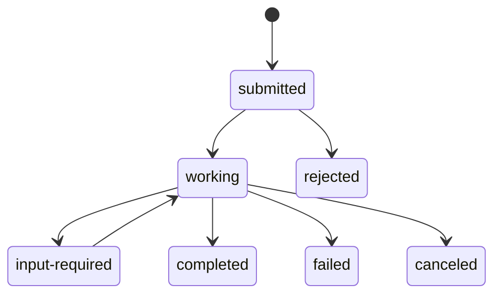
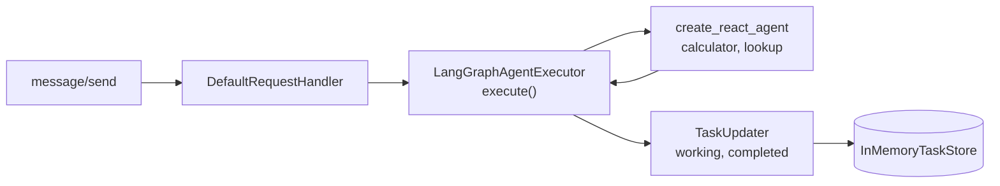

# M41.2 Theory: A LangGraph agent over A2A

*[M41 theory](../README.md) · Lesson 41.2 · Notebooks: [`02a_langgraph_agent_over_a2a.ipynb`](../../../../course/p11_agent_protocols/m41_a2a_protocol/notebooks/02a_langgraph_agent_over_a2a.ipynb) · [All theory pages](../../../README.md)*

## Tasks & messages

A2A has two reply shapes, and the executor decides which one a caller gets:

| Reply | When the executor produces it | Where the answer is | Can the client poll it? |
|---|---|---|---|
| Message (`"kind": "message"`) | It enqueues one agent message and nothing else, as the echo agent in 41.1 does | `result.parts` | No: `tasks/get` answers -32001, Task not found |
| Task (`"kind": "task"`) | It enqueues a Task, then status updates through a `TaskUpdater`, as notebook 41.2 does | `result.status.message`, plus `artifacts` if the agent publishes any | Yes, by its `id`, for as long as the task store keeps it |

A Message suits a one-shot answer. A Task suits anything that takes time, can fail halfway, or needs another turn from the caller.

**The lifecycle.** `TaskState` in 0.3.26 has nine values. The SDK treats four as terminal (`completed`, `failed`, `canceled`, `rejected`): `TaskUpdater` marks their update `final` and refuses any update after one, and `tasks/cancel` on a terminal task answers -32002. Two are interrupted states, where the task waits for the caller: `input-required` and `auth-required`. The caller continues such a task by sending a message with the same `taskId`; a message aimed at a terminal task gets error -32602 (the task is in terminal state), so a follow-up question starts a new task in the same `contextId`.

The diagram shows the paths these pages use; `auth-required` behaves like `input-required`, and `unknown` is the ninth value. Notebook 41.2's executor only ever walks `submitted`, `working`, then `completed` or `failed`.

The [interactive lab](interactive/a2a-exchange-lab.html) replays exchanges recorded from three agents served by `a2a-sdk` 0.3.26, each asked *Can I export my data after I cancel my plan?* The handbook agent has notebook 41.2's executor, with a stub that returns a fixed handbook answer where the notebook calls the LangGraph graph. Its four calls:

- **`message/send`** returns a Task in state `completed`. `history` holds the user turn and the working update; the 185-character answer is in `status.message`.
- **`message/stream`** returns three server-sent events: a `task` in `submitted`, a `status-update` to `working` with `"final": false`, and a `status-update` to `completed` with `"final": true`.
- **`tasks/get`** returns the same Task that `message/send` returned.
- **`tasks/cancel`** returns error -32002: the task cannot be canceled in state `completed`.

<!-- lab: interactive/a2a-exchange-lab.html -->

**When the graph fails.** Notebook 41.2's executor catches the exception, sets the task to `failed` with the error text, and then re-raises. The lab's third agent does the same with an index that is not loaded. A `message/send` caller gets JSON-RPC error -32603 whose message is the raw exception text, `vector index not loaded`, and no task id. A `message/stream` caller sees the task go to `failed`, and `tasks/get` with the streamed id returns the failed Task. An executor that sets `failed` and returns without re-raising gives the `message/send` caller a Task in state `failed` instead (checked against the same SDK), which the caller can handle like any other result, and the raw exception text stays out of a reply that may go to another team's agent.

## The executor seam

The A2A server never sees LangGraph. It calls one method, `AgentExecutor.execute(context, event_queue)`, and serialises whatever the method puts on the queue. Notebook 41.2's `LangGraphAgentExecutor` does five things:

1. Reads the text with `context.get_user_input()`.
2. Creates a Task with `new_task(context.message)` if the request did not continue one, and enqueues it.
3. Publishes `working` through a `TaskUpdater`, with a short agent message.
4. Runs `graph.invoke({"messages": [("user", text)]})` in `asyncio.to_thread`, since `invoke` blocks and the server's event loop must stay free.
5. Publishes `completed` with the last message's content, or `failed` on an exception.

`cancel()` raises `ServerError(error=UnsupportedOperationError())`, which reaches the caller as error -32004. Notebook 41.3's executors use `await agent.ainvoke(...)` instead of a thread; either keeps the loop free.

The card advertises two skills, `calculator` and `lookup`, one per tool of the ReAct agent, and `streaming=True`. Streaming here means task events: the graph's `invoke` returns once, so a stream carries the three events in the lab and no partial tokens. To stream tokens, the executor would iterate the graph's own stream and publish each chunk as an artifact update or a `working` message.

The notebook builds the graph with `langgraph.prebuilt.create_react_agent`. The installed langgraph 1.2.18 marks it deprecated in favour of `langchain.agents.create_agent` ([M24](../../../p08_agent_foundations/m24_react_agents/README.md)); it still runs, and the executor would wrap either one the same way.

## Check yourself

1. When should an A2A executor reply with a Task rather than a Message?

When the work takes time, can fail halfway, or needs another turn from the caller. A Task can be polled by its `id` for as long as the task store keeps it, and it moves through states; a Message suits a one-shot answer, and `tasks/get` on it answers -32001.

2. After the handbook agent's task reaches completed, the caller wants to ask a follow-up. Can it send the message with the same taskId?

No. `completed` is terminal, and a message aimed at a terminal task gets error -32602, so the follow-up starts a new task in the same `contextId`. Only a task in an interrupted state, `input-required` or `auth-required`, continues with the same `taskId`.

3. With the index not loaded, a message/send caller gets error -32603 carrying the raw exception text and no task id. What causes this, and what is better?

Notebook 41.2's executor sets the task to `failed` and then re-raises, which turns the failure into a JSON-RPC error. Set `failed` and return without re-raising: the caller gets a Task in state `failed`, handles it like any other result, and the raw exception text stays out of a reply that may go to another team's agent.

---
*Previous: [41.1 A2A basics: Agent Cards, tasks, messages](../01_a2a_basics_agent_cards_tasks_messages/README.md). Next: [41.3 Cross-framework agent interop](../03_cross_framework_agent_interop/README.md).*
