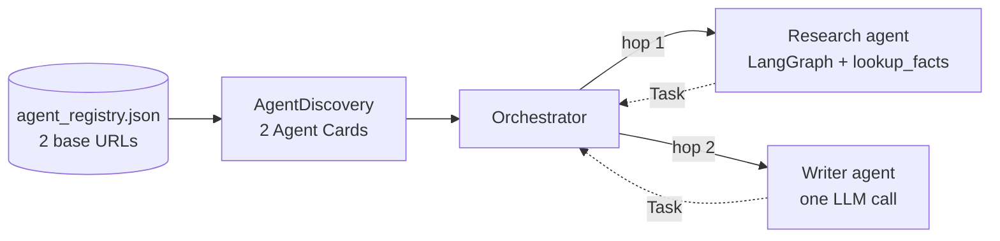

# M41.3 Theory: Cross-framework agent interop

*[M41 theory](../README.md) · Lesson 41.3 · Notebooks: [`03a_cross_framework_agent_interop.ipynb`](../../../../course/p11_agent_protocols/m41_a2a_protocol/notebooks/03a_cross_framework_agent_interop.ipynb) · [All theory pages](../../../README.md)*

## Cross-framework interop

Notebook 41.3 serves two agents that share no code. The research agent is a LangGraph ReAct agent with one tool, `lookup_facts`, on port 10101. The writer agent is a single `get_llm(temperature=0.7).invoke(...)` call behind a copywriter prompt, with no graph and no tools, on port 10102. Each has its own `AgentExecutor` and its own Agent Card. An orchestrator reads a registry file listing the two base URLs, fetches both cards, sends a topic to the research agent (hop 1) and passes the research agent's output to the writer agent (hop 2).


<!-- animated: diagrams/two-hop.anim.html -->

The two agents agree on four things: the card's shape, the `message/send` method, the Message and Task objects, and the well-known card path. They differ in everything else (framework, prompt, tools, temperature), and the orchestrator imports none of it. Replace the writer's single call with a CrewAI crew or a Google ADK agent, keep the card and the reply shape, and the orchestrator does not change.

On Larkspur Cloud the same layout is a support desk orchestrator, the handbook agent (the M28 to M31 agentic RAG graph, in LangGraph) as hop 1, and a reply drafter that turns the handbook answer into a customer email as hop 2. The drafter's team can pick any framework.

**Discovery from a registry.** The registry holds URLs only. Capabilities come from each card at run time, so a new agent joins by adding one URL, and a changed skill shows up without an orchestrator release. The notebook picks cards by `card.name`. Picking by skill (`id` or `tags`) survives a rename and lets two agents offer the same skill. The registry itself is a trust list: only agents on it get your traffic.

## Reading the reply

The orchestrator talks to both agents through an `AgentConnector` with one method, `send_task(message, session_id)`. Its reading of the reply decides what hop 2 receives:

```python
result = response.root.result
if hasattr(result, "parts"):          # a Message
    return "\n".join(part.root.text for part in result.parts if hasattr(part.root, "text"))
return str(result)                    # a Task object; fall back to its string representation
```

Both executors in the notebook enqueue a Task before their answer, so every reply is a Task, and a Task has no `parts`. The connector returns `str(result)`, the Python repr of the whole Task, and the orchestrator forwards that to the writer. The [interactive lab](../02_a_langgraph_agent_over_a2a/interactive/a2a-exchange-lab.html) shows it with the handbook agent: the repr is 1,492 characters of `context_id=…`, `history=[Message(…)]` and `TaskStatus(…)`, around a 185-character answer. Running the notebook's own `AgentConnector` cell against the same server returns the same 1,492 characters. The writer, told to synthesise research notes, receives Pydantic field names as its notes.

Two more paths in the same connector:

- **An error reply.** When the agent fails, `response.root` is a `JSONRPCErrorResponse`, which has no `result`. The `AttributeError` lands in the connector's `except`, and `send_task` returns the string `Error communicating with agent: 'JSONRPCErrorResponse' object has no attribute 'result'`, which the orchestrator passes to the writer as research notes.
- **The session.** `send_task` takes a `session_id` and never sends it, so each hop gets a fresh `contextId`. To keep the two hops in one conversation, set `context_id` on the outgoing `Message`; the server then files the new task under that context.

A reader that checks for an error first and then branches on the reply's kind fixes the first two:

```python
root = response.root
if hasattr(root, "error"):
    raise RuntimeError(f"A2A error {root.error.code}: {root.error.message}")
result = root.result
message = result if result.kind == "message" else result.status.message
if result.kind == "task" and result.status.state != "completed":
    raise RuntimeError(f"task {result.id} ended in {result.status.state}")
return "\n".join(p.root.text for p in message.parts if p.root.kind == "text")
```

An agent that publishes its output as artifacts (`TaskUpdater.add_artifact`) puts it in `result.artifacts` instead; read those the same way.

## Check yourself

<details>
<summary>1. What must the research and writer agents agree on for one orchestrator to call both, and what may differ?</summary>

Four things: the card's shape, the `message/send` method, the Message and Task objects, and the well-known card path. Framework, prompt, tools and temperature may all differ, and the orchestrator imports none of them, so a CrewAI crew could replace the writer without an orchestrator change.

</details>

<details>
<summary>2. The writer agent receives 1,492 characters of field names and TaskStatus text instead of research notes. What went wrong in the connector?</summary>

Both executors enqueue a Task, and a Task has no `parts`, so `AgentConnector` falls through to `str(result)`, the Python repr of the whole Task around a 185-character answer. Check for an error first, then branch on `result.kind` and read the text parts of `result.status.message` for a task.

</details>

<details>
<summary>3. Why pick agents from the registry by skill id or tags rather than by card name, as the notebook does?</summary>

Picking by skill survives a rename and lets two agents offer the same skill. The registry holds URLs only and capabilities come from each card at run time, so a new agent joins by adding one URL. The registry is also a trust list: only agents on it get your traffic.

</details>

---
*Previous: [41.2 A LangGraph agent over A2A](../02_a_langgraph_agent_over_a2a/README.md). Next: [41.4 Capstone: agentic RAG with MCP and A2A](../04_capstone_agentic_rag_with_mcp_and_a2a/README.md).*
