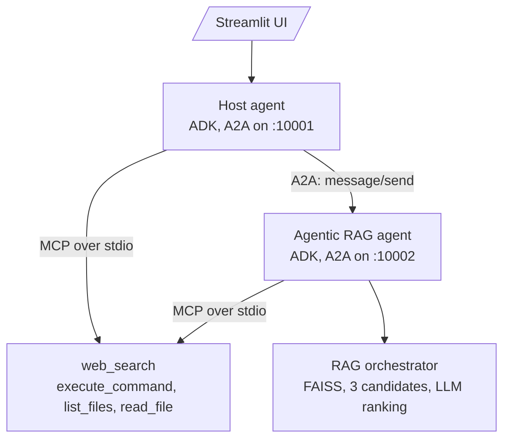

# M41.4 Theory: Capstone: agentic RAG with MCP and A2A

*[M41 theory](../README.md) · Lesson 41.4 · Notebooks: [`mcp_a2a_agentic_rag`](../../../../course/p11_agent_protocols/m41_a2a_protocol/projects/mcp_a2a_agentic_rag/README.md) (project) · [All theory pages](../../../README.md)*

## MCP + A2A

The capstone project runs two Google ADK agents, each behind its own A2A server, and gives both of them MCP tools. It runs in its own environment (its `requirements.txt`), with a Gemini model (`gemini-2.0-flash-exp` in `model.py`) and a Streamlit UI.

| | MCP | A2A |
|---|---|---|
| Connects | An agent to tools and data | An agent to another agent |
| In the capstone | `mcp_config.json` starts two servers as subprocesses over stdio: `web_search` (SerpAPI) and `terminal` (`execute_command` from an allow-list, `list_files`, `read_file`) | The host reads `agent_registry.json` (one URL, `http://localhost:10002`), fetches the RAG agent's card and delegates to it |
| The caller gets | A tool result, which its own model reasons over | An answer from an agent with its own model, tools and state |
| Lifetime | One call | A Task, with states, that can be polled, streamed or canceled |

The host is an orchestrator, as in 41.3, with four function tools (`_list_agents`, `_delegate_task`, `_smart_delegate_to_rag`, `_get_model_info`) next to the MCP toolsets. It does not always ask its model where to send a question. `_is_document_question` checks the text for keywords such as `resume`, `pdf`, `document` or `tell me about`, and on a match the host calls the RAG agent directly. Keyword routing is fast and predictable, and it misroutes: *tell me about today's AWS outage* goes to the document agent, though only the web can answer it.

The RAG agent splits a PDF into 500-token chunks (tiktoken `cl100k_base`) with 50 tokens of overlap, indexes them in a FAISS `IndexFlatL2`, and answers with multi-candidate retrieval: it adds Gaussian noise (standard deviation 0.01) to the query embedding three times, takes the top 5 chunks for each, answers all three candidate sets in parallel, and asks the model to pick the best answer. That is the agentic RAG of M28 to M32, now behind an A2A card instead of inside one graph.

On Larkspur Cloud, the host is the support desk, the RAG agent holds the handbook, and the MCP web search answers what the handbook cannot. A question like *Can I export my data after I cancel my plan?* goes over A2A to the handbook agent; *Is the Frankfurt region down right now?* goes to a tool over MCP.

## What the capstone needs to run

The project's A2A connector was written against an older `a2a-sdk` API, which notebook 41.3 also points out, and two of its paths fail without raising. Both are fixes for the source repository (see `CLAUDE.md`), listed here so the symptoms make sense:

- **The A2A hop.** `utilities/a2a/agent_connect.py` builds `A2AClient(base_url=self.agent_card.base_url, ...)` and calls `client.send_request(...)`. In `a2a-sdk` 0.3.26 `AgentCard` has no `base_url`, and `A2AClient` takes `agent_card` or `url` and has `send_message` but no `send_request`. Run against 0.3.26, `send_task` returns the string `Error communicating with agent: 'AgentCard' object has no attribute 'base_url'`, and the host passes that string on as the RAG agent's answer: to its model through `_delegate_task`, or, for a keyword-routed question, straight to the user. Notebook 41.3's connector uses the current API; combine it with the reader from [41.3](../03_cross_framework_agent_interop/README.md#reading-the-reply).
- **The RAG agent's own web search.** Besides the MCP tools ADK loads, `rag_orchestrator.py` has a `WebSearchAgent` that posts a JSON-RPC request with method `search` to `http://localhost:8000` (or `MCP_ENDPOINT`). Nothing in the project listens there, and `search` is not an MCP method (MCP calls a tool with `tools/call`). When the decision prompt asks for a web search, the final prompt receives `[WebSearchAgent] Failed to obtain web data.` as its web context.

Two smaller points: `pyproject.toml` lists `a2a-python` where `requirements.txt` lists `a2a-sdk>=0.3.0`, and the web search server logs the first ten characters of `SERPAPI_KEY` at startup, so its log is not safe to share.

A smoke test that sends one golden question through the host and checks that the reply contains handbook text, not `Error communicating`, catches the first failure on the first run.

---
*Previous: [41.3 Cross-framework agent interop](../03_cross_framework_agent_interop/README.md). Next: [M41 interview questions](../README.md#interview-spotlight-5-questions-you-might-get-asked).*
