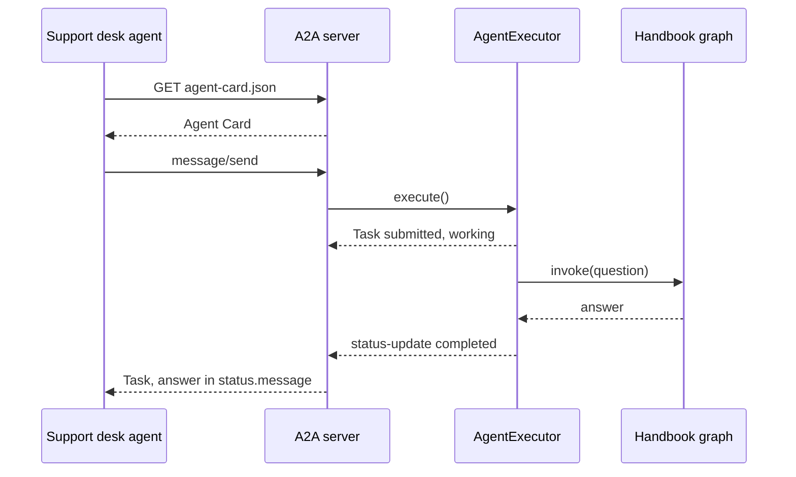

# M41 Theory: A2A: Agent-to-Agent Protocol

*Part XI · Agent Protocols: MCP & A2A · [Module README](../../../course/p11_agent_protocols/m41_a2a_protocol/README.md) · [All theory pages](../../README.md)*

MCP gives one agent a standard way to call tools. A2A gives agents a standard way to call each other over HTTP, whatever framework each one is built with. The M41 notebooks build on four ideas: the Agent Card a server publishes so callers can find it, the Task and Message objects that carry the work, agents from different frameworks talking only through that contract, and a system that uses MCP for tools and A2A between agents. Each idea has a page in the folder of the lesson that teaches it, listed under [Lessons](#lessons). This page has the overview, the interview questions and the takeaways.

The running example is Larkspur Cloud, the fictional cloud host whose handbook runs through M11 to M13. Its handbook agent, the agentic RAG graph from M28 to M31, becomes a service: it publishes an Agent Card and answers over A2A, and the support desk agent, built in another framework, calls it. The lab asks every agent the M11 golden question *Can I export my data after I cancel my plan?* All protocol details on these pages come from the installed `a2a-sdk` 0.3.26 (the `protocols` uv group) or from the notebooks.

## TL;DR

- An Agent Card is a JSON document at `/.well-known/agent-card.json`: name, URL, version, `capabilities` such as `streaming`, and `skills`. The client reads it before sending anything. In 0.3.26 the notebooks' path `/.well-known/agent.json` still answers, with a deprecation warning in the server log.
- Work travels as JSON-RPC 2.0 over HTTP: `message/send`, `message/stream`, `tasks/get`, `tasks/cancel`. The reply is either a Message (a one-shot answer) or a Task with a state such as `working` or `completed`.
- On the server, the only code you write is an `AgentExecutor`. The LangGraph graph, a plain LLM call or a Google ADK agent behind it is invisible to the caller.
- A Task keeps its answer in `status.message`. In the lab, a client that reads `result.parts` the way notebook 41.3's connector does forwards 1,492 characters of Python repr to the next agent instead of the 185-character answer.
- MCP and A2A sit at different layers: the capstone's host agent loads its tools over MCP (stdio) and delegates documents to the RAG agent over A2A (HTTP).

## Mental model

<!-- animated: diagrams/handshake.anim.html -->

The caller sees two things: a card and a stream of task events. Everything to the right of the A2A server, the executor and the graph, can be rewritten in another framework without the caller changing a line, as long as the card and the task events stay the same.

## Lessons

| Lesson | Topic | Theory |
|---|---|---|
| 41.1 | A2A basics: Agent Cards, tasks, messages | [Agent Card](01_a2a_basics_agent_cards_tasks_messages/README.md#agent-card) [From discovery to reply](01_a2a_basics_agent_cards_tasks_messages/README.md#from-discovery-to-reply) |
| 41.2 | A LangGraph agent over A2A | [Tasks & messages](02_a_langgraph_agent_over_a2a/README.md#tasks--messages) [The executor seam](02_a_langgraph_agent_over_a2a/README.md#the-executor-seam) |
| 41.3 | Cross-framework agent interop | [Cross-framework interop](03_cross_framework_agent_interop/README.md#cross-framework-interop) [Reading the reply](03_cross_framework_agent_interop/README.md#reading-the-reply) |
| 41.4 | Capstone: agentic RAG with MCP and A2A | [MCP + A2A](04_capstone_agentic_rag_with_mcp_and_a2a/README.md#mcp--a2a) [What the capstone needs to run](04_capstone_agentic_rag_with_mcp_and_a2a/README.md#what-the-capstone-needs-to-run) |

## Interactive lab

[**What comes back over A2A**](02_a_langgraph_agent_over_a2a/interactive/a2a-exchange-lab.html): open the file in a browser. Pick *Handbook agent (41.2)* and `message/send`, then switch the reader from `result.parts` to `status.message` and watch the forwarded text drop from 1,492 characters to 185. Then pick *Echo agent (41.1)* and `tasks/get`: the reply had a task id, and the server still answers -32001 Task not found. Last, pick *Handbook agent, index missing* and compare `message/send`, which returns only an error, with `message/stream`, which shows the task fail.

## How it connects

- **Before:** [M24](../../p08_agent_foundations/m24_react_agents/README.md) builds the ReAct agents that notebooks 41.2 and 41.3 put behind A2A. [M31](../../p09_agentic_rag/m31_rag_as_agent_tool/README.md) turns retrieval into an agent's tool; here the whole agent becomes a service. [M35](../../p10_memory_and_multi_agent/m35_multi_agent_architectures/README.md) teaches [supervisors](../../p10_memory_and_multi_agent/m35_multi_agent_architectures/04_supervisors_and_hierarchical_teams/README.md#supervisor) and [handoffs](../../p10_memory_and_multi_agent/m35_multi_agent_architectures/05_handoffs_and_swarms/README.md#handoffs) inside one process; A2A is how a supervisor reaches a worker that runs in another process, team or framework. [M40](../m40_mcp_applications/README.md) serves retrieval as an MCP tool, the other way to share a RAG system.
- **Next:** [M42](../../p12_hierarchical_and_graph_rag/m42_hierarchical_memory_rag/README.md) to M44 return to retrieval itself: hierarchical indexes, memory-augmented retrieval and knowledge graphs. Any of them can sit behind the same A2A executor.

## Interview Spotlight: 5 Questions You Might Get Asked

*Production questions in the style of OpenAI, Anthropic and Google interviews for applied AI roles.*

### 1. Larkspur's support desk agent calls the handbook agent over A2A, then passes the reply to a writer agent. Customers start getting answers that quote `context_id=` and `TaskStatus(`. Nothing errored. Where do you look?

**What a strong answer covers:**
- Logs the raw JSON-RPC response from the handbook agent and checks `result.kind`: the agent now returns a Task, where it used to return a Message
- Finds the connector that reads `result.parts` and falls back to `str(result)` for a Task; the answer is in `status.message` (or in `artifacts`, if the agent publishes them)
- Fixes the reader to branch on `kind`, and fails loudly on a kind it does not know rather than stringifying it
- Adds a contract test that runs the client against both reply shapes, so a change on the server side is caught before customers see it

### 2. The platform team wants every Larkspur team to reach the handbook RAG system. One proposal is an MCP tool `handbook_search`; the other is an A2A agent `larkspur_handbook_agent`. Which do you ship?

**What a strong answer covers:**
- An MCP tool returns chunks and leaves reasoning to the caller's model; an A2A agent returns an answer from a system that owns retrieval, grading and rewriting
- Callers that need citations, their own prompt or their own reranker are better served by the tool; callers that want an answer and a task they can poll are better served by the agent
- A2A adds a task lifecycle, streaming and cancellation, and costs a second model loop per question
- The two can coexist: the agent behind A2A, with its retriever exposed as an MCP tool for callers that want raw chunks

### 3. The handbook agent runs behind A2A in production. What do you measure, and what alerts you that it is degrading?

**What a strong answer covers:**
- Counts tasks by final state (`completed`, `failed`, `canceled`, `rejected`) and JSON-RPC error codes per caller and per skill
- Measures time to the first `working` update and time to `completed`, separately from the graph's own latency
- Watches tasks stuck in `working` and tasks lost on restart, since an `InMemoryTaskStore` keeps nothing across a deploy
- Alerts when the Agent Card changes (version, skills, `streaming`) without a matching client release, and replays the golden questions through A2A after every deploy

### 4. Re-indexing the handbook takes 20 minutes, and the support desk triggers it through the handbook agent over `message/send`. Calls time out, and some re-index twice. How do you redesign the exchange?

**What a strong answer covers:**
- Has the client send with `configuration.blocking` set to false, which returns the Task at once in `submitted`, then poll `tasks/get` or subscribe with `message/stream`, instead of holding one HTTP request open for 20 minutes
- Uses push notifications (`capabilities.push_notifications`, `tasks/pushNotificationConfig/set`) when the client cannot hold a stream
- Makes the trigger idempotent per handbook version, so a retried send does not start a second re-index
- Persists tasks in a durable store and implements `cancel()`, since a cancel on a finished task answers -32002 and a lost task answers -32001

### 5. A partner company wants its booking agent to call Larkspur's handbook agent. The Agent Card is public. What do you check before you open it up?

**What a strong answer covers:**
- Declares authentication in the card (`security_schemes`, `security`) and keeps internal skills on the authenticated extended card (`supports_authenticated_extended_card`)
- Treats every incoming message as untrusted input: the partner's agent can carry prompt injection into the handbook agent's model
- Treats every reply from a remote agent as untrusted too, before it reaches a tool call or a customer
- Rate-limits and logs per caller, and scopes the skills a partner sees to what its contract covers

## Key Takeaways

- Publish an Agent Card and let clients discover it; hard-code a base URL, never a list of skills.
- Read replies by kind: a Message has `parts`, a Task has `status.message` and `artifacts`. Never forward `str()` of a protocol object.
- Keep the A2A code in one `AgentExecutor` and keep the agent behind it framework-specific. That boundary is what lets you swap LangGraph for anything else.
- Use MCP for tools and data, A2A for agents. A system needs both once one agent's answer depends on another team's agent.

---
*Previous: [M40 MCP Applications & RAG over MCP](../m40_mcp_applications/README.md). Next: [M42 Hierarchical & Memory-Augmented Retrieval](../../p12_hierarchical_and_graph_rag/m42_hierarchical_memory_rag/README.md).*
