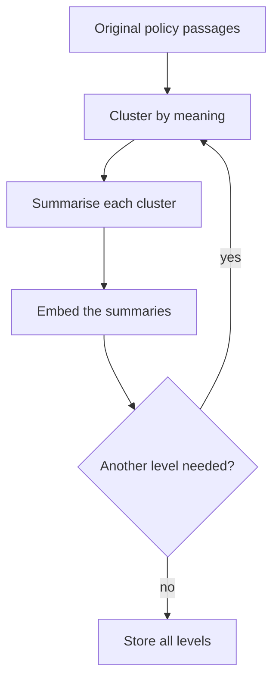
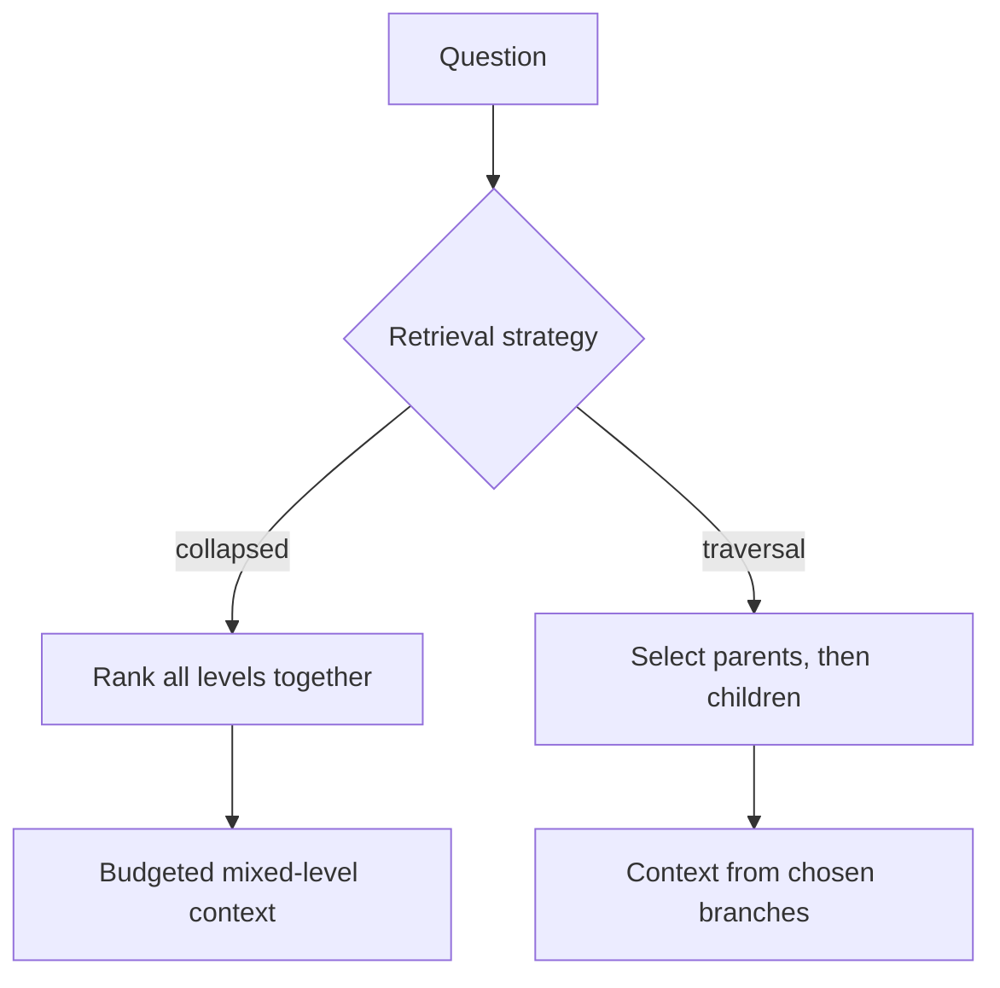

# M42.1 Theory: RAPTOR: clustering and recursive summarisation

*[M42 theory](../README.md) · Lesson 42.1 · Notebooks: [`01a_raptor.ipynb`](../../../../course/p12_hierarchical_and_graph_rag/m42_hierarchical_memory_rag/notebooks/01a_raptor.ipynb) · [All theory pages](../../../README.md)*

## Abstraction levels

An original passage preserves local wording. A summary combines claims across passages, and a summary of summaries describes a broader theme. These representations answer different questions. For Larkspur, an export procedure answers where to click; a cancellation summary connects export, retention and billing; a handbook overview can describe continuity across cancellation and outages.

The RAPTOR notebook repeatedly calls `embed_texts`, clusters the embeddings with `GaussianMixture`, and passes each cluster's text to `summarize_texts`. `build_raptor_tree(texts, max_levels=3)` limits the recursion. The cluster count is `min(10, len(current_texts) // 2)`, and `fit_predict` assigns each item one cluster. That is a teaching simplification: the [RAPTOR paper](https://arxiv.org/html/2401.18059v1) describes soft clustering and distinguishes tree traversal from collapsed-tree querying.

Store a node's level, source identifiers, source versions and child identifiers alongside its text. A summary may be accurate overall while omitting the one exception a customer asks about. For a policy answer, follow the summary back to passages before quoting a condition or number.

The notebook's leaf metadata starts with `level`, `origin` and `parent_id`, but no `id`. Its summary `child_ids` are built with `meta.get('id')`, so first-level child references are missing. Do not treat this metadata as verified provenance. A single input item also makes the cluster-count expression zero; handle empty and singleton inputs before fitting a mixture model in a production implementation.

## Collapsed-tree retrieval

Collapsed-tree retrieval puts original passages and summary nodes in one searchable pool. Embed the question, score every eligible node, and select context within a budget. The chosen mix of levels can change with the question. A top-down traversal instead selects parents first, then searches their descendants; an early wrong branch can exclude a relevant leaf.

The notebook's `build_vectorstore` collects all levels and creates a FAISS store, which makes mixed-level search possible. Its later `hierarchical_retrieval` helper loops over levels and appends an `AND id:` string to the query. Appending text to an embedding query does not enforce a metadata filter or a parent-child join. Inspect the selected node identifiers and check filtering behaviour before calling that helper a constrained tree traversal. `LLMChainExtractor` then compresses retrieved documents, adding another transformation whose output needs source checks.

The [interactive lab](interactive/collapsed-tree-lab.html) isolates the effect of adding summary nodes. Its four fictional passages and three authored summaries use real TF-IDF cosine scoring, with one vocabulary fitted over the whole fixture for a controlled comparison. Leaf-only mode filters out summaries; collapsed mode searches all nodes. These summaries are labelled representative, and no clustering or LLM runs in the browser.

<!-- lab: interactive/collapsed-tree-lab.html -->

At a maximum of two nodes, the lab prints these results:

| Question | Candidate pool | Positive hits | Summary hits | Source identifiers reached | Context words |
|---|---|---|---|---|---|
| Service continuity | Leaves only | 1 | 0 | 1 | 16 |
| Service continuity | All levels | 2 | 2 | 4 | 24 |
| Export steps | Leaves only | 2 | 0 | 2 | 37 |
| Export steps | All levels | 2 | 0 | 2 | 37 |

The continuity query reaches more source identifiers through summaries. It has not retrieved the full source passages or demonstrated a better generated answer. For the export question, adding summary candidates leaves the selected context unchanged at this budget.

Move the result budget and inspect the ledger. The lab reports positive-score hits, summary hits, distinct source identifiers reached through those hits, and context words. Source coverage describes ancestry, not fact retention: a summary linked to both export and retention passages may still omit the exact deletion condition. The specific export question exposes that distinction beside the thematic question.

For the notebook lab, freeze the corpus and question set, then compare flat retrieval, recursive summaries and graph retrieval at the same final context budget. Record indexing calls separately from retrieval and generation calls. Test precise facts, cross-section comparisons, changed policies and questions that the corpus cannot answer.

## Check yourself

1. Why does collapsed-tree retrieval rank every level together instead of selecting parents first and then searching their children?

Ranking all levels in one pool lets the mix of passages and summaries change with the question. A top-down traversal commits to parents first, so an early wrong branch can exclude a relevant leaf. The notebook's `build_vectorstore` puts all levels in one FAISS store, which is what makes mixed-level search possible.

2. In the lab at a budget of two nodes, what changes when summaries join the pool for the service continuity question, and for the export steps question?

For continuity, positive hits rise from 1 to 2, both are summaries, and the source identifiers reached rise from 1 to 4, with context growing from 16 to 24 words. For export steps nothing changes: 2 hits, no summaries, 37 words. Reaching more source identifiers describes ancestry, not a better answer or retained facts.

3. A customer asks for the exact data-deletion condition, and the top hit is a summary linked to the retention passage. Can you quote the condition from the summary?

No. A summary can be accurate overall and still omit the exception the customer asks about, so follow it back to the source passages before quoting a condition or number. The notebook's first-level `child_ids` are missing, because its leaves have no `id`, so do not treat its metadata as verified provenance.

---
*Previous: [M42 overview](../README.md). Next: [42.2 MemoRAG: global memory and clue-guided retrieval](../02_memorag_global_memory_and_clue_guided_retrieval/README.md).*
