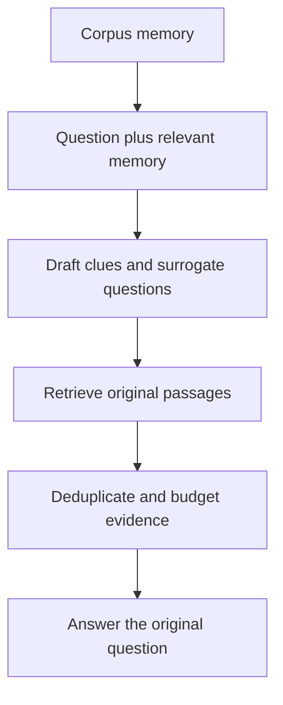

# M42.2 Theory: MemoRAG: global memory and clue-guided retrieval

*[M42 theory](../README.md) · Lesson 42.2 · Notebooks: [`02a_memorag.ipynb`](../../../../course/p12_hierarchical_and_graph_rag/m42_hierarchical_memory_rag/optional/02a_memorag.ipynb) (optional) · [All theory pages](../../../README.md)*

## Global memory

Corpus memory gives the retriever a view of the document collection before it searches for passages. For “How does Larkspur protect continuity?”, memory can suggest export, retention, availability and incident reports as clues. The final answer still needs source passages that support each claim.

The [MemoRAG paper](https://arxiv.org/html/2409.05591v2) uses a long-range memory model to form a compressed corpus representation and draft clues for retrieval. A clue can contain an incorrect detail. Its job is to locate evidence; the generator must check the retrieved material.

The optional notebook implements a smaller approximation. `MemoryStore.memorize` asks a chat model for JSON `topic` and `details` pairs, validates them with Pydantic, embeds the resulting text and stores it in FAISS. These are readable text records, not the model's attention key/value tensors. The prompt says it mimics KV-cache memory creation; distinguish that analogy from an actual compressed model cache.

At query time, `create_retrieval_queries` searches up to ten memory records, requests clue spans and surrogate questions, removes short candidates, and appends the original question. `process_query` retrieves three passages per query and deduplicates passage text before generating an answer. Each additional clue can add retrieval work and context; deduplication alone does not enforce a token budget.

| Stage | What to inspect | Failure to test |
|---|---|---|
| Memorise | Topic/detail records and parse failures | An exception lost during extraction |
| Find memory | Retrieved records and their source versions | Stale or irrelevant memory dominates |
| Generate clues | Exact clue text beside the original query | A plausible clue invents a product |
| Retrieve | Source identifiers, ranks and deduplication | Repeated clues crowd out another policy |
| Answer | Support for each claim | The generator repeats an unsupported clue |

The notebook's duplicate check uses `similarity_search("")` to obtain existing topics. A nearest-neighbour result is a subset, so this does not enumerate the whole store or establish uniqueness. Use an explicit topic registry or stable record identifiers when implementing updates. It also returns `None` when no memory exists, while `process_query` iterates the result; an empty-memory fallback should retrieve with the original question.

Treat memory as derived data with dependencies. When Larkspur changes retention rules, update the source index and regenerate memory entries derived from those passages. Shared memory must not expose restricted documents through its summaries or clues. Test deletions against both stored memory and generated answers.

The optional notebook loads a prebuilt FAISS memory store and uses paid model calls. Reading it establishes the implementation shape; it does not establish a measured advantage on the Larkspur questions. Report any comparison only after running both pipelines on the same question set and budget.

---
*Previous: [42.1 RAPTOR: clustering and recursive summarisation](../01_raptor_clustering_and_recursive_summarisation/README.md). Next: [42.3 LightRAG: low-level and high-level graph retrieval](../03_lightrag_low_level_and_high_level_graph_retrieval/README.md).*
