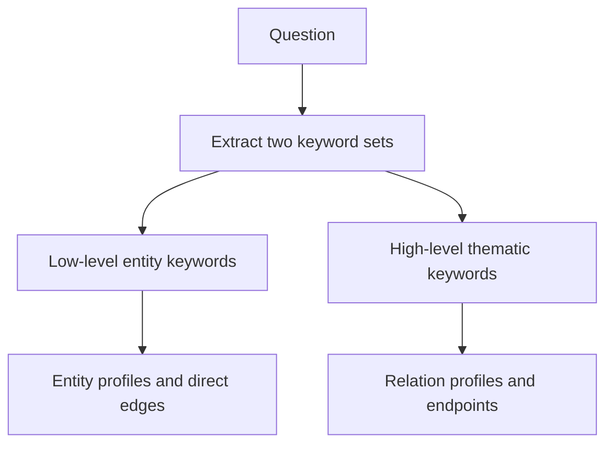

# M42.3 Theory: LightRAG: low-level and high-level graph retrieval

*[M42 theory](../README.md) · Lesson 42.3 · Notebooks: [`03a_light_rag.ipynb`](../../../../course/p12_hierarchical_and_graph_rag/m42_hierarchical_memory_rag/notebooks/03a_light_rag.ipynb) · [All theory pages](../../../README.md)*

## Dual-level retrieval

LightRAG searches for specific entities and broader relationships through separate routes. For “How does cancellation affect export?”, the low-level route can locate Cancellation and Export. The high-level route can locate a relationship profile about data portability. The two routes contribute evidence to one answer.

The [LightRAG paper](https://arxiv.org/html/2410.05779v3) describes graph indexing with entity and relationship profiles, dual-level retrieval and incremental integration of new material. High-level retrieval searches thematic relationships; it does not mean searching RAPTOR's upper summary levels or Microsoft GraphRAG community reports.

Combine these results with their source passages, deduplicate them and apply a context budget before generation. An edge description can help locate a policy, but it cannot replace the policy's qualifiers.

The notebook builds this mechanism directly with NetworkX, Pydantic extraction schemas and two FAISS indexes. It does not invoke the packaged LightRAG library. Its PDF splitter uses `chunk_size=1200` and `chunk_overlap=150`, then keeps the first twenty chunks for the demonstration. That cap limits the evidence available to every later graph query.

`GraphExtraction` returns entities and relationships. Entity names are normalised with `strip().lower()`. Node descriptions are merged; relationship descriptions and keywords are merged by endpoint pair. The graph is an undirected `nx.Graph`, so it cannot preserve a directed, typed multi-edge domain model without changes. Capitalisation and whitespace normalisation also cannot resolve two products with the same name.

| Route | Vector search target | Graph expansion | Source handling in the notebook |
|---|---|---|---|
| Low level | Entity profiles | Direct neighbours of selected entities | Adds passages recorded for the entity |
| High level | Relation profiles | Endpoint entities of selected relations | Adds passages recorded for the relation |

`lightrag_retrieve` defaults to four entity hits and four relation hits. Those are seed counts, not a bound on the final context: a high-degree entity can add many edges. The low-level expansion adds incident edges to `selected_edges`, but does not add all of those edges' source chunk identifiers to `relevant_chunks`. The returned relationship block can therefore contain an assertion whose source passage is absent. Join source identifiers for every selected assertion and test that invariant before relying on the answer's provenance.

For Larkspur, preserve separate product identifiers, relation direction where it carries meaning, and source versions. Restrict graph expansion to authorised evidence. If a policy is withdrawn, recompute merged profiles as well as removing the source passage, since old wording can survive inside a node description.

To evaluate the two routes, run entity-only, relation-only and combined retrieval on the same precise and cross-section questions. Inspect answer support, source coverage and context size. Record extraction failures and indexing cost separately; a graph with plausible labels can still omit the relationship the question needs.

## Key Takeaways

- LightRAG runs two routes: low-level search over entity profiles and their direct edges, and high-level search over relation profiles and their endpoints. Both feed one budgeted context.
- Seed counts do not bound the final context, because a high-degree entity can add many edges. Join a source passage to every selected assertion.
- Merged profiles keep old wording after a source is removed. Recompute them when a policy is withdrawn, and keep separate identifiers for products that share a name.

## Check yourself

1. For the question How does cancellation affect export?, what does each LightRAG route search for?

The low-level route searches entity profiles for keywords such as Cancellation and Export, then expands to their direct edges. The high-level route searches relation profiles for themes such as data portability, then adds the endpoint entities. High-level here means thematic relationships, not RAPTOR's upper summary levels or GraphRAG community reports.

2. Larkspur withdraws a policy and removes its source passage from the index. Is the graph now clean?

No. Node and relationship descriptions are merged across passages, so the old wording can survive inside a profile. Recompute the merged profiles as well as removing the source passage.

3. A retrieved relationship block contains an assertion whose source passage is absent from the context. What in the notebook causes this?

The low-level expansion adds incident edges to `selected_edges` but does not add those edges' source chunk identifiers to `relevant_chunks`. Join source identifiers for every selected assertion, and test that invariant, before relying on the answer's provenance.

---
*Previous: [42.2 MemoRAG: global memory and clue-guided retrieval](../02_memorag_global_memory_and_clue_guided_retrieval/README.md). Next: [M42 interview questions](../README.md#interview-spotlight-5-questions-you-might-get-asked).*
