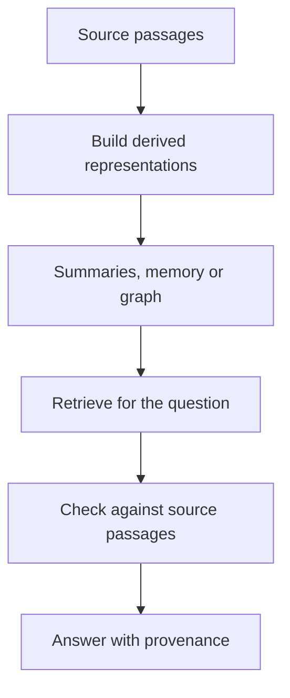

# M42 Theory: Hierarchical & Memory-Augmented Retrieval

*Part XII · Hierarchical, Memory & Graph RAG · [Module README](../../../course/p12_hierarchical_and_graph_rag/m42_hierarchical_memory_rag/README.md) · [All theory pages](../../README.md)*

A passage index finds local evidence. A question about the whole handbook may need a representation assembled from several passages before retrieval begins. The M42 notebooks build on four ideas: abstraction levels, collapsed-tree retrieval, global memory and dual-level retrieval. Each idea has a page in the folder of the lesson that teaches it, listed under [Lessons](#lessons). This page has the overview, the interview questions and the takeaways.

Larkspur Cloud's handbook supplies the running example. A customer asks how cancellation affects data access; an operations lead asks how the handbook manages service continuity. Both questions connect policies that live in separate sections. Source passages still decide what the answer may claim.

## TL;DR

- RAPTOR adds summaries at several levels to the retrieval corpus. Preserve their links to the passages they summarise.
- Collapsed-tree retrieval ranks leaves and summaries together. Tree traversal chooses a route through parent-child links; these are different retrieval algorithms.
- MemoRAG uses corpus memory to draft retrieval clues. Verify those clues against retrieved evidence before answering.
- LightRAG separates entity-focused retrieval from retrieval over thematic relationships, then assembles graph context and source passages.
- The lab uses four authored source passages and three representative summaries. At a two-node budget, the continuity query reaches one source identifier with leaves only and four through summary ancestry. These are fixture retrieval counts, not algorithm benchmark results.

## Mental model

<!-- animated: diagrams/representations.anim.html -->

Derived representations can make distributed evidence easier to find. They also introduce another place to lose an exception, merge unrelated entities or preserve a deleted policy. Keep source identifiers and versions through every transformation so a retrieved summary can lead back to its evidence.

## Lessons

| Lesson | Topic | Theory |
|---|---|---|
| 42.1 | RAPTOR: clustering and recursive summarisation | [Abstraction levels](01_raptor_clustering_and_recursive_summarisation/README.md#abstraction-levels) [Collapsed-tree retrieval](01_raptor_clustering_and_recursive_summarisation/README.md#collapsed-tree-retrieval) |
| 42.2 | MemoRAG: global memory and clue-guided retrieval | [Global memory](02_memorag_global_memory_and_clue_guided_retrieval/README.md#global-memory) |
| 42.3 | LightRAG: low-level and high-level graph retrieval | [Dual-level retrieval](03_lightrag_low_level_and_high_level_graph_retrieval/README.md#dual-level-retrieval) |

## Interactive lab

[**Search the leaves or the whole tree**](01_raptor_clustering_and_recursive_summarisation/interactive/collapsed-tree-lab.html): open the file in a browser. Compare the thematic question in leaf-only and collapsed modes. Move the result budget and inspect which summary or source passage enters the context. Switch to the specific export question and check whether a broad summary displaces the precise evidence.

## How it connects

- **Before:** [M11](../../p04_rag_foundations/m11_rag_lifecycle/README.md) establishes the flat retrieval baseline. [M33](../../p10_memory_and_multi_agent/m33_conversational_memory_rag/README.md) and [M34](../../p10_memory_and_multi_agent/m34_long_term_agentic_memory/README.md) cover conversational and persistent agent memory; this module's memory represents a document corpus.
- **Next:** [M43](../m43_knowledge_graphs_neo4j/README.md) makes graph modelling and queries explicit. [M44](../m44_graphrag/README.md) compares graph traversal, community reports and graph expansion.

## Interview Spotlight: 5 Questions You Might Get Asked

*Production questions in the style of OpenAI, Anthropic and Google interviews for applied AI roles.*

### 1. Larkspur's assistant says cancelled accounts lose data immediately, although the source passage describes a retention window. The retrieved summary omits that window. How do you debug it?

**What a strong answer covers:**
- Trace the summary to the exact source version and inspect whether summarisation dropped the exception
- Inspect both the summary rank and the source passage rank before changing the answering prompt
- Retrieve source evidence for precise policy claims and flag unsupported summary assertions
- Add the cancellation question to the golden set and rebuild affected summary ancestors

### 2. Operations asks for themes across the handbook, while support asks exact policy questions. Would you force both through top-down tree traversal?

**What a strong answer covers:**
- Compare traversal with collapsed search on both question types under the same context budget
- Check whether choosing one high-level parent excludes a needed leaf early
- Retain precise passages when summaries lack the required condition or number
- Report indexing work and per-query quality separately instead of assuming a tree is faster

### 3. A new memory-assisted retriever returns fluent clues about a service Larkspur no longer sells. What should you monitor?

**What a strong answer covers:**
- Log memory version, generated clues, retrieved source identifiers and final citations
- Measure evidence recall and answer support separately from clue fluency
- Invalidate derived memory when its source documents change or are deleted
- Compare against original-query retrieval and fall back when clues find no supported evidence

### 4. Larkspur has two products with the same short name. Entity extraction merges them and connects the wrong cancellation rule. How should the graph change?

**What a strong answer covers:**
- Use stable identifiers and product context instead of case-normalised names alone
- Keep relation direction, qualifiers and source identifiers when the domain requires them
- Inspect extracted assertions against passages before accepting a merge
- Rebuild affected profiles and test an ambiguous-name query after the correction

### 5. A private incident report is deleted, but a global handbook summary still mentions it. What must deletion remove?

**What a strong answer covers:**
- Follow dependency links through summaries, memory entries, graph descriptions and vector indexes
- Remove or regenerate derived text that contains the report's information
- Apply access controls before derived evidence is exposed, including shared summaries
- Verify with a deletion regression query and inspect stored representations as well as the answer

## Key Takeaways

- Choose a representation for the information need and compare it against the flat baseline.
- A summary's source coverage does not prove that every source fact survived compression.
- Distinguish a paper's algorithm from the simplified implementation in its teaching notebook.
- Measure retrieval, source support, update work and generation quality separately.

---
*Previous: [M41 A2A: Agent-to-Agent Protocol](../../p11_agent_protocols/m41_a2a_protocol/README.md). Next: [M43 Knowledge Graphs with Neo4j](../m43_knowledge_graphs_neo4j/README.md).*
