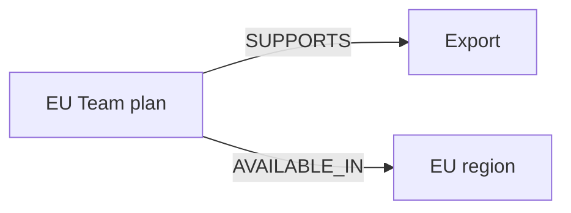

# M43.1 Theory: Graph fundamentals and Cypher

*[M43 theory](../README.md) · Lesson 43.1 · Notebooks: [`01a_kg_simple.ipynb`](../../../../course/p12_hierarchical_and_graph_rag/m43_knowledge_graphs_neo4j/notebooks/01a_kg_simple.ipynb) · [All theory pages](../../../README.md)*

## Nodes, edges, properties

A property graph stores entities as nodes, typed directed relationships between them, and attributes on either. Larkspur can represent a plan as `(:Plan {id: "eu-team"})`, an export capability as `(:Feature {id: "export"})`, and their connection as `(:Plan)-[:SUPPORTS]->(:Feature)`. The plan's display name is a property; its stable identifier determines which entity it is.

Direction encodes meaning. `Plan SUPPORTS Feature` permits a different question from `Feature DEPENDS_ON Service`. Choosing relationship types is part of modelling the handbook, before any retrieval algorithm runs. A graph answers only relationships you stored or can derive from them; an absent edge can mean missing extraction rather than a false claim.



The introductory notebook creates a `Person` and related subjects, prizes and countries with `MERGE`, then queries the named relationship types. Its small example teaches the same modelling decision: choose labels, identity properties and edge directions before asking a question. Keep Larkspur's invented teaching fixture separate from the notebook's example facts.

## Cypher

Cypher binds variables to matching graph patterns. To ask which Larkspur plans support exports in the EU, bind the same `p` in both patterns:

```cypher
MATCH (p:Plan)-[:SUPPORTS]->(:Feature {id: $feature}),
      (p)-[:AVAILABLE_IN]->(:Region {id: $region})
RETURN DISTINCT p.id AS plan
ORDER BY plan
```

Pass `feature="export"` and `region="eu"` as parameters. Reusing `p` requires one plan to satisfy both facts. Independent plan variables would admit unrelated matches. `DISTINCT` removes repeated result rows; it does not repair duplicate entity identities in storage.

The notebook uses `GraphDatabase.driver`, sessions, `session.execute_write` and `session.run`. Keep a driver open for its intended lifetime, consume query results while their session is open, and close it when finished. Some notebook helper functions close the shared driver in `finally`; running cells out of order can therefore require recreating it.

For diagnosis, inspect the returned paths and their source facts before asking a model to phrase the result. A fluent answer cannot supply a relationship the query failed to match.

## Key Takeaways

- A property graph stores entities as nodes, typed directed relationships and properties on both. Choose labels, identity keys and edge directions before asking any question.
- A graph answers only the relationships you stored or can derive. An absent edge may mean extraction missed it, not that the claim is false.
- In Cypher, reuse one variable when one entity must satisfy several patterns, and pass values as parameters. `DISTINCT` hides repeated rows but does not fix duplicate entities.

## Check yourself

<details>
<summary>1. Why are relationship types and directions modelling decisions, and what can it mean when an expected edge is absent?</summary>

Direction encodes meaning: `Plan SUPPORTS Feature` permits a different question from `Feature DEPENDS_ON Service`, so you choose types before any retrieval runs. A graph answers only relationships you stored or can derive from them. An absent edge can mean the extraction missed it, not that the claim is false.

</details>

<details>
<summary>2. The EU export query reuses one variable p in both patterns. What goes wrong if each pattern binds its own plan variable?</summary>

Reusing `p` requires one plan to satisfy both facts: it supports export and it is available in the EU. Independent variables admit unrelated matches, such as one plan with export and another plan in the EU region. `DISTINCT` only removes repeated rows; it does not repair duplicate entity identities.

</details>

<details>
<summary>3. A model-phrased answer says no plan supports export in the EU, and you expected one. What do you inspect before the wording?</summary>

The returned paths and their source facts. A fluent answer cannot supply a relationship the query failed to match, so check whether the pattern matched the stored labels, directions and identifiers before asking a model to phrase the result.

</details>

---
*Previous: [M43 overview](../README.md). Next: [43.2 From CSV to knowledge graph](../02_from_csv_to_knowledge_graph/README.md).*
