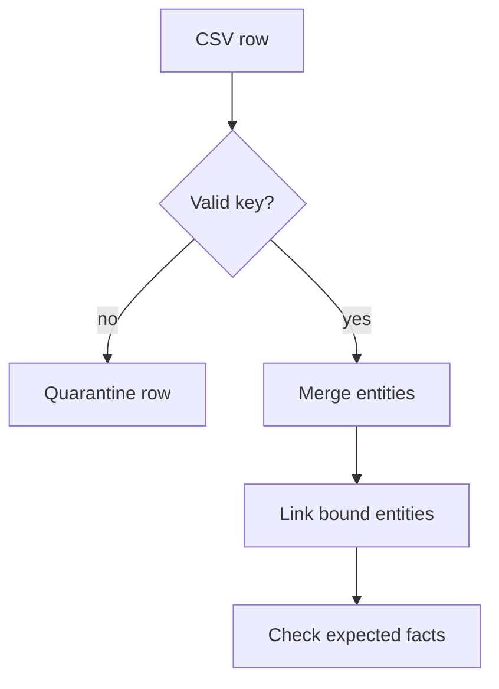

# M43.2 Theory: From CSV to knowledge graph

*[M43 theory](../README.md) · Lesson 43.2 · Notebooks: [`02a_healthcare_kg.ipynb`](../../../../course/p12_hierarchical_and_graph_rag/m43_knowledge_graphs_neo4j/notebooks/02a_healthcare_kg.ipynb) · [All theory pages](../../../README.md)*

## Identity before import

The healthcare notebook reads `healthcare.csv` with `csv.DictReader`, creates provider, patient, specialisation and location nodes, then links them with `TREATS`, `SPECIALIZES_IN` and `LOCATED_AT`. The Larkspur equivalent imports plans, features, regions and the source documents that assert their connections.

A repeated import should preserve identities when a description changes. The notebook merges a provider on both `name` and `bio`, and a patient on several attributes. If a bio changes, that entire property pattern no longer matches. Use a stable key for identity and update descriptive properties separately. Neo4j's [MERGE documentation](https://neo4j.com/docs/cypher-manual/current/clauses/merge/) explains full-pattern matching and uniqueness constraints.

```cypher
CREATE CONSTRAINT plan_id IF NOT EXISTS
FOR (p:Plan) REQUIRE p.id IS UNIQUE;
```

In a separate import query:

```cypher
MERGE (p:Plan {id: $plan_id})
SET p.name = $name, p.updated_at = $updated_at
```

These are a proposed Larkspur schema, rather than cells copied from the healthcare notebook. Include tenant or catalogue scope in the key when the identifier is only locally unique. Validate missing keys before writing; a display name alone rarely captures that scope.

## Import checks



Cast numeric and date fields explicitly when the query needs their types. `DictReader` provides text, so storing an age without conversion leaves a string. Match the endpoint entities before merging their relationship, and report rows whose endpoints are missing.

Check imported entity keys, relationship counts and a few known paths against the input. Re-run a small fixture with the same rows and then with an edited description. The entity count should stay fixed while the description changes. Keep a source document identifier and version on extracted assertions so that deleting an obsolete handbook edition does not leave unsupported plan capabilities behind.

---
*Previous: [43.1 Graph fundamentals and Cypher](../01_graph_fundamentals_and_cypher/README.md). Next: [43.3 Natural-language graph QA (text-to-Cypher)](../03_natural_language_graph_qa_text_to_cypher/README.md).*
