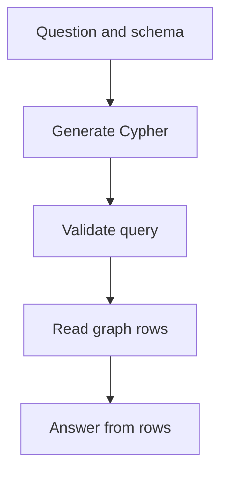

# M43.3 Theory: Natural-language graph QA (text-to-Cypher)

*[M43 theory](../README.md) · Lesson 43.3 · Notebooks: [`03a_query_kg_with_langchain.ipynb`](../../../../course/p12_hierarchical_and_graph_rag/m43_knowledge_graphs_neo4j/notebooks/03a_query_kg_with_langchain.ipynb) · [All theory pages](../../../README.md)*

## Text-to-Cypher

Text-to-Cypher translates a question into an executable graph query, runs it, and phrases the returned rows as an answer. The schema must tell the model which labels, relationship types and properties exist. Larkspur's question about EU export plans needs both the `SUPPORTS` and `AVAILABLE_IN` patterns, bound to the same plan.

The lesson notebook is narrower than its curriculum title. It calls `Neo4jGraph.query` with hand-written Cypher for provider counts, specialisations, locations and patients. It does not instantiate a query-generation chain. Read those queries as expected answers for a later translation test. Their healthcare examples are data-query exercises, not medical guidance.

<!-- animated: diagrams/cypher-query.anim.html -->

The [LangChain Neo4j integration](https://docs.langchain.com/oss/python/integrations/graphs/neo4j_cypher) documents `GraphCypherQAChain` and schema refresh. This is the extension beyond the checked-in notebook. After a schema change, refresh the schema used for generation and re-run questions that exercise the changed labels and properties.

## Debug the query before the answer

Save the question, generated Cypher, parameters, returned rows and final answer as separate trace fields. If the answer is wrong, first compare the generated pattern with the hand-written reference. A misspelled relationship, reversed direction, missing region condition or wrong property key can produce an empty or misleading result without a syntax error.

Test valid paraphrases, an unknown entity, ambiguous plan names, a question requiring multiple relationships and an empty-result case. Grade the rows as well as the answer. An empty result should say that no matching facts were found under this schema and data version; it cannot establish that a capability is impossible.

Generated queries need database-enforced read permissions and bounded execution. Use a read-only principal, query timeout and result limits; a prompt instruction alone does not restrict database authority. LangChain's [chain security note](https://reference.langchain.com/python/langchain-community/chains/graph_qa/cypher/GraphCypherQAChain/allow_dangerous_requests) explains that an opt-in flag acknowledges risk rather than enforcing permissions.

---
*Previous: [43.2 From CSV to knowledge graph](../02_from_csv_to_knowledge_graph/README.md). Next: [43.4 Vector indexes on graph nodes](../04_vector_indexes_on_graph_nodes/README.md).*
