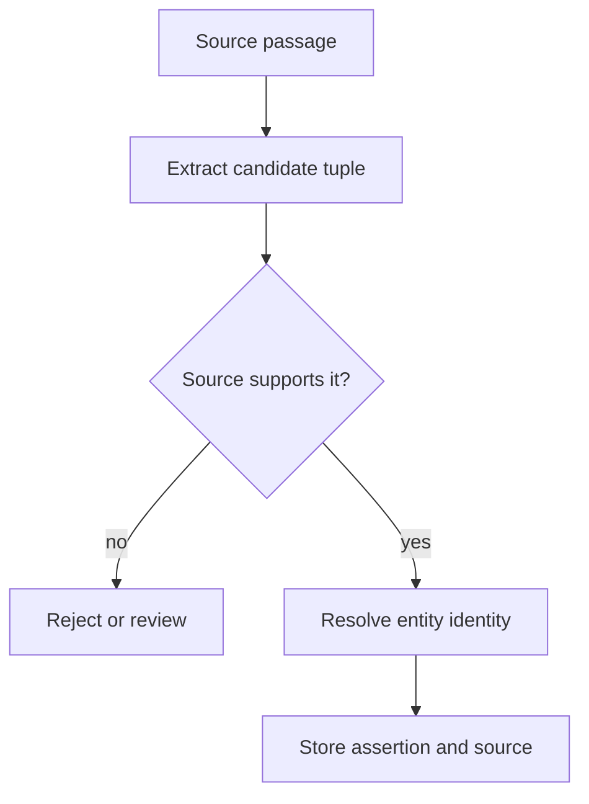

# M43.5 Theory: LLM entity and relationship extraction

*[M43 theory](../README.md) · Lesson 43.5 · Notebooks: [`05a_entity_relationship_extraction.ipynb`](../../../../course/p12_hierarchical_and_graph_rag/m43_knowledge_graphs_neo4j/notebooks/05a_entity_relationship_extraction.ipynb), [`05b_create_kg_from_text.ipynb`](../../../../course/p12_hierarchical_and_graph_rag/m43_knowledge_graphs_neo4j/exercises/05b_create_kg_from_text.ipynb) (optional) · [All theory pages](../../../README.md)*

## Extraction produces candidate facts

The extraction notebook asks an LLM for entities and relationship tuples, parses the response using `ast.literal_eval`, aggregates entities, and draws the graph with NetworkX. This demonstrates extraction and visualisation. It does not establish that every emitted tuple is supported by the text, nor does it persist that graph to Neo4j.

For Larkspur, “EU Team supports exports” can produce a `Plan`, a `Feature` and a `SUPPORTS` assertion. “EU Team may support exports after approval” needs its condition preserved. Flattening both sentences into an unconditional edge changes the policy.

Keep the passage identifier, source version and extraction configuration alongside accepted assertions. Validate endpoint types and allowed relationship types before insertion. Resolve aliases using identifiers and context: “Team” and “EU Team” might be separate products. A string set, as used for deduplication in the notebook, removes exact duplicate names but cannot resolve those identities.

## Preserve relations and conditions

The notebook's parser expects literal `Entities:` and `Relationships:` sections. Extra model commentary can break parsing. Structured output can constrain the response shape, but a schema-valid tuple still needs a support check. Handle malformed output as a failed extraction and retain the input for review.

Its line-based chunker uses a word threshold and can overshoot it when one line is long. Test boundary cases before assuming that threshold is a hard maximum. The optional exercise explicitly separates entity recognition, coreference resolution and relationship extraction; inspect pronouns and aliases at chunk boundaries when evaluating those stages.

A directed graph with one edge per ordered node pair can also overwrite distinct relationship labels between the same entities. Use a representation that preserves each assertion when the domain allows several predicates, versions or sources for a pair. Evaluate entity resolution errors separately from relation extraction errors, then check the paths used by your question set. A graph that looks plausible in a visualisation can still answer the wrong question.

---
*Previous: [43.4 Vector indexes on graph nodes](../04_vector_indexes_on_graph_nodes/README.md). Next: [43.6 End-to-end knowledge-graph RAG](../06_end_to_end_knowledge_graph_rag/README.md).*
