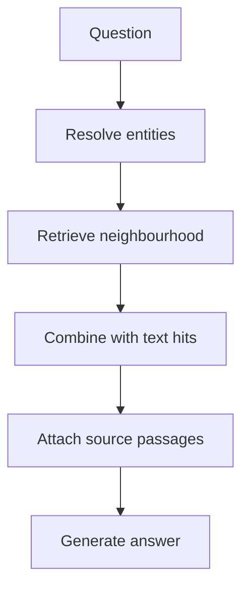

# M43.6 Theory: End-to-end knowledge-graph RAG

*[M43 theory](../README.md) · Lesson 43.6 · Notebooks: [`06a_roman_empire_graph_rag.ipynb`](../../../../course/p12_hierarchical_and_graph_rag/m43_knowledge_graphs_neo4j/notebooks/06a_roman_empire_graph_rag.ipynb) · [All theory pages](../../../README.md)*

## Assemble retrieval with source evidence

The end-to-end notebook loads Roman Empire pages, splits the first three documents with `TokenTextSplitter(chunk_size=512, chunk_overlap=24)`, converts chunks with `LLMGraphTransformer`, and calls `add_graph_documents(include_source=True, baseEntityLabel=True)`. These are notebook settings, rather than measured optimums. Larkspur substitutes versioned handbook passages while retaining links from extracted entities to the source text.

Its retrieval has two combinations. First, `Neo4jVector.from_existing_graph(search_type="hybrid")` combines keyword and vector search over `Document` text, as described in the [Neo4jVector integration](https://docs.langchain.com/oss/python/integrations/vectorstores/neo4jvector). Separately, `structured_retriever` extracts question entities, resolves them through a full-text index, and fetches incoming and outgoing relationships. The final retriever concatenates these graph facts with retrieved document text.

The graph branch uses a full-text query with fuzzy terms, a limit of two entity candidates, and a final limit of fifty relationship rows. These are explicit caps, not relevance guarantees. Log which identity matched and which rows were truncated. A highly connected entity can consume the neighbourhood budget before the needed relationship appears.

## Check the evidence contract

`include_source=True` retains source connections during ingestion; the notebook's structured retriever excludes `MENTIONS` edges and returns relation strings. Those strings alone do not give the answer model a per-claim passage citation. To make a verifiable answer, retrieve the supporting passage identifiers and text alongside each graph assertion and carry them into the prompt.

Test a local entity question, a relationship join, a paraphrase whose entity name differs, an unsupported claim, and a changed handbook version. Compare vector-only retrieval, graph-only retrieval and their combination on the same questions. Report retrieved evidence, answer correctness, unsupported claims, latency and indexing work separately. No notebook output establishes that the combined system wins on Larkspur.

The notebook also rewrites conversational follow-ups before retrieval. Record the rewritten question, since a wrong resolved pronoun can send both retrieval branches to the wrong entity. Keep the original user question available when judging the final answer.

---
*Previous: [43.5 LLM entity and relationship extraction](../05_llm_entity_and_relationship_extraction/README.md). Next: [M43 interview questions](../README.md#interview-spotlight-5-questions-you-might-get-asked).*
