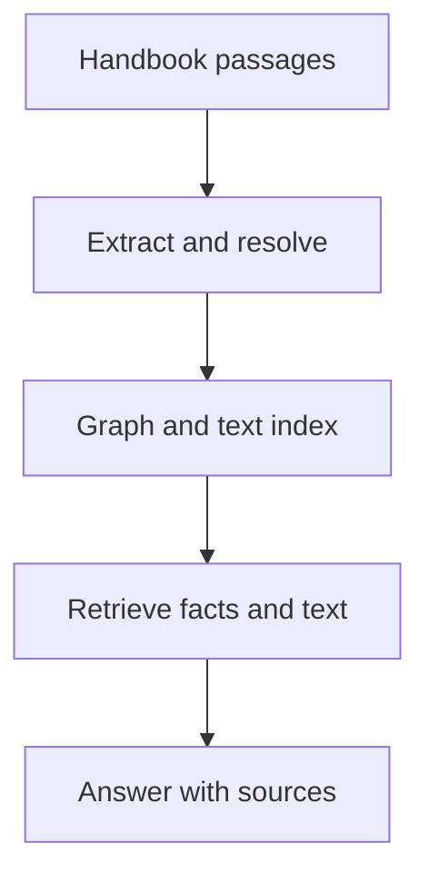

# M43 Theory: Knowledge Graphs with Neo4j

*Part XII · Hierarchical, Memory & Graph RAG · [Module README](../../../course/p12_hierarchical_and_graph_rag/m43_knowledge_graphs_neo4j/README.md) · [All theory pages](../../README.md)*

A knowledge graph represents named entities and their relationships explicitly. Cypher matches those relationships; vector retrieval helps find a starting entity when a question uses different words. The M43 notebooks build on four ideas: the property graph, pattern queries, translating questions into Cypher, and combining graph facts with text retrieval. Each idea has a page in the folder of the lesson that teaches it, listed under [Lessons](#lessons). This page has the overview, the interview questions and the takeaways.

The running example extends the fictional Larkspur Cloud handbook into plans, features, regions and supporting passages. The golden questions ask which plans support exports in the EU, which source establishes that capability, and what happens after a policy version changes. The notebooks use healthcare, historical and extraction examples; the Larkspur catalogue is a separate teaching fixture.

## TL;DR

- Model identity, edge direction and source provenance before querying the graph.
- Bind the same plan variable across feature and region patterns when both constraints must hold.
- The 43.3 notebook executes hand-written Cypher; automatic text-to-Cypher is an explained extension.
- Vector candidates can fail exact relationship checks. In the lab, `k=2` yields no eligible plans, `k=3` yields one and `k=5` yields both.
- A stored source link helps only when retrieval carries its passage into the answer evidence.

## Mental model

<!-- animated: diagrams/knowledge-path.anim.html -->

Extraction turns prose into candidate facts. Stable identities let those facts connect across documents, while retained passages let a reader inspect what supports them. Retrieval must carry both the matched relationship and its supporting text into the answer.

## Lessons

| Lesson | Topic | Theory |
|---|---|---|
| 43.1 | Graph fundamentals and Cypher | [Nodes, edges, properties](01_graph_fundamentals_and_cypher/README.md#nodes-edges-properties) [Cypher](01_graph_fundamentals_and_cypher/README.md#cypher) |
| 43.2 | From CSV to knowledge graph | [Identity before import](02_from_csv_to_knowledge_graph/README.md#identity-before-import) |
| 43.3 | Natural-language graph QA (text-to-Cypher) | [Text-to-Cypher](03_natural_language_graph_qa_text_to_cypher/README.md#text-to-cypher) |
| 43.4 | Vector indexes on graph nodes | [Graph + vector hybrid](04_vector_indexes_on_graph_nodes/README.md#graph--vector-hybrid) |
| 43.5 | LLM entity and relationship extraction | [Extraction produces candidate facts](05_llm_entity_and_relationship_extraction/README.md#extraction-produces-candidate-facts) |
| 43.6 | End-to-end knowledge-graph RAG | [Assemble retrieval with source evidence](06_end_to_end_knowledge_graph_rag/README.md#assemble-retrieval-with-source-evidence) |

## Interactive lab

[**Candidates and graph constraints**](04_vector_indexes_on_graph_nodes/interactive/graph-filter-lab.html): open the file in a browser. Increase `k` until the first EU export plan survives. Continue until both eligible plans appear, then inspect the extra candidate checks after recall stops changing. Read the ledger's rejection reason for the highest-ranked record.

## How it connects

- **Before:** [M42](../m42_hierarchical_memory_rag/README.md) compares hierarchical summaries, memory and lightweight graph retrieval.
- **Next:** [M44](../m44_graphrag/README.md) uses graph structure for traversal, community retrieval and expansion. M45 compares complete architecture choices.

## Interview Spotlight: 5 Questions You Might Get Asked

*Production questions in the style of OpenAI, Anthropic and Google interviews for applied AI roles.*

### 1. Larkspur's EU export plan disappears after a handbook update, although its passage still exists. How do you locate the failure?

**What a strong answer covers:**
- Checks ingestion version, entity key and the required feature and region paths.
- Separates a missing graph edge from a candidate that fell below the vector budget.
- Reads the extraction input and supporting passage before changing the prompt.
- Adds the updated plan and previous version to the fixed regression questions.

### 2. Product wants both a free-text search and exact regional availability. Would you retrieve vectors first or match the graph first?

**What a strong answer covers:**
- Uses exact graph predicates when identity and constraints are known.
- Uses semantic candidates for approximate descriptions and validates their graph relationships.
- Measures eligible-answer recall against candidate budget, query latency and graph degree.
- Applies authorization across every retrieval branch and checks all returned source passages.

### 3. The assistant returns a convincing answer from an empty Cypher result. What should monitoring record?

**What a strong answer covers:**
- Logs original question, rewritten question, generated query, parameters and rows separately.
- Grades query results against known paths as well as grading final answer support.
- Tracks empty-result and truncation rates by question type and schema version.
- Requires an explicit unsupported-answer response when the available facts cannot answer.

### 4. A CSV re-import doubles the number of plans after descriptions change. How do you repair the import design?

**What a strong answer covers:**
- Inspects which mutable properties were included in the merge pattern.
- Uses a stable scoped identifier with an appropriate uniqueness constraint.
- Updates descriptions separately and resolves existing duplicates with source-aware review.
- Tests repeated imports and edited descriptions on a fixture before loading the full catalogue.

### 5. A generated query asks for a plan relationship that is absent from the schema. Should the system retry until it finds an answer?

**What a strong answer covers:**
- Checks whether the requested relation is representable and present in the current schema.
- Bounds retries and query execution, with read-only database permissions.
- Distinguishes a translation error from missing source data and ambiguous identity.
- Returns the evidence limitation rather than inventing a relation to satisfy the request.

## Key Takeaways

- Choose stable entity identities and explicit relationship meanings before import.
- Compare generated Cypher with a hand-written query and inspect rows before grading prose.
- Separate semantic candidate selection from exact graph validation and measure both stages.
- Retrieve source passages with graph assertions so each answer claim can be checked.

---
*Previous: [M42 Hierarchical & Memory-Augmented Retrieval](../m42_hierarchical_memory_rag/README.md). Next: [M44 GraphRAG Techniques](../m44_graphrag/README.md).*
