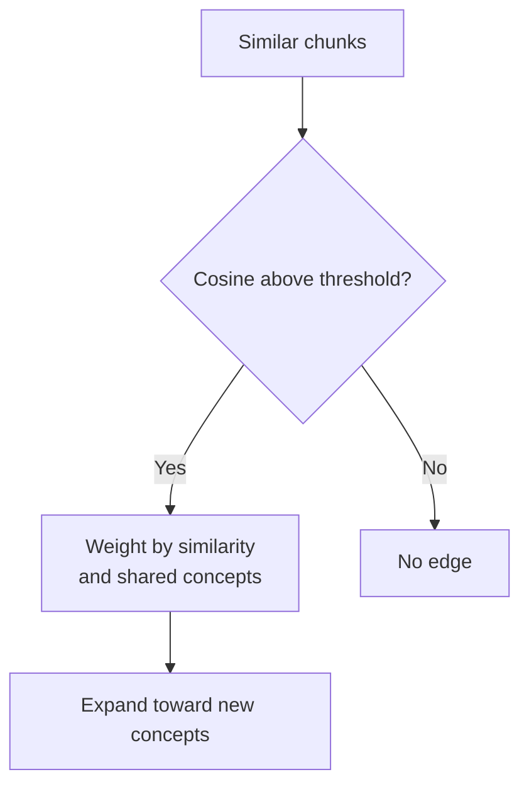

# M44.1 Theory: Concept-graph traversal

*[M44 theory](../README.md) · Lesson 44.1 · Notebooks: [`01a_graph_rag.ipynb`](../../../../course/p12_hierarchical_and_graph_rag/m44_graphrag/notebooks/01a_graph_rag.ipynb) · [All theory pages](../../../README.md)*

## Chunk graphs and traversal

The first notebook represents each chunk as a node in an undirected NetworkX graph. It splits documents with `chunk_size=1000` and `chunk_overlap=200`, extracts concepts with a structured LLM response and named entities with spaCy, then compares chunk embeddings. An edge exists when cosine similarity is strictly greater than `0.8`. Shared concepts influence the edge weight after that threshold has passed.

For chunks A and B, the code weights an edge as `0.7 × cosine + 0.3 × shared_fraction`. The denominator of `shared_fraction` is the smaller concept-set size, with zero when that size is zero. This weight combines two signals chosen by the notebook author. It has no calibrated meaning as a probability that either chunk proves the other.

A Larkspur cancellation chunk and export chunk could share a product name while describing different dates or account states. The similarity edge is a retrieval lead. Read the passages before turning that lead into a policy statement.

The query path retrieves `k=5` chunks from FAISS, compresses them with `LLMChainExtractor`, then tries to map their text back to graph nodes. Compression can change the text, so equality against the original chunk is fragile. Stable chunk IDs and an explicit mapping between compressed spans and original passages remove that ambiguity.

The traversal uses a heap, inverse edge weights and a model-based completeness check. Its implementation also appends neighbours immediately when discovered. It should not be described as an unmodified shortest-path algorithm. The initial seed priority uses `1 / similarity_score` on a value returned by `similarity_search_with_score`; verify the backend's score convention and zero handling before using it as a relevance priority.

## Budgets and stopping

The code sets `max_context_length=4000`, but the traversal does not enforce that attribute. A variable named as a budget supplies no protection until a branch checks it. Count the accumulated context with the answer model's tokenizer and stop before exceeding an explicit budget. Cap visited nodes and completeness-check calls separately.

An LLM saying “complete” is a stopping heuristic. For the cancellation question, check that the context contains the cancellation condition, available export mechanism and applicable retention condition. If the graph has no path to one of those passages, report the missing evidence. Increasing context cannot create a relation absent from the index.

For each query, log seed IDs, selected edges, retrieved source spans, context size and stopping reason. Compare against flat retrieval on the same golden questions. A longer traversal can increase work while leaving the answer's supporting evidence unchanged.

---
*Previous: [M44 overview](../README.md). Next: [44.2 Local GraphRAG with source attribution](../02_local_graphrag_with_source_attribution/README.md).*
