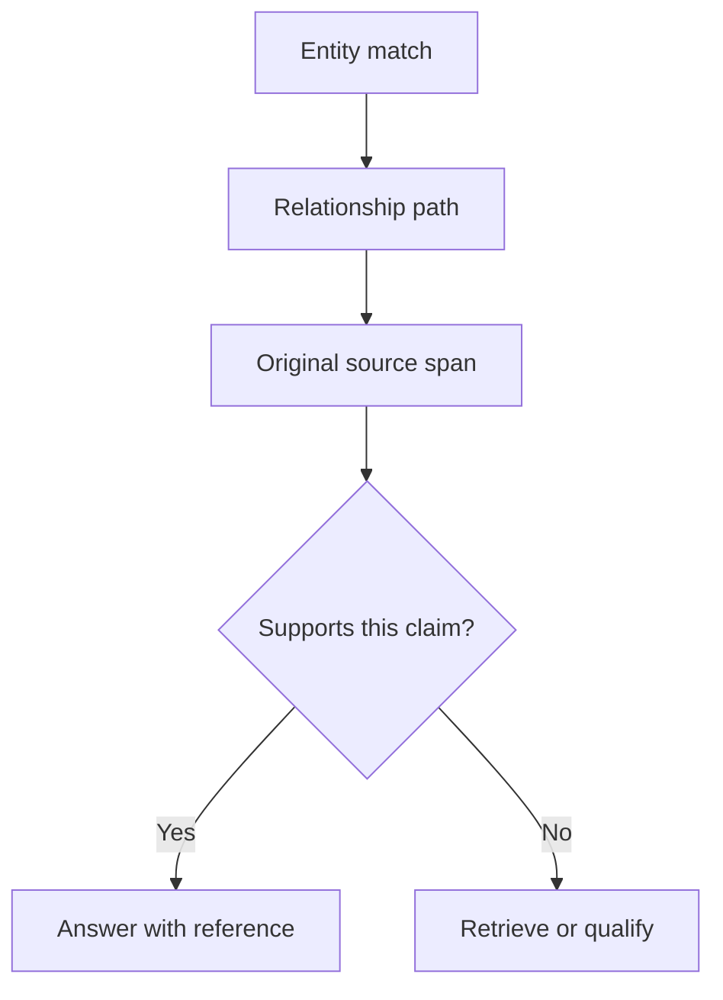

# M44.2 Theory: Local GraphRAG with source attribution

*[M44 theory](../README.md) · Lesson 44.2 · Notebooks: [`02a_graph_rag_local_attribution.ipynb`](../../../../course/p12_hierarchical_and_graph_rag/m44_graphrag/optional/02a_graph_rag_local_attribution.ipynb) (optional) · [All theory pages](../../../README.md)*

## Source attribution

The optional local notebook uses Ollama for extraction and generation, `all-MiniLM-L6-v2` for entity embeddings, and a directed NetworkX graph for relationships. Its `Entity` and `Relationship` records store `source_doc` and `source_sentence`. Query-time vector search finds entity entry points, then breadth-first traversal follows outgoing edges up to `max_hops`.

For Larkspur, a graph path might connect Cancellation to Export, then Export to Snapshot. The path explains why retrieval reached the snapshot document. The cancellation policy still needs a passage stating the conditions under which that snapshot export remains available.

Keep two records for each generated claim: the route by which retrieval found evidence, and the exact passage used to support the claim. A traversable relation can be stale, incorrectly extracted or disconnected from the conditions in the original text. Inspecting the source is how a reviewer can reject that relation.

## What the notebook verifies

The example prompt asks for `[N]` references. The code finds those markers with a regular expression and maps valid IDs back to source records. It assigns each resulting `Citation` a fixed `confidence=0.9`, and its `claim` field contains a reference label rather than the extracted answer claim. That value is an example constant, not a measured confidence estimate.

The context supplied to generation contains entity names and descriptions. The stored source sentence is attached afterwards through the source map. The code therefore demonstrates provenance storage and citation resolution; it does not check entailment between every answer claim and the quoted sentence. Add a claim-to-span review before treating an answer as verified.

The graph also uses a single source record per entity ID. Re-ingesting the same lowercased name can overwrite its description and source. A `DiGraph` allows one edge for a given ordered node pair, so distinct relation evidence between the same pair can overwrite as well. Preserve multiple source spans and relation types when they carry separate claims.

## Local execution boundaries

The notebook falls back to empty extraction results if Ollama is unavailable. An empty graph from that branch does not establish that the documents contain no relationships. Report model availability and extraction failures separately from a legitimate zero-result retrieval.

When using several seeds, verify distance budgets per seed. A single shared visited set can let an earlier seed suppress a shorter path from a later seed. Store the best depth or run a true multi-source breadth-first traversal when the required semantics are “within this many hops of any seed”. Retain source access filters during traversal and again when constructing context.

## Check yourself

1. A graph path runs from Cancellation to Export to Snapshot. Why record both that path and the exact passage behind each claim?

The path explains how retrieval reached the snapshot document; it does not support the policy claim. A traversable relation can be stale, wrongly extracted or cut off from the conditions in the original text. The source passage is what lets a reviewer check the claim, or reject the relation.

2. Each citation the notebook produces carries confidence 0.9. What does that number tell you about the answer?

Nothing measured: it is a fixed example constant, and the `claim` field holds a reference label rather than the answer's claim. The code finds `[N]` markers and maps valid IDs back to source records, but it never checks that the cited sentence supports the claim. Add a claim-to-span review before treating an answer as verified.

3. Ollama was unavailable during ingestion and the graph came out empty. Can you conclude that the documents contain no relationships?

No. The notebook falls back to empty extraction results when Ollama is unavailable, so an empty graph from that branch says nothing about the documents. Report model availability and extraction failures separately from a legitimate zero-result retrieval.

---
*Previous: [44.1 Concept-graph traversal](../01_concept_graph_traversal/README.md). Next: [44.3 Microsoft GraphRAG: communities, global vs local search](../03_microsoft_graphrag_communities_global_vs_local_search/README.md).*
