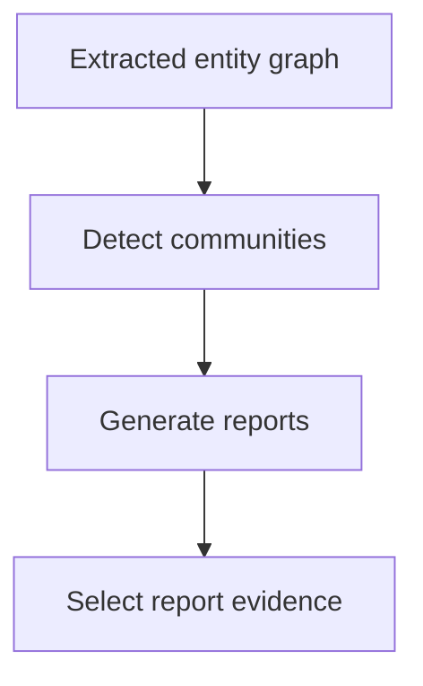

# M44.3 Theory: Microsoft GraphRAG: communities, global vs local search

*[M44 theory](../README.md) · Lesson 44.3 · Notebooks: [`03a_microsoft_graphrag.ipynb`](../../../../course/p12_hierarchical_and_graph_rag/m44_graphrag/notebooks/03a_microsoft_graphrag.ipynb) · [All theory pages](../../../README.md)*

## Community detection

An entity graph can group related regions before a question arrives. Community detection derives groups from graph connectivity. A community report then summarises the extracted material in a group. The grouping and its generated report are separate artifacts: changing the summary prompt changes the report without changing the graph partition.

For Larkspur, cancellation and export relations may form one region, while outage recovery relations form another. These are illustrative groups, not results of running a community detector on the handbook. Review extracted edges and group membership before interpreting a report as a reliable account of a product area.

Microsoft GraphRAG's indexing pipeline extracts graph information, detects communities, builds reports at multiple levels and embeds text. That pipeline supplies reusable artifacts for query time. [Microsoft indexing overview](https://microsoft.github.io/graphrag/index/overview/).

## Global vs local search

Local search combines entity-related graph material with source text. Use it for “Which export mechanism remains available after cancellation?”: the evidence centres on specific entities and their conditions. Check that the selected context includes the original policy spans. [Microsoft local search](https://microsoft.github.io/graphrag/query/local_search/).

Global search addresses questions spread across the corpus by using community reports. The standard approach processes report context into partial responses, then combines useful results. Use it for “What operational dependencies recur across the handbook?” and inspect which report regions contributed. A fluent answer can still omit a small community or repeat an extraction mistake. [Microsoft global search](https://microsoft.github.io/graphrag/query/global_search/).

| Question | Evidence to require | Failure to inspect |
|---|---|---|
| A named product's cancellation condition | Entity relations and original policy spans | Wrong identity or stale version |
| Themes across product areas | Reports covering the relevant corpus regions | Omitted communities |
| Exact retention wording | The current source passage | Summary dropping a qualification |

The notebook asks both local and global questions against one indexed input. Its `python -m graphrag.index`, query flags and `llm` settings structure belong to the interface shown in that notebook. Check the installed package's CLI and configuration schema before adapting those commands. The theory concerns retrieval behavior rather than promising those commands work unchanged on another release.

Its `remove_data()` function strips `[Data: ...]` annotations from the displayed answer. Keep the unmodified response and the underlying artifact IDs in an evidence record if you need to trace an answer back through reports to sources.

## Indexing cost

Flat RAG pays to split, embed and store passages. A graph pipeline adds extraction, identity resolution and relation storage. Community retrieval adds detection and report generation. Changes to source material can require rebuilding derived records, including reports that depend on the changed entities.

Record each stage separately. Useful fields include model and prompt version, input and output tokens, call count, retries, elapsed time, stored artifact size and changed source IDs. At query time record report selections, expansion candidates, reranking calls and answer context. The notebook configures a `10000` maximum context token setting for global search; that configured value is neither a measured bill nor proof that every execution uses the whole allowance.

Use the module lab brief's shared global and multi-hop question set to compare GraphRAG, RAPTOR and hybrid retrieval. Hold source versions, answer model and evaluation criteria constant. Report indexing and update work alongside retrieval and answer quality. Derive any amortised cost from measured indexing work, measured query work and the actual expected query volume; no break-even figure follows from the architecture alone.

---
*Previous: [44.2 Local GraphRAG with source attribution](../02_local_graphrag_with_source_attribution/README.md). Next: [44.4 Graph expansion inside a vector database (Milvus)](../04_graph_expansion_inside_a_vector_database_milvus/README.md).*
