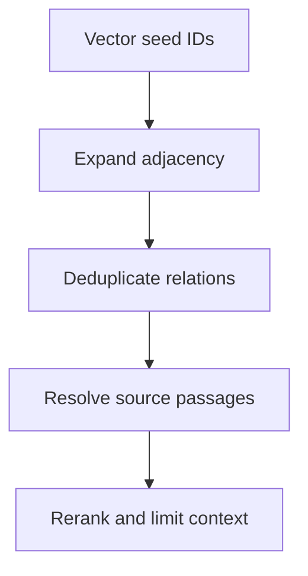

# M44.4 Theory: Graph expansion inside a vector database (Milvus)

*[M44 theory](../README.md) · Lesson 44.4 · Notebooks: [`04a_graphrag_with_milvus.ipynb`](../../../../course/p12_hierarchical_and_graph_rag/m44_graphrag/optional/04a_graphrag_with_milvus.ipynb) (optional) · [All theory pages](../../../README.md)*

## Graph expansion

The Milvus notebook stores entity, relationship and passage embeddings in separate collections. Vector retrieval chooses initial entity and relationship IDs. Adjacency mappings connect those IDs back to candidate relations and then to the passages that mention them. The graph traversal in this design runs in application memory; Milvus supplies vector retrieval and stored records.

Let `B` be the entity-by-relation incidence matrix. `B[e,r]=1` when entity `e` participates in relation `r`. Then `B Bᵀ` connects entities that share a relation, while `Bᵀ B` connects relations sharing an entity. The notebook uses powers of these matrices to expand the seed sets, takes nonzero entries, and merges the entity and relationship retrieval paths. [Milvus Graph RAG tutorial](https://milvus.io/docs/graph_rag_with_milvus.md).

Matrix products count walks. They do not certify that a relation supports the user's question. Their diagonal entries also permit a walk to remain at the same entity, so increasing the degree can retain previously reached candidates. Direction and relation type require separate handling: an undirected incidence matrix does not preserve a predicate's direction.

The [interactive lab](interactive/expansion-lab.html) computes the entity-side candidate row of `(B Bᵀ)^d B`. Degree 0 shows direct incident relations and is a teaching baseline; the notebook's configured `target_degree` starts at 1. The explicit fictional fixture has no embedding or LLM output. Choosing a seed stands in for the preceding vector search.

<!-- lab: interactive/expansion-lab.html -->

With Cancellation selected, degree 0 reaches the cancellation-to-export and cancellation-to-billing relations. Degree 1 also reaches the export-to-snapshot and billing-to-refund relations. Those are 4 candidate relations across 3 distinct source passages. At degree 2 the set has 6 relations across 4 passages; degree 3 has all 8 relations across 5 passages. The lab labels every relation with its source so that expansion has a visible evidence cost.

The additional billing branch is reachable and can still be irrelevant to an export question. Rerank relations using the question, then fetch and deduplicate their source passages. Preserve the retrieval route for debugging, but cite the actual passage used by the answer. Compare the candidate set before and after reranking against the golden evidence set.

## Keeping expansion bounded

The notebook retrieves `top_k=3` entity and relationship hits, merges expanded candidates, uses an LLM to select relations and limits final passages with `final_top_k=2`. Those parameters control different stages. Increasing the first value can enlarge work even when the final context limit stays fixed.

Bound expansion degree, candidate relation count and source-passage count before an expensive reranker runs. If a hub connects many unrelated policies, filter by product, relation type, version and access rights before following it. Record which budget stopped the expansion so a missing passage can be attributed to a specific stage.

Treat identity mapping as part of retrieval correctness. Different casing, aliases and repeated names can split one entity or merge different entities. The notebook's IDs come from string lists; an operational index needs stable IDs and explicit updates to both vectors and adjacency mappings. A fresh vector record with stale adjacency can retrieve the right entity and still traverse the wrong policy graph.

---
*Previous: [44.3 Microsoft GraphRAG: communities, global vs local search](../03_microsoft_graphrag_communities_global_vs_local_search/README.md). Next: [M44 interview questions](../README.md#interview-spotlight-5-questions-you-might-get-asked).*
