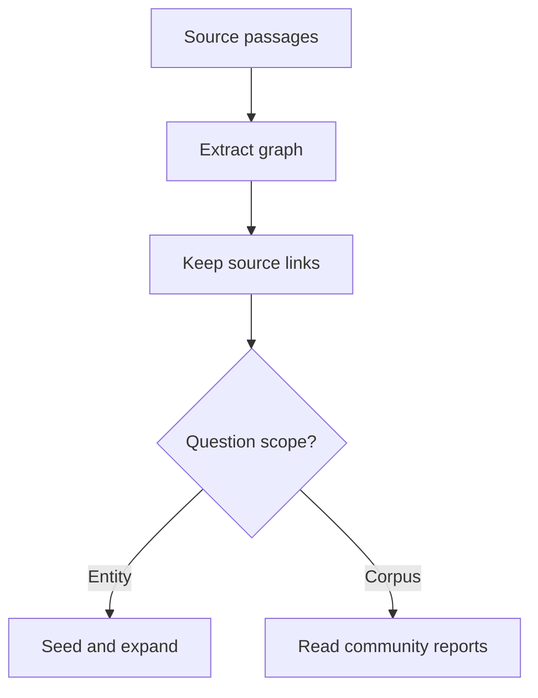

# M44 Theory: GraphRAG Techniques

*Part XII · Hierarchical, Memory & Graph RAG · [Module README](../../../course/p12_hierarchical_and_graph_rag/m44_graphrag/README.md) · [All theory pages](../../README.md)*

Graph retrieval changes which evidence reaches the answer model. A question can start at one entity, follow a relationship to another passage, or ask for themes across communities. The M44 notebooks build on four ideas: community detection, global and local search, graph expansion, and the indexing work those choices require. Each idea has a page in the folder of the lesson that teaches it, listed under [Lessons](#lessons). This page has the overview, the interview questions and the takeaways.

The running example is the fictional Larkspur Cloud handbook. “Which export mechanism remains available after cancellation?” needs a connection between policy and product pages. “What dependencies recur across cancellation, exports and outages?” asks for a corpus overview. These questions need different retrieval plans, even when they share an index.

## TL;DR

- Decide what a node and an edge mean before calling a system GraphRAG. A similar pair of chunks, an extracted factual relation and a community membership support different inferences.
- Local search starts near entities; global search uses community reports to cover the corpus. Choose using the question's required evidence.
- Expansion increases the candidate set. In the lab's cancellation fixture, degree 0 returns 2 relations; degree 1 returns 4. Neither count measures answer accuracy.
- Carry source passages through extraction, traversal and generation. A citation marker alone does not establish that its claim follows from its source.
- Compare indexing, updates and query work on the same question set before replacing the flat retrieval baseline.

## Mental model

<!-- animated: diagrams/evidence-route.anim.html -->

Both routes must return evidence that the answer can cite. The graph supplies candidate connections; the source passages establish what the handbook actually says. Community reports add a summary layer whose omissions need checking against those passages.

## Lessons

| Lesson | Topic | Theory |
|---|---|---|
| 44.1 | Concept-graph traversal | [Chunk graphs and traversal](01_concept_graph_traversal/README.md#chunk-graphs-and-traversal) |
| 44.2 | Local GraphRAG with source attribution | [Source attribution](02_local_graphrag_with_source_attribution/README.md#source-attribution) |
| 44.3 | Microsoft GraphRAG: communities, global vs local search | [Community detection](03_microsoft_graphrag_communities_global_vs_local_search/README.md#community-detection) [Global vs local search](03_microsoft_graphrag_communities_global_vs_local_search/README.md#global-vs-local-search) [Indexing cost](03_microsoft_graphrag_communities_global_vs_local_search/README.md#indexing-cost) |
| 44.4 | Graph expansion inside a vector database (Milvus) | [Graph expansion](04_graph_expansion_inside_a_vector_database_milvus/README.md#graph-expansion) |

## Interactive lab

[**Expansion and the evidence set**](04_graph_expansion_inside_a_vector_database_milvus/interactive/expansion-lab.html): open the file in a browser. Start with Cancellation and compare degrees 0 and 1. Increase the degree until the source set stops growing. Switch to Outage to see that the same expansion budget reaches different passages from a different seed.

## How it connects

- **Before:** [M42](../m42_hierarchical_memory_rag/README.md) retrieves at different abstraction levels. [M43](../m43_knowledge_graphs_neo4j/README.md) models and queries factual relationships. This module uses graph structure to choose evidence.
- **Next:** M45 compares complete agentic RAG architectures, including the cost of routing and repeated retrieval.

## Interview Spotlight: 5 Questions You Might Get Asked

*Production questions in the style of OpenAI, Anthropic and Google interviews for applied AI roles.*

### 1. Larkspur's cancellation answer reaches an export node but misses the retention condition. Where do you look first?

**What a strong answer covers:**
- Inspect the retrieved seed IDs, traversed relations and final passage IDs before editing the prompt.
- Check whether the retention relation was extracted, linked and reachable in the allowed direction.
- Separate an expansion cutoff from a reranking or context-budget omission.
- Add the complete policy path to the golden question's evidence set and check its sources.

### 2. Support asks for themes across the whole handbook, but the current retriever returns only cancellation neighbours. How would you change retrieval?

**What a strong answer covers:**
- Route the overview question to community reports with explicit corpus coverage.
- Check which communities and report levels contributed to the answer.
- Compare the overview against source passages and a flat baseline on the same corpus.
- Retain local retrieval for questions about a specific product or policy condition.

### 3. GraphRAG improves an offline answer score but indexing is too expensive after every handbook edit. What would you measure?

**What a strong answer covers:**
- Record extraction, embedding and report-generation work separately from query work.
- Measure update frequency and which reports depend on each changed source.
- Include failed calls, retries and storage in the comparison.
- Compare amortised work over the actual question volume without assuming an unmeasured break-even point.

### 4. Two documents use “Snapshot” for different products, and the assistant joins their policies. How do you contain the error?

**What a strong answer covers:**
- Inspect entity identity, product scope and version fields before increasing traversal depth.
- Split ambiguous entities and preserve the source record for each relation.
- Filter candidate passages and graph edges by the caller's product and access rights.
- Test a question where the wrong merge would produce a plausible answer with a false policy condition.

### 5. Every answer has numbered citations, yet reviewers keep finding unsupported claims. What would a useful attribution check do?

**What a strong answer covers:**
- Split the answer into claims and resolve each reference to an existing source span.
- Check that the span supports the claim and preserves its conditions and date.
- Audit relation evidence as well as the final node's description.
- Treat fixed confidence values and valid citation syntax as insufficient evidence of support.

## Key Takeaways

- Name the graph representation and retrieval route in each evaluation result.
- Bound expansion before context construction and measure the candidate set it creates.
- Preserve passage provenance through both graph and community retrieval.
- Re-evaluate source coverage, update work and answer quality whenever extraction or routing changes.

---
*Previous: [M43 Knowledge Graphs with Neo4j](../m43_knowledge_graphs_neo4j/README.md). Next: [M45 Agentic RAG Architectures: Choosing a Design](../../p13_architecture_and_capstone/m45_architecture_synthesis/README.md).*
