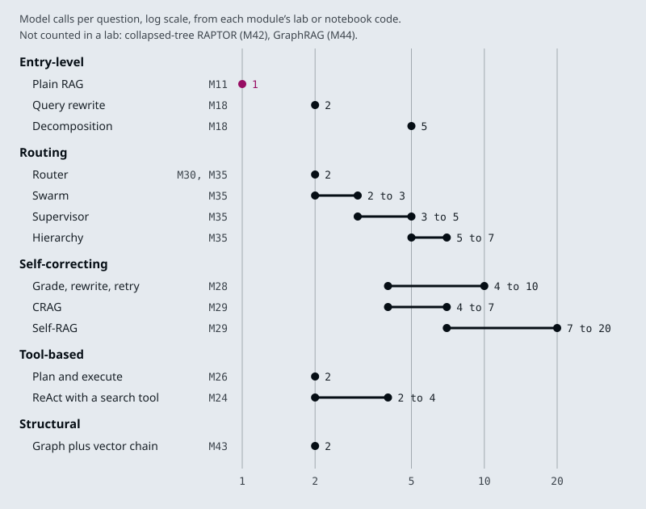

# M45.1 Theory: The agentic RAG architecture map

*[M45 theory](../README.md) · Lesson 45.1 · Notebooks: [`01a_AGENTIC_RAG_ARCHITECTURES.md`](../../../../course/p13_architecture_and_capstone/m45_architecture_synthesis/notebooks/01a_AGENTIC_RAG_ARCHITECTURES.md) · [All theory pages](../../../README.md)*

## The architecture map

The course keeps two inventories of what it teaches. The wider one, [`docs/agentic-architectures.yaml`](../../../../docs/agentic-architectures.yaml), rendered as [Agentic Architecture Coverage](../../../../docs/agentic-architecture-coverage.md), compares the course with an upstream catalogue of 35 agentic architectures in seven families and finds all 35 covered. Five of them are retrieval architectures, and all five are on the mandatory track:

| # | Architecture | Taught in |
|---|---|---|
| 23 | Agentic RAG | [M28](../../../p09_agentic_rag/m28_retrieval_grading_rewriting/README.md), [M31](../../../p09_agentic_rag/m31_rag_as_agent_tool/README.md) |
| 24 | Corrective RAG (CRAG) | [M29](../../../p09_agentic_rag/m29_crag_and_self_rag/README.md) |
| 25 | Self-RAG | [M29](../../../p09_agentic_rag/m29_crag_and_self_rag/README.md) |
| 26 | Adaptive RAG | [M30](../../../p09_agentic_rag/m30_adaptive_rag_routing/README.md) |
| 27 | GraphRAG | [M43](../../../p12_hierarchical_and_graph_rag/m43_knowledge_graphs_neo4j/README.md), [M44](../../../p12_hierarchical_and_graph_rag/m44_graphrag/README.md) |

The lesson's reading, `01a_AGENTIC_RAG_ARCHITECTURES.md`, maps the retrieval side by graph shape rather than by folder. It names five architectures covered end to end (CRAG, Adaptive RAG, Self-RAG, domain-router RAG and retrieval as a tool) and writes each one as its `add_node` and `add_conditional_edges` structure, for example `retrieve → grade_documents → (rewrite_query ⟲ | web_search) → generate_answer` for CRAG. Its table has a sixth row, the M28 agent with query rewriting and guardrails, although the text above it says five notebooks. It lists RAPTOR and the GraphRAG notebooks as anthology variants, and one gap: CacheRAG exists in the source repository only as an empty placeholder.

Neither inventory says when to use what. For that, the architectures need a common unit. Every one of them is the M11 pipeline (retrieve, then generate) with components added, and each component is paid for in model calls per question. The course's labs have counted those calls on Larkspur questions:

The ranges come from different questions and settings, so read them as orders of magnitude. Plain RAG is 1 call. Routing and tool loops cost 2 to 7. The self-correcting loops climb to 10 (M28's retry loop with two rewrites) and 20 (Self-RAG at `k = 5` on a question the handbook cannot answer, M29). Collapsed-tree RAPTOR and GraphRAG have no counted query cost; their main cost is LLM work at index time, which this axis does not show.

## What each family adds

The module objectives sort the architectures into five families. Each family adds a different kind of component to plain RAG, and each has a module whose theory page measures what that component buys.

- **Entry-level** changes nothing in the control flow and improves what reaches the model. Plain RAG and its baseline ([M11](../../../p04_rag_foundations/m11_rag_lifecycle/README.md)), indexing that searches small and returns large ([M16](../../../p05_ingestion_and_indexing/m16_advanced_indexing/README.md)), hybrid search ([M17](../../../p06_retrieval_quality/m17_retrievers_hybrid_search/README.md)), query transformation ([M18](../../../p06_retrieval_quality/m18_query_transformation/README.md)) and reranking ([M19](../../../p06_retrieval_quality/m19_reranking_post_retrieval/README.md)). Late interaction (lesson 45.2) belongs here too. Most add no model call; query rewriting adds one, decomposition four.
- **Self-correcting** puts a judgment between retrieval and the answer: grade, rewrite and retry ([M28](../../../p09_agentic_rag/m28_retrieval_grading_rewriting/README.md)), CRAG and Self-RAG ([M29](../../../p09_agentic_rag/m29_crag_and_self_rag/README.md)), graders and user feedback ([M32](../../../p09_agentic_rag/m32_reliability_feedback/README.md)). Each check is a model call, and each failed check sends the question round again.
- **Routing** decides where a question goes before anything is retrieved: a classifier over knowledge bases and adaptive RAG ([M30](../../../p09_agentic_rag/m30_adaptive_rag_routing/README.md)), then supervisors, hierarchies and swarms of specialist agents ([M35](../../../p10_memory_and_multi_agent/m35_multi_agent_architectures/README.md)). A misroute hides the answer, because the filter restricts retrieval to a knowledge base that does not hold it.
- **Tool-based** hands retrieval to a model that decides when to call it: ReAct ([M24](../../../p08_agent_foundations/m24_react_agents/README.md)), plan and execute ([M26](../../../p08_agent_foundations/m26_planning_reflection_reasoning/README.md)) and retrieval as a tool ([M31](../../../p09_agentic_rag/m31_rag_as_agent_tool/README.md)). The same tool can be served over MCP and called across agents over A2A ([M38](../../../p11_agent_protocols/m38_mcp_foundations/README.md) to [M41](../../../p11_agent_protocols/m41_a2a_protocol/README.md)) without changing the loop.
- **Structural** changes the shape of the index: summary trees ([M42](../../../p12_hierarchical_and_graph_rag/m42_hierarchical_memory_rag/README.md)), knowledge graphs ([M43](../../../p12_hierarchical_and_graph_rag/m43_knowledge_graphs_neo4j/README.md)) and community-based GraphRAG ([M44](../../../p12_hierarchical_and_graph_rag/m44_graphrag/README.md)). The work moves to index time, and the index has to be rebuilt or patched when the handbook changes.

Memory ([M33](../../../p10_memory_and_multi_agent/m33_conversational_memory_rag/README.md), [M34](../../../p10_memory_and_multi_agent/m34_long_term_agentic_memory/README.md)) cuts across all five. A follow-up such as *How long do I have?* needs rewriting into a standalone question before any of these architectures can retrieve for it.

The families also stack. The M28 agent is a tool-based loop with a self-correcting grader; adaptive RAG in M30 is a router in front of two graders. When a design names several families, count each component's calls separately, so a later review can remove one without guessing what it cost.

## Check yourself

1. What common unit does the lesson use to compare the architectures, and what does that unit leave out?

Model calls per question, because every architecture is the M11 pipeline with components added: plain RAG is 1 call, routing and tool loops 2 to 7, and self-correcting loops climb to 10 and 20. It leaves out index-time LLM work, which is the main cost of collapsed-tree RAPTOR and GraphRAG, so those have no counted query cost on the axis.

2. The agentic RAG agent with query rewriting is a tool-based loop with a self-correcting grader. How should a design document count its cost?

Count each component's calls separately: the loop's calls and the grader's calls. A later review can then remove one component and know what it saves, instead of guessing from a single total.

3. A customer asks a follow-up, How long do I have?, and every architecture retrieves the wrong chunks. What is missing?

Memory (M33, M34), which cuts across all five families. The follow-up has to be rewritten into a standalone question using the conversation before any architecture can retrieve for it.

---
*Previous: [M45 overview](../README.md). Next: [45.2 End-to-end RAG ecosystem walkthrough (incl. ColBERT and RAGAS)](../02_end_to_end_rag_ecosystem_walkthrough_incl_colbert_and_ragas/README.md).*
