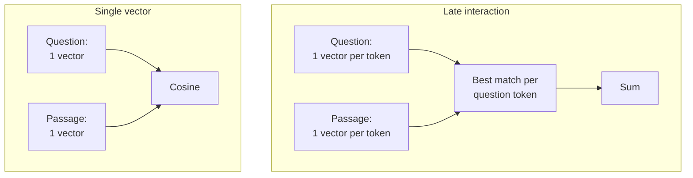

# M45.2 Theory: End-to-end RAG ecosystem walkthrough (incl. ColBERT and RAGAS)

*[M45 theory](../README.md) · Lesson 45.2 · Notebooks: [`02a_rag_ecosystem.ipynb`](../../../../course/p13_architecture_and_capstone/m45_architecture_synthesis/notebooks/02a_rag_ecosystem.ipynb) · [All theory pages](../../../README.md)*

## The stack in one notebook

`02a_rag_ecosystem.ipynb` walks the whole RAG stack in one place. Its recap note says what is new: the early parts are a refresher of earlier modules, the parts it owns are RAPTOR, ColBERT and agentic self-correction, and the evaluation sections are pointers. Of those three, only ColBERT runs as code here; RAPTOR and self-correction are described and linked out.

| Notebook part | What it builds | Taught in depth |
|---|---|---|
| Basic RAG | load, split, embed, retrieve, generate | [M11](../../../p04_rag_foundations/m11_rag_lifecycle/README.md) |
| Query transformations | multi-query, RAG-Fusion, decomposition, step-back, HyDE | [M18](../../../p06_retrieval_quality/m18_query_transformation/README.md) |
| Routing and query construction | logical and semantic routing, a metadata filter written from the question | [M18](../../../p06_retrieval_quality/m18_query_transformation/README.md), [M30](../../../p09_agentic_rag/m30_adaptive_rag_routing/README.md) |
| Indexing | multi-representation indexing, RAPTOR (described), ColBERT | [M16](../../../p05_ingestion_and_indexing/m16_advanced_indexing/README.md), [M42](../../../p12_hierarchical_and_graph_rag/m42_hierarchical_memory_rag/README.md), below |
| Retrieval and generation | Cohere reranking, CRAG and Self-RAG (described), long context | [M19](../../../p06_retrieval_quality/m19_reranking_post_retrieval/README.md), [M29](../../../p09_agentic_rag/m29_crag_and_self_rag/README.md) |
| Evaluation | judges written from scratch, deepeval, grouse, RAGAS | below |

The notebook ships without outputs. Sentences such as "The output is remarkable" after the rerank cell, or "`faithfulness` and `context_recall` are perfect" after the RAGAS cell, describe a run that is not saved with it. Treat them as expectations to check.

Its long-context section argues for the hybrid the earlier modules reach as well: retrieval picks the few passages that matter, and a long-context model reads them. M11's interview questions cover when sending the whole corpus instead is right and when it breaks.

## Late interaction (ColBERT)

A single-vector retriever (M14) turns a passage into one embedding and the question into another, and scores the pair with cosine similarity. The notebook calls this a "bag-of-words" approach, but the embedding model reads the tokens in context and pools them, so word order and phrasing count. What a single vector loses is which part of the passage matched. A 180-token passage that mentions the answer once is one point in space, pulled toward everything else it says.

ColBERT (Khattab and Zaharia, SIGIR 2020) keeps a contextual vector for every token of the passage and every token of the question. The score is MaxSim: for each question token, take its highest similarity with any passage token, then sum over the question tokens.

The name places it between the two retrieval models the course already uses. A bi-encoder computes everything at index time and compares one pair of vectors at query time. A cross-encoder reranker ([M19](../../../p06_retrieval_quality/m19_reranking_post_retrieval/README.md)) computes nothing in advance and reads every question and passage pair together at query time. ColBERT computes the passage token vectors at index time and lets the tokens interact only at the end, through a cheap max and sum. [M21](../../../p07_rag_applications/m21_multimodal_rag/03_page_image_retrieval_with_colpali/README.md#late-interaction) uses the same scoring on page images, where every image patch gets a vector.

The notebook runs it through RAGatouille:

- `RAGPretrainedModel.from_pretrained("colbert-ir/colbertv2.0")` loads ColBERTv2.
- `RAG.index(collection=[full_document], index_name="Miyazaki-ColBERT", max_document_length=180, split_documents=True)` splits a Wikipedia page fetched at run time into passages and indexes every token.
- `RAG.search(query="What animation studio did Miyazaki found?", k=3)` returns the top three passages, and `RAG.as_langchain_retriever(k=3)` wraps the index as a LangChain retriever, so the rest of a chain does not change.

The cost moves into storage. ColBERTv2 stores 128 dimensions per token vector (Santhanam et al., *ColBERTv2*, NAACL 2022). A passage of up to 180 tokens is then up to 23,040 numbers, against 1,536 for one `text-embedding-3-small` vector, 15 times as many before compression. ColBERTv2 shrinks each vector to a centroid id plus a residual of 1 or 2 bits per dimension. Pages in M21 are larger still: ColSmol stores 1,139 vectors of 128 dimensions per page.

On the architecture map, late interaction is an entry-level change. It replaces the retriever and keeps one retrieval and one model call per question. Weigh it against the other retrieval upgrades on the same golden set: BM25 in a hybrid ([M17](../../../p06_retrieval_quality/m17_retrievers_hybrid_search/README.md)) already catches exact codes, where dense retrieval ranked the E-4021 chunk 5th, and a cross-encoder reranks a wide candidate list at a measured latency.

## End-to-end evaluation

The notebook names three properties of a good RAG answer: faithfulness (the answer can be derived from the retrieved context), correctness (it matches a reference answer) and contextual relevancy (the retrieved context fits the question). Each one judges a different stage, and that is what makes them useful for choosing an architecture: an end-to-end score says the outage answer is wrong, and a stage score says whether retrieval or generation made it wrong.

It measures them three ways:

- **Judges written from scratch.** A `gpt-4o` judge with structured output returns a score from 0 to 1. The correctness prompt compares the answer with a reference; the faithfulness prompt asks whether the answer can be deduced from the context, with few-shot examples. Under that rule the answer "6" to *what is 3+3?* with the context "6" is unfaithful, because the context states the number but not the sum. That is stricter than "the context does not contradict it", so write down which definition a score uses.
- **deepeval.** `GEval(name="Correctness", model="gpt-4o")` and `FaithfulnessMetric()` run over `LLMTestCase` objects. `ContextualRelevancyMetric` is imported and never used. grouse cannot share this environment, so its cells need a separate one, and the setup guide the cell's comment mentions is [the original repository's setup notes](../../../../docs/source/09/setup.md).
- **RAGAS.** Three questions, each with an answer, the retrieved contexts and a reference answer, go into a Hugging Face `Dataset` with the columns `question`, `answer`, `contexts` and `ground_truth`, and `evaluate()` scores four metrics. In the locked environment (`ragas` 0.4.3 with `langchain-community` 0.4.2) the cell cannot start: `import ragas` raises `ModuleNotFoundError: No module named 'langchain_community.chat_models.vertexai'`.

The metrics map onto the stages like this:

| Metric | Stage it judges | Needs a reference answer |
|---|---|---|
| `context_recall` (RAGAS) | retrieval | yes |
| `ContextualRelevancyMetric` (deepeval) | retrieval | no |
| `faithfulness` (RAGAS, deepeval, from scratch) | generation, against the retrieved context | no |
| `answer_relevancy` (RAGAS) | the answer, against the question | no |
| `answer_correctness` (RAGAS), GEval correctness | the whole pipeline | yes |

For an architecture decision, run every candidate over the same golden set and record one row each: the stage metrics, model calls and retrievals per question, and latency. Retrieval metrics such as recall@k need no judge; the M11 baseline row is computed from the golden set's labelled evidence chunks. The judged metrics cost model calls at evaluation time, one or more per metric per question, which is a reason to keep the golden set fixed and small enough to run on every change. Report per question as well as the mean: on the outage question, TF-IDF and dense retrieval differ completely, and a mean over three questions blurs it.

## Key Takeaways

- ColBERT keeps a vector per token and scores with MaxSim, so it knows which part of a passage matched. It still costs one retrieval and one model call, but stores about 15 times more numbers before compression.
- Use stage metrics to locate a failure: context recall and relevancy judge retrieval, faithfulness judges generation, and correctness judges the whole pipeline.
- Run every candidate on the same fixed golden set, report per question as well as the mean, and write down which faithfulness definition a judge uses.

## Check yourself

1. What does a single-vector retriever lose that ColBERT's late interaction keeps?

Which part of the passage matched. A 180-token passage that mentions the answer once becomes one point, pulled toward everything else it says. ColBERT keeps a contextual vector for every token and scores with MaxSim: for each question token, its best similarity with any passage token, summed over the question tokens.

2. How many numbers does ColBERTv2 store for a 180-token passage before compression, against one text-embedding-3-small vector?

180 × 128 = 23,040 numbers, against 1,536: 15 times as many. ColBERTv2 then shrinks each token vector to a centroid id plus a residual of 1 or 2 bits per dimension.

3. An end-to-end correctness score says the outage answer is wrong. Which metrics tell you whether retrieval or generation caused it?

The stage metrics. `context_recall` (RAGAS, needs a reference answer) and `ContextualRelevancyMetric` (deepeval) judge retrieval; recall@k needs no judge at all, only the labelled evidence chunks. `faithfulness` judges generation against the retrieved context. Report them per question, because a mean over three questions blurs the outage case.

---
*Previous: [45.1 The agentic RAG architecture map](../01_the_agentic_rag_architecture_map/README.md). Next: [45.3 Decision framework: picking the simplest architecture that works](../03_decision_framework_picking_the_simplest_architecture_that_works/README.md).*
