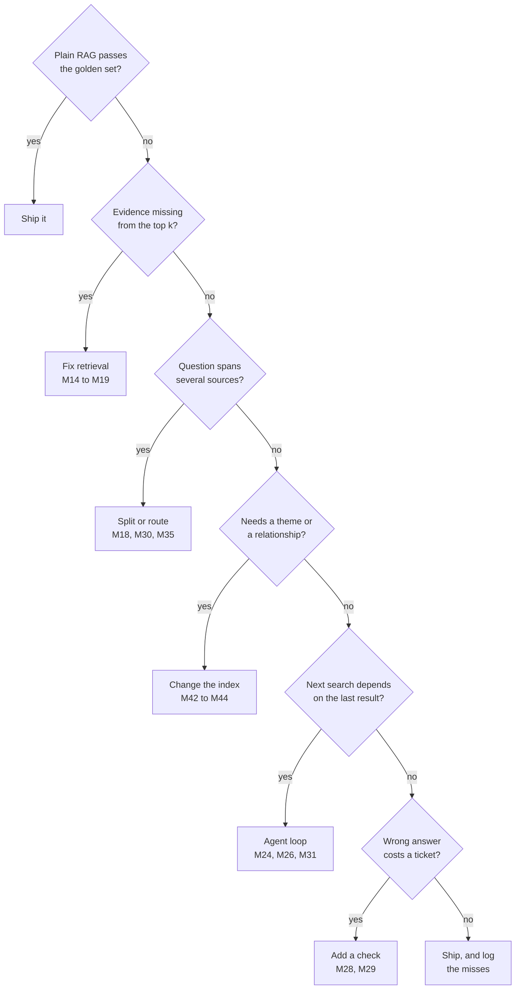

# M45.3 Theory: Decision framework: picking the simplest architecture that works

*[M45 theory](../README.md) · Lesson 45.3 · [All theory pages](../../../README.md)*

## Architecture selection

Choosing an architecture is a chain of questions asked of the golden set. Each question names a failure, and each "yes" points at the family that fixes it. A "no" moves on to the next question, so a design only reaches the expensive families when the cheaper fixes are ruled out.

Each branch has a counted example from an earlier lab:

- **Evidence missing: fix retrieval.** On *What happens if my server goes down?* TF-IDF retrieves neither evidence chunk (M24 lab), because the handbook says "outage". Dense retrieval ranks `incidents` and `sla` first and second (M17 lab) for the same single call. The loops that work around the miss pay for it: the M28 retry loop finds the evidence on its second rewrite, at 10 calls, and Self-RAG spends 14 calls on three passes over the same chunks (M29). M29's own rule is that retrieval misses are fixed in retrieval.
- **Several sources: split or route.** *My server went down last night. Do I get service credits?* needs operations and billing. On three knowledge bases a router spends 2 calls and never asks billing, a swarm answers in 3 and a supervisor in 5 (M35 lab). On one index, decomposition splits the question, at 5 calls and 3 retrievals for three sub-questions (M18).
- **A theme or a relationship: change the index.** *How does service continuity work?* reaches 1 source passage from the leaves and 4 through summaries at the same two-node budget (M42 lab). *Which plans support data export in the EU?* needs the EU edge checked: at `k = 5` both eligible plans survive the check, and without the graph nothing can tell them from the plans that only mention exports (M43 lab).
- **Path depends on results: an agent loop.** A loop rewords failed searches: ReAct lifts mean evidence recall on the M11 golden set from 0.50 to 1.00 for 9 model calls instead of 3 (M24). When the lookups are known in advance, a fixed plan makes 2 calls however many lookups it holds (M26).
- **Costly mistakes: add a check.** A relevance grader keeps unrelated chunks away from the model. On the export question the M28 loop costs 4 calls; on *Does Larkspur offer GPU servers?* it ends in a no-results reply after 9. A web fallback (CRAG) does not help here, because every Larkspur fact lives in a private handbook the web cannot see (M29).

Asking about a costly mistake last means the check runs on top of the best retrieval the design already has, so it grades good chunks instead of looping over bad ones.

## Complexity budget

A complexity budget is what one question may spend before the answer reaches the user. Its main unit is model calls: they set the bill, and since the course's notebooks make them one after another, they set the latency too. Retrievals, tokens re-read in every loop iteration, index-time LLM work and the number of prompts to test count against the same budget. A component earns its place when it buys a measured gain on the golden set that nothing cheaper buys.

The [interactive lab](interactive/architecture-picker-lab.html) holds the counts earlier labs recorded for the six Larkspur questions, each rung with its model calls, retrievals and what the lab saw. Set the data shape, the latency budget in model calls and what a wrong answer costs. A rung qualifies when its data exists, it answers the question (or refuses one the handbook cannot answer), it has a check when a wrong answer costs a support ticket, and its calls fit the budget. The pick is the first qualifying rung in order of calls.

<!-- lab: interactive/architecture-picker-lab.html -->

The lab's rules agree with an independent Python copy of them on all 960 control settings, and each of its 30 counts traces to a theory page, a lab's own code or a notebook. Five settings show the budget at work:

- **Outage, wrong answer cheap.** Dense retrieval at 1 call, at every budget. The hybrid blend at `alpha = 0.5` is also 1 call, but it keeps `sla` and loses `incidents` (recall@3 0.50 in the M17 lab), so the ladder passes it.
- **Outage, wrong answer costs a ticket.** The only counted rung with a check that answers is the M28 loop at 10 calls. Below a budget of 10 nothing fits. A grader on top of dense retrieval may cost less, but no course lab has counted it; count it on your golden set before you ship it.
- **Service credits, three knowledge bases.** The swarm at 3 calls; at a budget of 2 nothing fits, because the router's 2 calls answer only the outage half. On one index the pick is decomposition at 5.
- **Export, any data shape.** Plain TF-IDF RAG at 1 call. Splitting the handbook into three knowledge bases does not make a router necessary; the question has one domain and plain retrieval over all three answers it.
- **GPU servers, wrong answer costs a ticket.** The M28 loop at 9 calls, ending in a safe no-results reply. Self-RAG spends 14 and still generates an answer with no context behind it.

The budget also has to hold what the lab's call counts leave out:

- **Index-time work.** RAPTOR in M42 makes one summary call per cluster at every level of the tree, with `min(10, len(current_texts) // 2)` clusters per level. GraphRAG and the M43 graph builders make an extraction call per chunk. This work is paid again when the handbook changes.
- **Tokens per call.** A loop re-reads its whole message list on every call; the M24 outage run reads about 451 tokens of context over four calls.
- **Parts to test.** Every grader is a prompt with its own failure mode. M28's topic check rejects silently, and M29's groundedness check is skipped when no document passed. Each one needs questions in the golden set that exercise it.

The lab brief turns this into a document: a two-page design for your capstone that justifies each component against a simpler alternative. For each component, write the failure on the golden set that it fixes, the simpler alternative you tried first, the measured gain and the calls it adds per question.

## Check yourself

1. Why does the decision chain ask whether a wrong answer costs a ticket only after the retrieval, routing, index and loop questions?

So the check runs on top of the best retrieval the design already has, and grades good chunks instead of looping over bad ones. Each earlier question rules out a cheaper fix first, so a design reaches the expensive families only when it needs them.

2. The service-credits question runs over three knowledge bases with a budget of 2 model calls. What does the lab pick, and what changes at 3?

Nothing fits at 2: the router's 2 calls answer only the outage half and never ask billing. At a budget of 3 the swarm qualifies and is picked. On one index the pick would be decomposition at 5 calls.

3. TF-IDF misses the outage evidence, and a teammate proposes Self-RAG to recover it. What does the framework recommend instead?

Fix retrieval, because the evidence is missing from the top k. Dense retrieval ranks `incidents` and `sla` first and second in a single call, while the loops pay to work around the miss: the M28 retry loop takes 10 calls and Self-RAG 14. M29's own rule is that retrieval misses are fixed in retrieval.

---
*Previous: [45.2 End-to-end RAG ecosystem walkthrough (incl. ColBERT and RAGAS)](../02_end_to_end_rag_ecosystem_walkthrough_incl_colbert_and_ragas/README.md). Next: [M45 interview questions](../README.md#interview-spotlight-5-questions-you-might-get-asked).*
