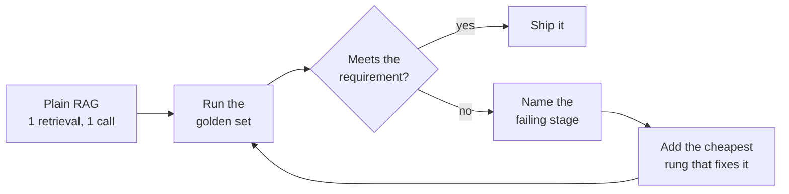

# M45 Theory: Agentic RAG Architectures: Choosing a Design

*Part XIII · Architecture Synthesis & Capstone · [Module README](../../../course/p13_architecture_and_capstone/m45_architecture_synthesis/README.md) · [All theory pages](../../README.md)*

M11 to M44 built more than a dozen ways to answer a question from documents, from one retrieval and one model call up to self-correcting loops, teams of agents and graph indexes. This module puts them on one map and asks which one a requirement needs. The M45 notebooks build on four ideas: choosing an architecture against a simpler alternative, the budget each extra component spends, late interaction as a retrieval upgrade that adds no model calls, and evaluating the whole pipeline end to end. Each idea has a page in the folder of the lesson that teaches it, listed under [Lessons](#lessons). This page has the overview, the interview questions and the takeaways.

The running example is the Larkspur Cloud handbook from M11. Six questions carry the comparison, and an earlier module's lab has already run each one through several architectures: *Can I export my data after I cancel my plan?* (M24, M28, M29), *What happens if my server goes down?* (M17, M24, M28, M29), *My server went down last night. Do I get service credits?* (M35), *Does Larkspur offer GPU servers?* (M29), *How does service continuity work?* (M42) and *Which plans support data export in the EU?* (M43). This module reuses their counts and adds no new measurements.

## TL;DR

- Start with plain RAG, one retrieval and one model call, and add one component at a time, each justified by a failure on the golden set. Every step up is paid in model calls: in the course's labs a router costs 2, a supervisor 3 to 5, CRAG 4 to 7 plus a web search and Self-RAG 7 to 20.
- Fix the stage that fails. On *What happens if my server goes down?* TF-IDF retrieves neither evidence chunk, and dense retrieval ranks both first and second (M17 lab) for the same single call. The M28 retry loop needs 10 calls to get there, and Self-RAG spends 14 without finding them.
- Two kinds of question need a different index. A theme across the handbook needs summaries built at index time (M42), and "available in the EU" needs an edge to check (M43). No retrieval setting stands in for either.
- Late interaction (ColBERT) keeps one vector per token and scores with MaxSim. A passage of up to 180 tokens at 128 dimensions is up to 23,040 numbers before compression, against 1,536 for one `text-embedding-3-small` vector, and it still makes one retrieval and one model call.
- Evaluate the pipeline on one golden set with a metric per stage: context recall for retrieval, faithfulness for generation, answer correctness end to end. In this course's locked environment `import ragas` fails, so the notebook's RAGAS cells do not run as shipped.

## Mental model

<!-- animated: diagrams/escalation-loop.anim.html -->

Every architecture in the course is plain RAG plus components: better retrieval, a router, a grader, a loop, more agents, a different index. Each component has a price in model calls, latency and parts to test, so it stays only when the golden set shows the failure it fixes. The simplest architecture that meets the requirement is the one this loop stops at.

## Lessons

| Lesson | Topic | Theory |
|---|---|---|
| 45.1 | The agentic RAG architecture map | [The architecture map](01_the_agentic_rag_architecture_map/README.md#the-architecture-map) [What each family adds](01_the_agentic_rag_architecture_map/README.md#what-each-family-adds) |
| 45.2 | End-to-end RAG ecosystem walkthrough (incl. ColBERT and RAGAS) | [The stack in one notebook](02_end_to_end_rag_ecosystem_walkthrough_incl_colbert_and_ragas/README.md#the-stack-in-one-notebook) [Late interaction (ColBERT)](02_end_to_end_rag_ecosystem_walkthrough_incl_colbert_and_ragas/README.md#late-interaction-colbert) [End-to-end evaluation](02_end_to_end_rag_ecosystem_walkthrough_incl_colbert_and_ragas/README.md#end-to-end-evaluation) |
| 45.3 | Decision framework: picking the simplest architecture that works | [Architecture selection](03_decision_framework_picking_the_simplest_architecture_that_works/README.md#architecture-selection) [Complexity budget](03_decision_framework_picking_the_simplest_architecture_that_works/README.md#complexity-budget) |

## Interactive lab

[**The simplest architecture that works**](03_decision_framework_picking_the_simplest_architecture_that_works/interactive/architecture-picker-lab.html): open the file in a browser. It opens on the outage question with one handbook index, a budget of 5 calls and a cheap wrong answer: dense retrieval wins at 1 call, and the ladder shows TF-IDF and the hybrid blend falling short. Set the wrong answer to cost a support ticket and the only counted rung that has a check and answers is the M28 retry loop at 10 calls, so nothing fits until the budget reaches 10. Then pick the service-credits question and switch between one index and three knowledge bases: decomposition at 5 calls against a swarm at 3, with the router's 2 calls never asking billing.

## How it connects

- **Before:** every module. The baseline and the golden set come from [M11](../../p04_rag_foundations/m11_rag_lifecycle/README.md); retrieval upgrades from [M14](../../p05_ingestion_and_indexing/m14_embeddings/README.md) to [M19](../../p06_retrieval_quality/m19_reranking_post_retrieval/README.md); the self-correcting loops from [M28](../../p09_agentic_rag/m28_retrieval_grading_rewriting/README.md), [M29](../../p09_agentic_rag/m29_crag_and_self_rag/README.md) and [M32](../../p09_agentic_rag/m32_reliability_feedback/README.md); routing from [M30](../../p09_agentic_rag/m30_adaptive_rag_routing/README.md) and [M35](../../p10_memory_and_multi_agent/m35_multi_agent_architectures/README.md); tool-based retrieval from [M24](../../p08_agent_foundations/m24_react_agents/README.md), [M26](../../p08_agent_foundations/m26_planning_reflection_reasoning/README.md) and [M31](../../p09_agentic_rag/m31_rag_as_agent_tool/README.md); structural indexes from [M42](../../p12_hierarchical_and_graph_rag/m42_hierarchical_memory_rag/README.md), [M43](../../p12_hierarchical_and_graph_rag/m43_knowledge_graphs_neo4j/README.md) and [M44](../../p12_hierarchical_and_graph_rag/m44_graphrag/README.md).
- **Next:** the [capstone projects](../../../capstones/README.md). Each ships a working system, an evaluation report on a golden question set and a demo, and the M45 lab brief asks for the design document behind it: every component justified against a simpler alternative.

## Interview Spotlight: 5 Questions You Might Get Asked

*Production questions of the kind asked in applied AI engineering interviews.*

### 1. Larkspur's support assistant moved from plain RAG to Self-RAG. Latency is several times higher, and “What happens if my server goes down?” still gets a wrong answer. What happened, and what do you change?

**What a strong answer covers:**
- Prints the retrieved chunks per pass: TF-IDF returns `reboot`, `sizing` and `export` every time, so the checks see the gap and loop over the same chunks (14 calls in the M29 lab at `k = 3`)
- Names the failing stage as retrieval: the handbook says "outage" and "availability", the question says "goes down"
- Fixes retrieval first (dense ranks both evidence chunks first and second in the M17 lab, at one call) and keeps a check only where a wrong answer is costly
- Caps every loop in code and logs model calls per question, so a later regression shows up in the logs before it reaches the bill

### 2. The product team wants billing, operations and data specialists. When is a router enough, when do you need a supervisor, and when a swarm?

**What a strong answer covers:**
- Measures how many requests span two domains; a router (2 calls) sends *My server went down last night. Do I get service credits?* to operations only, and billing never sees the credits question
- A supervisor answers it in 5 calls, 3 of them routing, and gives one place to log, test and cap every decision
- A swarm answers it in 3 and each follow-up costs 1 call against 3 for the supervisor, but routing quality now lives in every agent's prompt
- Keeps plain RAG over all three knowledge bases as the baseline: the export question needs one call whatever the data is split into

### 3. Leadership asks whether GraphRAG is worth replacing the flat index. How do you measure it?

**What a strong answer covers:**
- Runs both on the same golden set and budget, with questions of each kind: a specific fact, a theme across the handbook, a relationship such as EU availability
- Reports per stage and per question: context recall shows what reached the model, answer correctness what came out, and a mean can hide one question type that got worse
- Counts index-time work separately from query time: summary and extraction calls, re-indexing after a handbook edit, storage
- Treats lab fixture counts (M42's 1 against 4 source passages, M44's 2 against 4 relations) as mechanisms to test; neither lab measured answer quality

### 4. A customer asks “Does Larkspur offer GPU servers?” The handbook does not say. How do you make sure the assistant refuses instead of guessing?

**What a strong answer covers:**
- Plain RAG still sends the top `k` chunks, all unrelated, so only the prompt and a permission to say "I don't know" stand between them and a guess
- A relevance grader with a bounded rewrite loop ends in a no-results reply, at 9 calls with two rewrites allowed (M28); a score floor is cheaper if the golden set supports one
- CRAG's web fallback cannot see a private handbook, and the M29 Self-RAG graph generates with no context and skips the groundedness check on that path
- Adds unanswerable questions to the golden set and tracks the refusal rate, so a prompt change that starts guessing fails a test

### 5. A teammate proposes replacing the dense retriever with ColBERT. What do you check before agreeing?

**What a strong answer covers:**
- Storage and indexing: one vector per token instead of one per chunk, up to 23,040 numbers per 180-token passage before compression against 1,536
- The questions that fail today and why: exact codes such as E-4021, where dense ranked the right chunk 5th in M17, may be cheaper to fix with BM25 in a hybrid
- A cross-encoder reranker (M19) reads question and chunk together at query time; ColBERT precomputes document vectors, so compare both on recall and latency, not one in isolation
- Model calls do not change, so the decision rests on retrieval recall, latency and storage measured on the golden set

## Key Takeaways

- Build plain RAG first and record its row on a frozen golden set; every later component has to beat that row on the questions it targets.
- Name the failing stage before adding anything. A retrieval miss is fixed in retrieval, at no extra model calls; a loop on top of it pays repeatedly for the same missing chunk.
- Count what each component costs in model calls, retrievals and index-time work, and set a budget per question before choosing; loops get a cap in code.
- Change the data when the question needs it: summaries for themes, explicit edges for constraints, separate knowledge bases only when routing to them buys something.

---
*Previous: [M44 GraphRAG Techniques](../../p12_hierarchical_and_graph_rag/m44_graphrag/README.md). Next: [Capstone projects](../../../capstones/README.md).*
